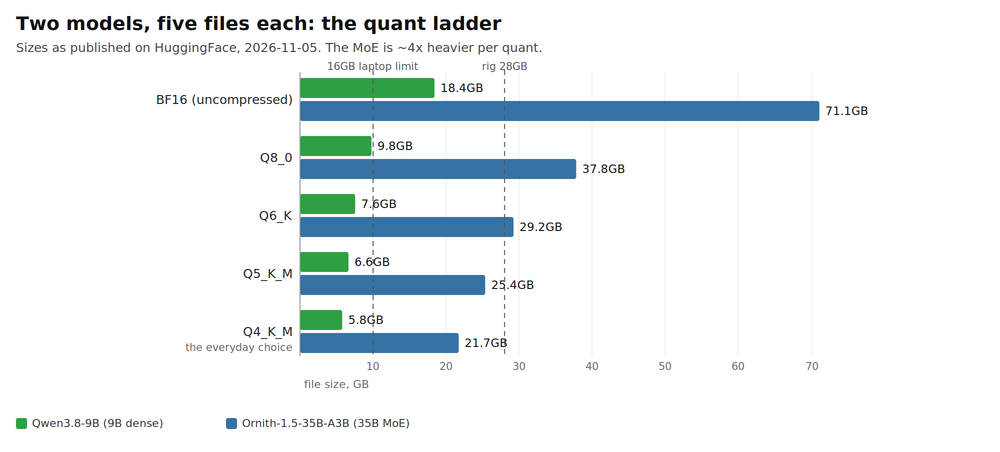
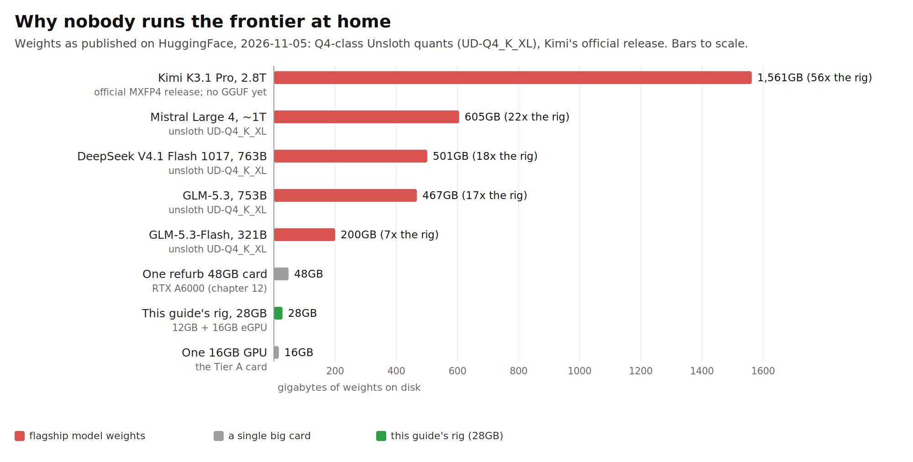

# 01: HuggingFace in eight minutes

[HuggingFace](https://huggingface.co) is the model zoo. New open-weights models are
pushed **daily**; you need exactly three skills: find, judge, download.

## Anatomy of a model repo

- **Model card**: architecture, context length, license, benchmark table. Read it.
- **Files and versions** tab, the actual weights. Two kinds:
  - `safetensors`, original (full-precision) weights. For training/fine-tuning or
    frameworks that quantize on the fly. **Not** what llama.cpp runs.
  - `.gguf`, quantized (compressed to fewer bits per number) single-file weights
    for llama.cpp (and friends). **This is what you want.** Several sizes per
    model, named by quant level.

## Quant levels: how much quality per byte

These labels are **not hard-set sizes**. The bit-widths below are nominal labels;
actual file size depends on each model's architecture: layer count, expert count,
vocab size, embedding ratio, and how much attention is grouped across fewer
key/value heads instead of one per query head (GQA, grouped-query attention) all
shift the number. Two models at the same quant label can differ by tens of percent in file
size. The numbers below are pinned to the fleet exemplars: Qwen3.8-9B for the 9B
column and Ornith-1.5-35B (a 35B "A3B MoE", meaning a Mixture-of-Experts model
where about 3 billion of its 35 billion parameters fire per word) for the 35B
column. For any other model,
check its own GGUF file listing on HuggingFace rather than extrapolating.

| Name | ~bpw (bits per weight) | 9B model ≈ (Qwen3.8-9B) | 35B model ≈ (Ornith-1.5-35B) | Use when |
|---|---|---|---|---|
| Q8_0 | 8.5 | 9.6GB | 37.8GB | Near-lossless; overkill for chat |
| Q6_K | 6.6 | 7.4GB | 29.2GB | Quality-critical, memory to spare |
| Q5_K_M | 5.7 | 6.5GB | 25.4GB | Good default on 32GB+ machines |
| **Q4_K_M** | 4.8 | **5.5GB** | **21.7GB** | **The everyday default** |
| IQ4_XS | 4.3 | 4.9GB | 19GB | Slightly tighter than Q4, small quality cost |
| IQ3_XXS | 3.1 | 3.6GB | 14GB | Last stop before real degradation |
| IQ2_XS | 2.1 | 2.4GB | 9GB | Only for huge-MoE-on-tiny-VRAM stunts |

*Q8_0 through Q4_K_M in the 35B column are the
[official ornith-ai GGUF repo](https://huggingface.co/ornith-ai/Ornith-1.5-35B-A3B-GGUF)'s
file sizes (2026-11-05); the IQ rows are estimates.*

The ladder, drawn as real file sizes for both exemplar repos (the beginner
track opens with a one-model version):

*Two models, one HuggingFace repo each: Qwen3.8-9B (green bars,
empero-ai/Qwen3.8-9B-Distill-GGUF) and Ornith-1.5-35B-A3B (blue bars, the
official ornith-ai repo), sizes as published 2026-11-05. Same quant labels,
but the 35B MoE is nearly 4x heavier at every level, and its Q4 file alone
needs almost the whole rig. Dashed lines: the beginner-track fit limit for a
16GB RAM laptop, and the lab rig's 28GB total VRAM.*

Rules of thumb: **Q4_K_M is the default choice**; drop to IQ4_XS when ~1GB short;
below Q3 quality falls off fast (IQ2_XS is a party trick, not a daily driver).
Community *mixed recipes* (e.g. the APEX-I-MiniPlus requants in our fleet,
profiled in [05](05-fleet-2026-11.md)) blend
levels across tensors, ~3.5bpw average with near-Q4 quality at ~15GB for 35B models.

**Imatrix quants** (labels like `IQ4_XS` from a quantizer with an imatrix note,
where imatrix = an importance matrix computed from sample text) use a
calibration corpus to protect quality at low bpw, prefer them over plain quants at
the same level.

## A 4-step download decision

1. **Trust the source.** Official org uploads or established quantizers
   (bartowski, Unsloth): consistent, tested quants. A boutique shop with its
   own published benchmark cards counts too (our fleet's IsValorum requants,
   see [05](05-fleet-2026-11.md)). A random first-time uploader
   at Q2 is a gamble.
2. **Check the card's own benchmark table.** No table, no trust.
3. **Pick size by memory budget**, the arithmetic is in [02-hardware-fit.md](02-hardware-fit.md).
4. **Check the license.** Apache-2.0 and MIT are permissive; research licenses may
   block commercial use.

**Vision models** ship a second small file, usually named `*mmproj*.gguf`
(mmproj = multi-modal projector, the piece that converts images into the model's
token space), download it alongside if you want image input.

**Draft models** (small `*-draft*.gguf` files) are for speculative decoding
(see [03-llamacpp-server.md](03-llamacpp-server.md)): a small fast model guesses
several tokens ahead, the big model checks them all at once, giving a speed-up
when the guesses are right.

## Keeping current without FOMO

- *Explore → Trending* for the weekly pulse; filter by **GGUF** and parameter size.
- New flagship releases land constantly; a fresh release is **rarely** worth
  re-verifying your whole stack. Our vetted shortlist lives in
  [05-fleet-2026-11.md](05-fleet-2026-11.md): refresh it monthly, not daily.
- Simplest option of all: ask the local LLM lead. That is this guide's author; the
  shortlist above is the standing answer to that question, and it is refreshed
  monthly for you.
- Search tip: in the *Models* tab, filter Type → GGUF, then sort by downloads or
  trending; sort "Recently updated" only if you are hunting a fix.

## How big is too big: the flagship reality check

The ladder above ends at a 9B and a 35B model, which can suggest that
"quantize it and it fits". It does not scale: the models in
[11](11-flagship-models.md)'s index are another dimension, and this is the most
commonly underestimated fact about local LLMs, one the lead tester also got
wrong at first:

*Weights on disk as published on HuggingFace, 2026-11-05: Q4-class quants from
Unsloth's dynamic recipes (UD-Q4_K_XL) where available, the official release
otherwise (Kimi K3.1 Pro ships MXFP4 weights, a 4-bit floating-point format;
no GGUF quantizer has published for it yet). Bars are to scale. The green
sliver is this guide's entire rig; even the "Flash" sibling of GLM-5.3
outweighs it seven to one.*

The numbers behind the bars: [GLM-5.3-Flash](https://huggingface.co/unsloth/GLM-5.3-Flash-GGUF)
(321B total parameters) needs 200GB at 4-bit; [GLM-5.3](https://huggingface.co/unsloth/GLM-5.3-GGUF)
(753B) needs 467GB; [DeepSeek V4.1 Flash 1017](https://huggingface.co/unsloth/DeepSeek-V4.1-Flash-1017-GGUF)
(763B) needs 501GB; [Mistral Large 4](https://huggingface.co/unsloth/Mistral-Large-4-1T-A52B-GGUF)
(about 1T) needs 605GB; [Kimi K3.1 Pro](https://huggingface.co/moonshotai/Kimi-K3.1-Pro)
(2.8T total, 104B active) ships 1,561GB of official weights. A 48GB card covers
none of them. This is why the fleet tops out where it does
([05](05-fleet-2026-11.md)), why the served and cloud tiers exist, and why
"just download the best open model" is not a plan: at the frontier, the
weights alone are a small datacentre.

> **Takeaway:** Three skills cover the zoo: find the model, judge it from its
> card and files, download the right GGUF for your memory. And one number
> explains why tiers exist: the frontier models you cannot run weigh 200GB to
> 1.5TB on disk.

---

*Every abbreviation and term used here is explained in one line in the [glossary](glossary.md).*
