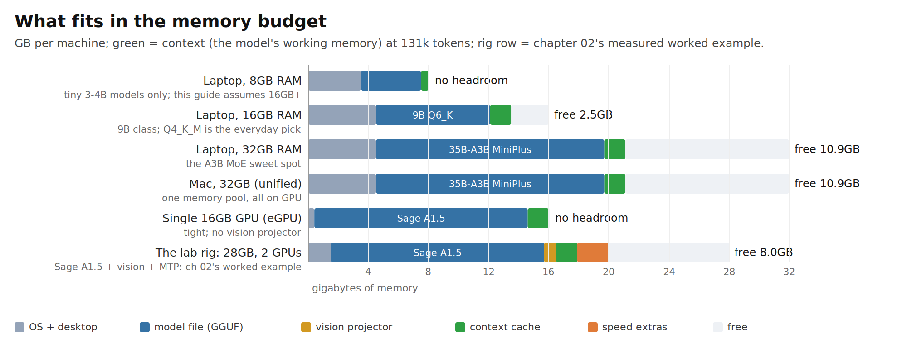

# 02: Will it fit? Hardware-fit arithmetic

Four budgets decide everything. Learn these once and you can judge any model
on HuggingFace against any machine, including ones that don't exist yet.

## 1. Weights: the file size

```
GB ≈ total_params × bpw / 8
```

- Qwen3.8-9B at Q4_K_M (4.8bpw, bits per weight) ≈ 5.5GB
- Ornith-1.5-35B (a 35B "A3B MoE", a Mixture-of-Experts model where about 3 billion
  of its 35 billion parameters fire per word) at Q4_K_M ≈ 21.7GB
- Same 35B in a mixed recipe (≈3.5bpw, e.g. the fleet's APEX-I-MiniPlus requants) ≈ 15GB

Quant file sizes are **not hard-set** across models: the same quant label can
differ by tens of percent between architectures (layer count, expert count, vocab
size, embedding ratio, GQA head ratios all shift the number). The examples above
are pinned to the fleet exemplars; for any other model, read its GGUF file size
on HuggingFace rather than extrapolating.

You rarely need to compute this: **the GGUF file size on HuggingFace is the answer.**
The formula is for planning quants that don't exist yet.

## 2. KV cache: the context tax

The KV cache (key-value cache, the model's working memory for the conversation
so far; every token in context needs its own entry) costs cache memory:

```
bytes/token = 2 (K+V) × layers × kv_heads × head_dim × bytes_per_value
```

Real examples from the fleet:

| Model type | Per token (q8_0 KV) | At 131k ctx | At 262k ctx |
|---|---|---|---|
| Dense GQA (grouped-query attention: fewer KV heads shared across query heads; 32 layers × 8 KV heads × 128-dim) | ~65KiB | ~8.6GB | ~17GB |
| Hybrid, few full-attn layers (Sage: 10L × 2KV × 256-dim) | ~10.6KiB (measured) | ~1.4GB | ~2.8GB |
| Hybrid SSM/GDN layers (state-space-model gated-delta-net layers, which compress the whole history into a fixed-size state instead of caching each token) | fixed ~0.5GB state | flat | flat |

Two levers, both free:

- **`-ctk q8_0 -ctv q8_0`** halves KV memory with negligible quality cost.
- **Hybrid (linear-attention/SSM) architectures** pay per-layer *state*, not
  per-token cache, that's why the fleet reaches 262k context in 16GB.

Modern llama.cpp prints the exact KV buffer size in the boot log, check it
rather than trusting arithmetic (rule #5 below).

## 3. Overhead: the stuff people forget

Add to weights + KV:

| Item | Cost |
|---|---|
| OS / browser / IDE (laptop RAM) | 4–6GB |
| GPU driver + display (if the GPU drives a monitor) | 1–2GB |
| Vision encoder (`-mm`, if used) | 0.6–1GB |
| Draft model (speculative decoding: a small fast model that guesses ahead; the big model checks the guesses) | ~0.5–1GB |
| Ubatch prefill buffers (`-ub 512…2048`, the batch size used when reading in new context) | 0.5–2.9GB (prefill only) |
| MTP head (multi-token prediction, an extra output head baked into the GGUF that predicts several tokens at once for speed) | ~0.2GB |

## 4. Speed: bandwidth and *active* parameters

Decode speed ≈ memory bandwidth ÷ bytes-read-per-token, and for MoE models the
bytes that matter are the **active** parameters (the `A3B` in "35B-A3B" = only
3B params fire per token).

```
ceiling ≈ bandwidth / (active_params × bpw / 8)
```

- 35B-**A3B** at 3.5bpw → ~1.3GB/token:
  5060 Ti (448GB/s) → ceiling ~340 tok/s; real-world 40–60% → **60–140 tok/s measured** with
  speculative decoding.
- Same model on a CPU (DDR5 ~80GB/s) → real-world **15–25 tok/s**, still usable!
  This is why A3B MoE is the CPU laptop sweet spot.
- Dense 9B (~5.5GB/token) on that CPU → **5–12 tok/s** (est.).

Real-world lands at roughly 40–60% of the ceiling (attention, scheduling, I/O).

## Worked example (real, from the fleet's flagship)

Sage A1.5 (14.18GB weights) at 131k context on the 28GB dual-GPU rig:

```
14.18 weights + 0.84 mmproj (vision projector) + 1.4 KV (131k, q8) + 0.5 GDN state
+ 0.2 MTP head + 1.4 ubatch buffers  =  ~18.5GB  →  ~8GB headroom on 26.5GB
```

The same model on a single 16GB eGPU: drop context to ~65–100k or shave with
lower ubatch: still fits. On a 32GB-RAM laptop (CPU-only): fits, runs ~15–25 tok/s.

## Tier fit table

| Tier | Free memory | Best fleet fit | Context reach |
|---|---|---|---|
| CPU laptop 16GB | ~10GB | 9B Q4/Q5 | ≤131k |
| CPU laptop 32GB | ~26GB | 35B-A3B MiniPlus (~15GB) | ≤131k |
| Apple Silicon 32GB | ~26GB | 35B-A3B MiniPlus | ≤131k |
| Apple Silicon 48GB | ~40GB | 35B-A3B MiniPlus or larger | 262k |
| eGPU 16GB | 16GB | 35B-A3B MiniPlus | ≤229k (hybrid) |
| eGPU 32GB / dual-GPU 28GB | 28GB+ | everything (Tier A + B) | 229–262k |

The same budget picture, drawn once per tier:



*Stacked memory budgets per machine, context shown at 131k tokens (KV cache, the
green segment). The rig row is the worked example above; the single-16GB-GPU row
is the tight one, which is exactly why the dual rig exists. A simplified version
opens the beginner chapter, where it does the most teaching.*

## Rule #5: boot and read the log

Arithmetic gets you *in range*; the boot test decides. `llama-server` prints exact
buffer sizes, KV size, and per-device splits at startup. If it boots with GB of
headroom you can raise `-c`; if it OOMs, drop context or `-ub`. A crash is a
finding, not a failure, record the margin that worked.

> **Takeaway:** Four budgets decide everything: weights (GB ≈ params × bpw / 8),
> KV cache, context, speed. Arithmetic gets you in range; the boot log decides.

---

*Every abbreviation and term used here is explained in one line in the [glossary](glossary.md).*
