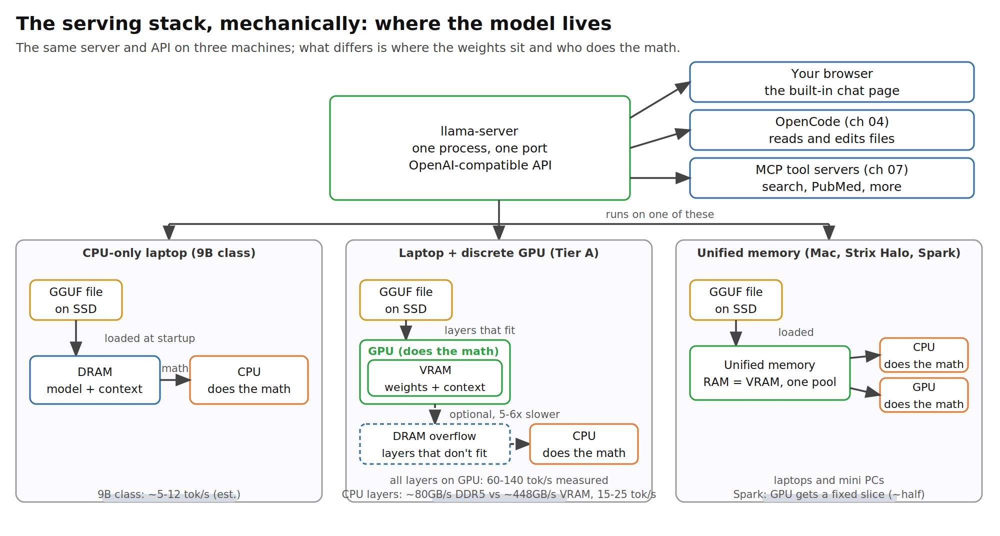

# 03: Serving a model with llama.cpp

[llama.cpp](https://github.com/ggml-org/llama.cpp) runs GGUF models (GGUF = the
single-file quantized model format llama.cpp uses) on CPU, Apple Silicon, and
CUDA/Vulkan GPUs. `llama-server` is its OpenAI-compatible HTTP server,
with a built-in web UI at the same port, so you can test before wiring anything else.

The whole stack in one picture:



*One file, one server, any client: the model is loaded once and the server owns
it from then on; every client speaks the same OpenAI-shaped HTTP to the same
port, whichever machine runs it. The three machines show where the weights sit
and who does the math: CPU and RAM alone; a GPU whose VRAM holds the layers
that fit while RAM takes the rest; or one shared pool on a Mac, Strix Halo, or
RTX Spark. The dashed overflow path is optional, and this lab does not use it:
the CPU-resident layers read DDR5 at ~80GB/s where VRAM offers ~448GB/s, which
drags decode from the measured 60-140 tok/s toward the 15-25 tok/s a CPU-only
run of the same model gets (the bandwidth arithmetic is ch 02's).*

## Install

- **Windows (NVIDIA):** grab the CUDA prebuilt from the
  [releases page](https://github.com/ggml-org/llama.cpp/releases): `llama-server.exe`.
- **macOS:** `brew install llama.cpp` (Metal backend, works out of the box).
- **Linux CPU-only:** build from source (`cmake -B build && cmake --build build`) or
  use a release binary.

## The flag tour

| Flag | Meaning | Notes |
|---|---|---|
| `-m FILE.gguf` | model file | or `-hf org/model` to pull from HuggingFace |
| `-c N` | context length | the big memory lever: see 02 |
| `-ngl 99` | layers to offload to GPU | `99`/`999` = all; omit on CPU-only |
| `-fa on` | FlashAttention | on for anything with a GPU |
| `-ctk q8_0 -ctv q8_0` | KV cache quant | halves context memory |
| `-ub N` | prefill batch | bigger = faster prefill, more peak memory; decode unaffected |
| `-np N` | parallel slots | 1 is fine to start |
| `-sm layer` / `-dev CUDA0,CUDA1` | multi-GPU split | `-sm layer` = only activations cross the bus (the fast mode); order follows `-dev` |
| `--jinja` | use the GGUF's chat template | always on |
| `-mm FILE.gguf` | vision projector | enables image input |
| `--temp 0.85 --top-p 0.95 --top-k 20` | sampling | sane defaults; set once, in the server |
| `--host 0.0.0.0 --port 9932` | where to listen | `--log-file` too, always |
| `--mcp-servers-config mcp.json` | give the *server* its own tools (web search etc.) | its web UI/agent mode uses them |
| `--ctx-checkpoints 8` | divergence-recovery checkpoints | caps host-RAM use of the default-32 |

## Recipe A: 9B on any machine (the every-day workhorse)

Real launch line (condensed from the lead tester's `qwen38-9b.bat`):

```sh
llama-server \
  -m Qwen3.8-9B-Q5_K_M.gguf \
  -ngl 99 -c 131072 -np 1 -fa on --ctx-checkpoints 8 -t 8 -tb 16 \
  -ub 512 \
  --jinja --temp 0.85 --top-p 0.95 --top-k 20 \
  --host 0.0.0.0 --port 9932 \
  --log-file logs/qwen38-9b.log --mcp-servers-config mcp.json
```

- Runs on CPU-only (drop `-ngl`), Apple Silicon (`-ngl 999`), or dual-GPU (this exact line).
- `-t 8 -tb 16` = CPU thread counts, matters only when CPU does real work.

## Recipe B: 35B-A3B flagship with dual-GPU, vision, speculative decoding

Real launch line (condensed from `sage-a15_dualGPU.bat`; values explained in 02):

```sh
llama-server \
  -m Sage-A1.5.APEX-I-MiniPlus-V2.1.gguf \
  -c 229376 -ctk q8_0 -ctv q8_0 \
  -sm layer -dev CUDA0,CUDA1 -ngl 999 \
  -ub 1024 -np 1 -fa on --ctx-checkpoints 8 \
  --spec-type draft-dflash --spec-draft-n-max 7 \
  -md Qwen3.6-35B-A3B-DFlash2-draft-F16.gguf -devd CUDA1 -ngld 999 \
  -mm Sage-A1.5-mmproj.gguf \
  --jinja --reasoning-preserve --reasoning-effort medium \
  --temp 0.85 --top-p 0.95 --top-k 20 --min-p 0.0 \
  --host 0.0.0.0 --port 9945 \
  --log-file logs/sage-a15.log --mcp-servers-config mcp.json
```

## Speculative decoding: the 1.5–3× free lunch

| Mode | What it is | Cost |
|---|---|---|
| **MTP** (multi-token prediction, `--spec-type draft-mtp`) | next-token head baked into the GGUF itself | free; quality-neutral |
| **DFlash2 drafter** (`--spec-type draft-dflash -md draft.gguf`, a separate small model that guesses ahead) | separate small drafter model | +~1GB VRAM; needs a matching-tokenspace drafter |

A drafter trained for a *different* model still works with degraded acceptance
(~0.2–0.3, measured, still 50–70% faster than plain decode). Check the drafter's
card for hardware requirements (some draft formats are GPU-generation-specific).

## Vision

`-mm *-mmproj*.gguf` enables image input. Gotcha: once loaded, the server scans
every prompt for media markers: a stray marker with no image is a hard error.

## Operations: five habits

1. **One server per port, one at a time on shared VRAM.** Two servers on one GPU
   both degrade. Verify the old one is dead and VRAM freed before relaunching.
2. **Never edit a launch script while its server runs**, restarts then resume at a
   shifted offset and corrupt the model load. Edit first, kill second, launch third.
3. **Check the boot log** for `KV buffer size` (memory plan) and
   `MCP warmup: ... discovered N tools` (tools loaded, MCP = Model Context
   Protocol, the standard for plugging external tools into the server). A cold
   first boot can miss the MCP discovery window, restart once if tools are missing.
4. **Copy the log before restarting** a crashed server, the log file truncates on
   each start.
5. **Boot-test new context values.** Arithmetic (02) gets you in range; the boot
   log decides.

> **Takeaway:** Serving is one `llama-server` command per tier, and five habits
> prevent most of the pain: one server per GPU, never edit a running launcher,
> read the boot log, copy logs before restarting, boot-test every new context
> value.

---

*Every abbreviation and term used here is explained in one line in the [glossary](glossary.md).*
