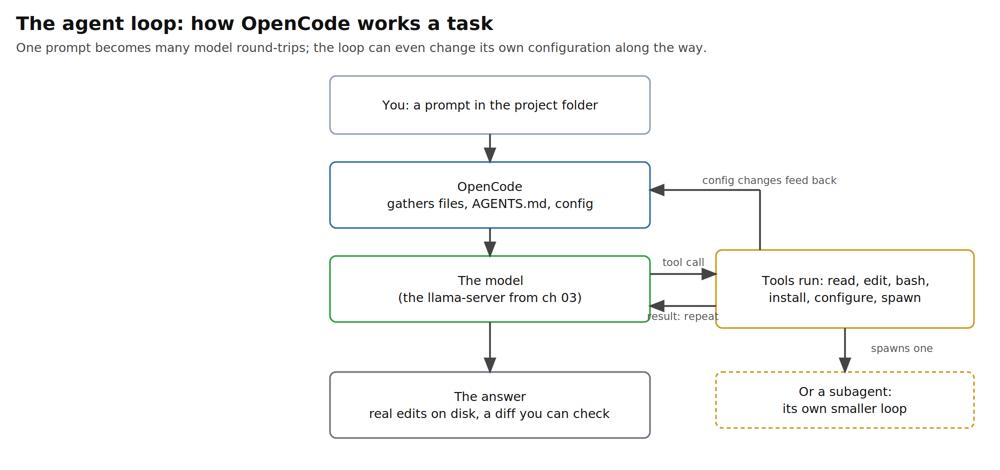

# 04: OpenCode: the agent on top

[OpenCode](https://opencode.ai) is a terminal coding agent (an agent = a program
that takes high-level instructions and decides which tools to run itself): it
reads your repo, edits files, runs tools, and answers, with **any**
OpenAI-compatible model behind it, including the local `llama-server` from
[03](03-llamacpp-server.md). The same guide shows how to extend it with MCP tools
(Model Context Protocol, a standard for plugging external tools into the agent),
skills, and plugins, and let local and cloud models live side by side.

What happens when you give it a task, in one picture:



*The loop is the whole trick: one prompt becomes many model round-trips, each
one a chance to read, edit, or run something. Tools reach beyond files: they
install packages, change the configuration the loop itself runs under, and
spawn subagents that run loops of their own. It is also why the permissions
section below exists: the loop touches real files on every turn.*

## Install and first run

```sh
curl -fsSL https://opencode.ai/v2/install | bash   # or: npm i -g @opencode/cli
opencode   # TUI (terminal user interface) in your project dir
```

OpenCode runs a background service (sessions, tools, permissions live there);
check it with `opencode service status`. No API key needed for a local server.

## Point it at your local server

Configuration lives in `~/.config/opencode/opencode.jsonc` (global) and/or
`.opencode/opencode.jsonc` (project). Real example: the 9B provider, verbatim from
the lead tester's config (URL uses `127.0.0.1` when both run on the same machine;
a WSL↔Windows split uses the host gateway IP instead):

```jsonc
{
  "$schema": "https://opencode.ai/config.json",
  "model": "qwen-local-9b/qwen3.8-9b",          // format: provider/model-id
  "small_model": "qwen-local-9b/qwen3.8-9b",    // cheap tasks: titles, summaries
  "providers": {
    "qwen-local-9b": {
      "package": "@opencode/ai/providers/openai-compatible",
      "name": "Qwen3.8-9B (llama.cpp)",
      "settings": { "baseURL": "http://127.0.0.1:9932/v1" },
      "models": {
        "qwen3.8-9b": {
          "name": "Qwen3.8-9B (local)",
          "limit": { "context": 131072, "output": 16384 },
          "body": { "temperature": 0.85 }
        }
      }
    }
  }
}
```

Two details that matter:

- **`limit.context` must match the server's `-c`** (or be lower), the agent plans
  around it.
- **Config edits hot-reload**, no restart needed; `/reload` forces a full one.
  Declare what the model can actually do (`capabilities.input: ["text"]` vs
  `["text","image"]`) or you'll chase 400 errors on image paste.

## MCP (Model Context Protocol): give the agent tools

MCP servers add tools (search, PubMed, databases…; each is a small program the
agent can call). Remote servers are one command:

```sh
opencode mcp add <name> --global --url <https://server-url>
opencode mcp list
```

Local (command-based) servers are a JSONC entry, real example, the PubMed server
(twelve research tools; note it requires Node ≥ 24):

```jsonc
"mcp": {
  "servers": {
    "pubmed": {
      "type": "local",
      "command": [
        "~/.nvm/versions/node/v24/bin/node",
        "~/.nvm/versions/node/v24/lib/node_modules/@cyanheads/pubmed-mcp-server/dist/index.js"
      ]
    }
  }
}
```

Note the layering: [03](03-llamacpp-server.md) gave the *server* its own MCP tools
(used by llama-server's web UI); OpenCode's MCP is client-side and used by the agent.
Both can run simultaneously.

## Skills: reusable playbooks

A skill is a `SKILL.md` the model loads on demand when relevant, instructions plus
supporting files, without bloating every prompt.

```text
.opencode/skills/        ← project skills (or ~/.config/opencode/skills for global)
└── beastx-xml/
    └── SKILL.md         ← frontmatter: name + one-line "when to use" description
```

Load manually by mentioning `@beastx-xml` in a prompt. Built-ins load automatically,
the lead tester's daily set includes `ponytail` (concise dev mode), `beastx-xml`,
`beastx-mmm` (BEASTX model configs), `d3-diagrams`, `pubmed` workflow helpers.

## Plugins: extend the agent itself

Plugins are npm packages that hook sessions, transform tool calls, or add TUI
(terminal user interface) elements. Config (canonical V2 field):

```jsonc
"plugins": ["opencode-agent-memory", "@dietrichgebert/ponytail"]
```

The lead tester runs an agent-memory plugin (persistent notes across sessions) and
ponytail (minimal-change coding mode). Writing your own is documented at
[opencode.ai/v2/docs/build/plugins](https://opencode.ai/v2/docs/build/plugins).

## The tooling gap is sometimes the feature

Local setups lack several cloud conveniences: no built-in memory that follows
the agent across sessions, no silent context injection, no server-side history
the model can quietly draw on. That reads as a limitation, and often is one.
But it also removes a whole failure class: automatically written memory. When
an agent saves a "fact" about your project once, slightly wrong or half
outdated, that block can resurface for weeks with unearned confidence, and you
rarely witness the moment it went stale; automatic memory is a common source of
confident, outdated nonsense. With less tooling doing things silently, every
durable fact is a file you wrote on purpose: plain text, readable, deletable,
reviewable. If you do add a memory plugin (above), hold its store to the same
standard: read what it wrote now and then, delete what aged out. Fewer moving
parts, fewer stale beliefs.

## Permissions: gate what the agent may do

```jsonc
"permissions": [
  { "action": "external_directory", "resource": "*", "effect": "ask" }
]
```

Effects: `allow` / `ask` / `deny`, last matching rule wins. Start with `ask`
everywhere and relax as trust grows.

**Warning: `allow` removes the confirmation prompt entirely.** With file-edit or
shell permissions set to `allow`, the agent executes without asking, and a
destructive command such as `rm *` can delete files in the working directory
permanently. The same lesson recurs throughout this guide: real safety comes
from the permission gates, not from model alignment. Keep the gates up
until you have a reason and a backup.

## Long sessions: compaction

Long sessions auto-compact (summarized and continued). One knob worth knowing:

```jsonc
"compaction": { "buffer": "25%" }
```

The default can squeeze the summary too hard on local models; 25% gives them room.

### A real example of context degradation (from this guide's own build)

This guide is itself written by an agent in long sessions on this rig, and on
2026-11-05 it demonstrated the failure mode perfectly. Early in the session, the
human instruction was explicit: analysis scripts belong in `scripts/`. Hours and
many commits later, the agent copied two updated scripts into the repository
root instead, and the committed copies in `scripts/` were stale versions from
before that day's changes: regenerating the chapter tables from them would have
silently resurrected numbers that had already been corrected (the
session-warming artifacts, removed earlier that same session). The error then
survived two rounds of verification because every check ran against the new
files, not against the rule.

It happened again later the same day: a chart fix's copy command dropped five
files into the repository root, in a commit whose message cited this very
section, and the mistake was caught and removed one commit later. That is the
realistic best case: the rule makes repeats faster to catch, not impossible.

Read that as the agent version of what happens to a model's context: early
instructions fall out of attention while recent work stays salient, and the
older the session, the more of the beginning is compressed into a summary or
gone. The remedy is the same one this guide recommends for models, applied to
the agent: put durable rules somewhere the agent re-reads every session (this
repository now carries one, `AGENTS.md` at its root), not in conversation, and
verify outputs against the rule, not against the latest file. Sessions that feel long to you
are long to the model in exactly the same way.

## LiteLLM: local + cloud side by side

A local [LiteLLM](https://docs.litellm.ai/) proxy (127.0.0.1:4000) fronts authorized
cloud endpoints behind one key, so OpenCode treats them like another provider:

```jsonc
"litellm": {
  "package": "@opencode/ai/providers/openai-compatible",
  "name": "Lab proxy",
  "settings": { "baseURL": "http://127.0.0.1:4000/v1", "apiKey": "sk-<your-virtual-key>" },
  "models": {
    "big":    { "limit": { "context": 262144, "output": 32768 },
                "capabilities": { "tools": true, "input": ["text"], "output": ["text"] } }
  }
}
```

Now `Tab` in the TUI switches between e.g. `qwen-local-9b/qwen3.8-9b` and
`litellm/big`. Keep credentials in the proxy's env file, never in `opencode.jsonc`;
one diagnostic gotcha: `/v1/models` answers even with a bad key: test auth with
`/v1/chat/completions` instead.

## Pi: a lightweight alternative (stub)

[Pi](https://github.com/earendil-works/pi-coding-agent) is a smaller coding agent
that does a subset of what OpenCode does. Its lightness is both its boon and its
downfall: fast to install and start, but without the depth of tooling, permission
gating, compaction, and plugin ecosystem that makes OpenCode the workhorse here.
I do not have enough measured experience with Pi to write a full section; treat
it as a stub and OpenCode as the default.

> **Takeaway:** One config file makes OpenCode the workhorse: local and served
> models side by side. Tools are what lift a local model from chat toy to lab
> assistant: MCP servers, skills, plugins.

---

*Every abbreviation and term used here is explained in one line in the [glossary](glossary.md).*
