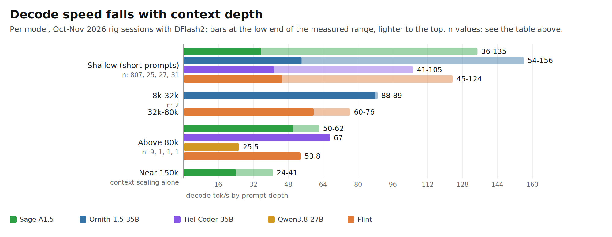

# 05: The fleet, ranked (verified 2026-11-04)

What the lead tester actually runs. Rig: RTX 4080 Laptop 12GB (CUDA0) + RTX 5060 Ti
16GB eGPU (CUDA1) = 28GB, llama.cpp b11803, Windows launchers parameterized by env
(`CTX`, `NP`, `PORT`, `UB`, `NMAX`, `MTPOK`, `NODRAFT`), ports 9932–9946, logs in
`logs/`. All sizes are the APEX-I-MiniPlus family of mixed requants (~3.5bpw average,
imatrix-calibrated, where imatrix = an importance matrix computed from sample text
that guides which tensors get more precision) unless stated. "bpw" = bits per
weight, i.e. how many bits each model parameter gets.

Ranks allow ties. Benchmark scores are provider-published (not independently
replicated); speeds are measured on this rig unless "(est.)".

## Where the requants come from: the IsValorum APEX line

Five of the six Tier A models below are requants (re-quantized versions of
other labs' released weights) from one boutique quantizer:
[IsValorum](https://huggingface.co/IsValorum) (73 published models, ~400k
downloads across the APEX/VAL ecosystem as of 2026-11-05). Their signature is
per-tensor mixed precision: every weight tensor gets its own quant level,
chosen with a 4-moment importance matrix (the imatrix idea from
[01](01-huggingface.md), pushed further than most), and they publish a recipe
rather than a single file, so a base model becomes a family of sizes:

- **APEX-I-MiniPlus (~14-15GB)**: the Tier A size below. MoE expert tensors
  locked at IQ3_XXS (about 3.1 bits per weight), attention tensors at
  Q4_K/Q6_K. Sage A1.5, Ornith-1.5, Tiel-Coder, Flint and the
  Qwen3.8-27B-MiniPlus all carry this recipe on different base models.
- **APEX-I-NanoPlus (~11.5-12.3GB)**: the 16GB-card size, with IQ2_S/IQ2_XXS
  only in the core FFN tensors (FFN = feed-forward network, the bulk of MoE
  weights). Fits a single 16GB card at 16-32k context; the 262k-context
  recipes below need the MiniPlus size plus a second GPU.

Collections worth bookmarking: [standard MiniPlus MoE](https://huggingface.co/collections/IsValorum/apex-i-miniplus-v21-standard-moe-6acfee77961c8c0cf5a083b5), [abliterated MiniPlus MoE](https://huggingface.co/collections/IsValorum/apex-i-miniplus-v21-abliterated-moe-6acfee762fc4a8cf2298c55b) (alignment-stripped variants), and [VAL-APEX 27B](https://huggingface.co/collections/IsValorum/val-apex-miniplus-standard-27b-6acfec54ca4ce4cf5cd5bdb6). The one Tier A model outside the line is CarbonX-14B. IsValorum also runs a request Space where users nominate new base models for the recipe ([MiniPlus-NanoPlus-Requests](https://huggingface.co/spaces/IsValorum/MiniPlus-NanoPlus-Requests)), and their own benchmark cards live at [shortbench.vercel.app](https://shortbench.vercel.app/).

## Tier A: 27–35B class (16GB+ VRAM, or 32GB-RAM laptops at CPU speed)

| Rank | Model | Size | Context | Spec. decode | Vision | Why / caveat |
|---|---|---|---|---|---|---|
| **1** | **Sage A1.5** (InternScience) | 14.18GB | 262k native (229k in use) | DFlash2 drafter (F16, ~1GB) or baked MTP (speculative decoding: a small model guesses tokens ahead for speed) | yes (mmproj 0.84GB) | Best across the board: beats Ornith-1.5 on 19/21 shared rows (BrowseComp 81.7 vs 67.6, GAIA 95.1 vs 77.6, SciCode 44.3, OmniDocBench 91.5 doc parsing). Agentic-forward ([tech report](https://arxiv.org/abs/2610.28578), Oct 2026: orchestration and self-verification are the trained skills; its benchmark wins are self-reported, the ranking here is our own bench). Caveats: no GPQA/AIME published; MTP/DFlash2 acceptance boot-test pending |
| 2= | Ornith-1.5-35B-A3B (A3B = about 3 billion of its 35 billion parameters fire per word) | 15.23GB | 262k | DFlash2: 60–69 tok/s | yes | All-rounder: TB2.1 67.8, MCP-Atlas 70.2, GPQA-D 89.2 |
| 2= | Tiel-Coder-35B-A3B (same A3B meaning) | 15.23GB | 262k | DFlash2: 67–75 tok/s | text-only | Coding/agentic specialist; sanitized metadata |
| 2= | Flint (IsValorum) | 15.86GB | 262k | DFlash2 (0.4B drafter): 73–142 tok/s | no | Factory-aligned base, reasons heavily, the "safe" pick; no MTP |
| 5 | Qwen3.8-27B-MiniPlus | 14.16GB | 131k | DFlash2: 24.5–29.5 (long) / 40–68 (short) | yes | Aligned Qwen3.8-27B base, solid but older recipe + shorter context |
| 6 | [CarbonX-14B](https://huggingface.co/HuggingFaceBio/Carbon-X) | Q8_0 (official) | 40k | n/a | text-only | Niche: text-only companion, fixed temp 0.6 (the card's own default). Origin: DNA-plus-text specialist ([official GGUF builds](https://huggingface.co/HuggingFaceBio/Carbon-X-GGUF)); why that matters in [06](06-use-cases.md). Caveat: our DENV/CHIKV genomes are out-of-distribution for it (measured row below) |

## Measured on the rig: speed by depth (Oct-Nov 2026)

The ranking above says what to run; this table says what running it actually
feels like. Figures come from the lead tester's session logs, 2026-10-29 to
2026-11-05, with DFlash2 wherever a drafter exists. n = the number of
generations a figure averages over; "shallow" = short prompts (a few hundred
tokens); acc / len = DFlash2 acceptance rate and average accepted tokens per
step (the mechanics are [08](08-optimisations.md)'s opening section).

| Model | Decode tok/s | Prefill tok/s | DFlash2 acc / len | Ops notes |
|---|---|---|---|---|
| Sage A1.5 | shallow 35.5-134.8 (n=807); 50.3-62.3 above 80k (n=9, outputs to 14.2k); 24-41 near 150k (context scaling alone) | 1,307-1,646 at ~125k full context; incremental tails 480-680 (drafter fixed cost) | .361 / 3.52 (n=830) | All-day session, zero restarts; the 4080 idles in a low power state during decode (the Balanced plan never ramps it; the drafter carries the load) |
| Ornith-1.5-35B | shallow 54.1-156.1 (n=25); 88-89 at 8-32k (n=2); no above-80k task run yet | 2,322 at 30,003 (fleet fastest); 1,859 at 9,303 | .248 / 2.73 (n=27) | Drafter jzinno F16 (1.06GB); deepest prompt so far ~30k, so deep decode is unmeasured |
| Tiel-Coder-35B | 67.2 above 80k (5,271 tokens out; 3-second window 74.4); shallow 41.4-105.3 (n=27) | 1,809 at 106,619 (58.9s) | .347 / 3.43 (n=28), best in the 35B class | Same boot as the previous day (multi-day stability); drafter jzinno F16 |
| Qwen3.8-27B-MiniPlus | 25.5 above 80k (n=1) | 700 at 85,391 | .28 / 2.96 (n=1) | Single-task boot so far; dense hybrid, thinnest VRAM in the class |
| Flint | shallow 45.2-123.5 (n=31); 59.7-76.4 at 32-80k; 53.8 above 80k (3,754 out) | 1,289 at 153,484 (118.9s, deepest prefill measured on the fleet); 2,242 at 36k | .276 / 2.93 (n=40) | Drafter Q8_0; sliding-window cache (cache-reuse refused), no MTP |
| CarbonX-14B | 23.6 (160 tokens out) | 2,255 at 16.7k of DNA; 1,435 at 3,280 of text (DNA prefills faster) | none (no drafter exists) | DNA specialist; our DENV/CHIKV genomes are out-of-distribution for it |

## Unranked: under evaluation

Two models arrived on 2026-11-05 and are still being benchmarked; they are not
yet ranked in any tier. Both are A3B (assisted speculative decoding: a small
draft model proposes tokens that a larger main model verifies, cutting latency)
variants built on the Qwen3.6-35B architecture:

| Model | Size | Context | Spec. decode | Vision | Why / caveat |
|---|---|---|---|---|---|
| **Groot-19B-A3B** | 7.84GB | 262k | DFlash2 drafter (sage) or baked MTP | yes (mmproj opt-in) | Generalist 19B on the 4080; 92 tok/s at 131k in 11-05 work sessions |
| **Occamy-1.0 A3B** | 13.74GB | 262k (131k cap on 4080) | baked MTP | yes (mmproj opt-in) | 16GB-card candidate on the dual-GPU split; 64-72 tok/s in 11-05 work sessions |

*These rows are unranked pending further benchmarking; speeds are from 11-05
work sessions, not formal bench readings.*

The same table, drawn by depth:

*Decode tok/s by prompt depth, per model (Oct-Nov 2026 rig sessions, DFlash2
where a drafter exists). Bars sit at the low end of the measured range and the
lighter segment runs to the top. The shallow bucket mixes chat and agentic
sessions, which is why its ranges are wide; n values are in the table above.
CarbonX-14B's single reading has no depth attached and is not drawn.*

Three readings fall out of it:

- **Decode falls with context on every model.** Sage's 50-62 tok/s above 80k
  dropping to 24-41 near 150k is pure context scaling, not drafter failure;
  pick your working context with that curve in mind.
- **Prefill is where deep sessions get expensive.** The same 153k-token prompt
  that costs Flint 118.9 seconds is why the context ladder in
  [08](08-optimisations.md) exists at all.
- **Acceptance now has sample sizes.** Sage's .361 over 830 generations retires
  its earlier "unverified" label; Tiel's .347 (n=28) came from the same borrowed
  jzinno drafter as its earlier .19-.24 reading, so that spread is content, not
  drafter choice (corrected in [08](08-optimisations.md)).

## Tier B: 9B class (CPU laptops, MacBooks, fast auxiliary)

| Rank | Model | Notes |
|---|---|---|
| 1= | Ornith-1.5-9B | MTP + DFlash2 variants; 65k ctx in OpenCode |
| 1= | Qwen3.8-9B (Q5_K_M) | 131k ctx; ~2.5–3× decode with draft-MTP (measured) |
| 2 | Heretic-9B | Alignment-stripped variant, use only where policy allows |
| candidate | MiMo-V2.6-Distill-Qwen-9B | 262k ctx, MIT license, on the watchlist (not yet in service) |

## Tier C: big-model-on-a-budget (experimental)

| Model | Notes |
|---|---|
| Qwen3.8-Flash-Next 125B IQ2_XS (via Strata engine) | ~44.7 tok/s decode with SSD expert streaming (SSD = solid-state disk; rarely-used "expert" blocks are read from disk instead of living in memory) | **2-bit quality caveat**, the "run a frontier-size MoE on 16GB" exemplar, not a daily driver |

## Pasteur-served models (the other half of the fleet)

Fully local is not the only tool in the box. The lab's LiteLLM proxy
(`127.0.0.1:4000`, fronting the IA Pasteur endpoint) serves authorized cloud models
into the same OpenCode, switchable with Tab. Same guide, same workflows, different
engine:

| Model | Notes |
|---|---|
| medium (default) | GLM 5.3 Flash NVFP4; the agentic daily driver; accepts text and images |
| big | the heavier tier; text-only input (image requests are rejected, a known gotcha) |
| small | cheap summaries and titles (the OpenCode `small_model`) |
| medium-reasoning / coder | deliberate reasoning and coding tiers |

All configured at 262k context / 32k output. Credentials live in the proxy's env
file, never in this repo. When a task outgrows local hardware, the served tier
takes it; the ChronAeon preprint audit of 2026-11-04 is a worked example.

## Cloud benchmarks: open models too big for the rig

The served tier is not only the lab proxy. Ollama Cloud hosts the same open-weights
families the fleet tracks, at sizes no home rig can hold (chapter
[01](01-huggingface.md) draws exactly how big), and that access is a
deliberate part of the method: to rank models fairly, every candidate has to run
the same bench set, and a model you cannot fit locally is still worth ranking.
The cloud tier is how models like Kimi K3.1, MiniMax M3.1, DeepSeek v4.1 Flash,
and Mistral Large 4 enter the comparison at all (session-log runs include Kimi
K2.6/K2.7-code, MiniMax M3/M3.1, GLM 5.2/5.3, and Mistral Large 4).
No local hardware is involved: the same OpenAI-compatible API points at the
hosted model, and the runs show up in [09](09-runtimes.md) as `(ollama-cloud)`
rows. What the cloud tier buys is model size, not speed; its tempo numbers trail
the local fleet, and that is expected. How these cloud models compare against
the closed frontier on a published index is chapter [11](11-flagship-models.md);
what the same access costs per token, and against subscriptions, is chapter
[12](12-hardware-and-costs.md).

## How the fleet is chosen: and kept current

1. **Shared benchmarks** across the fleet (TB2.1, MCP-Atlas, GPQA-D, BrowseComp, GAIA,
   SciCode…), prefer models that win rows relevant to *your* work, not aggregates.
2. **Size-to-quality**: the mixed requant families hit ~Q4 quality at ~15GB, which is
   what makes Tier A fit a 16GB card with room for KV, drafter, and vision.
3. **Spec-decode support** (baked MTP, compatible drafters), free speed.
4. **License + provenance** (Apache-2.0/MIT; sanitized metadata where it matters).
5. **Re-verify when a new flagship lands**: rerun the shared bench set, boot-test the
   new GGUF at your working context, and only then promote it into the table.
   This file carries the date of the last full pass, trust it no further.

## Tier → machine mapping (cross-reference to [02](02-hardware-fit.md))

- CPU laptop 16GB → Tier B (9B Q4/Q5)
- CPU laptop 32GB → Tier A at CPU speed (~15–25 tok/s, the A3B MoEs are built for this)
- Apple Silicon 32–48GB → Tier A, all layers on GPU, context per memory budget
- eGPU 16GB → Tier A, full offload + MTP; check the KV budget for your context
- Dual-GPU / 32GB VRAM → the whole table, 229–262k context

> **Takeaway:** The daily driver is Sage A1.5; the fleet spans 9B-class chats to
> 262k-token marathons. Every recommendation is a copy-paste launcher, and the
> table is dated: re-verify when a new flagship lands, trust it no further.

---

*Every abbreviation and term used here is explained in one line in the [glossary](glossary.md).*
