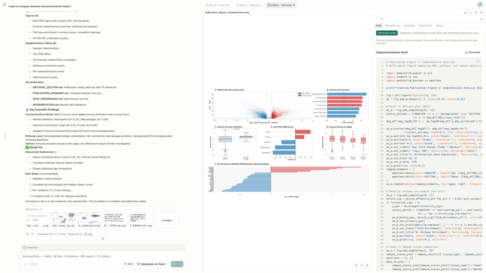

# 07: The extension ecosystem: MCP, skills, plugins

[04](04-opencode.md) showed the config mechanics. This file tours what is actually
installed and what it unlocks, because a local model without tools is a chat toy, and
with tools it does literature work, searches the web, and writes careful code.

## MCP servers

Two distinct layers, easy to confuse:

| Layer | Hosted by | Used by | Example |
|---|---|---|---|
| Server-side | llama-server itself (`--mcp-servers-config`) | the model's own web UI / agentic mode | web search tools |
| Client-side | OpenCode (`mcp.servers`) | the agent, whatever model it runs | PubMed, more search |

Both can run at once; they do not interfere.

Hunting for new tools: the community catalog is the
[Awesome MCP Servers list](https://github.com/punkpeye/awesome-mcp-servers), hundreds
of servers sorted by category (search, science, databases, browser control...). New
high-quality publication and web-research servers appear weekly; skim it before
building your own.

### PubMed MCP: the publication workhorse

`@cyanheads/pubmed-mcp-server` exposes twelve research tools:

- `pubmed_search_articles`, `fetch_articles`, and `fetch_fulltext` (resolves through
  PMC, then EuropePMC, then Unpaywall)
- `find_related` (similar, cited_by, references), `pubmed_format_citations`
- `pubmed_lookup_mesh`, `pubmed_spell_check`, `pubmed_lookup_citation`,
  `pubmed_convert_ids`
- `pubmed_fetch_citation_metrics` (NIH iCite: Relative Citation Ratio, percentiles)
- `europepmc_search` and `europepmc_fetch` for preprints and Europe-PMC-only records
A typical agentic flow: search, fetch abstracts, pull fulltext, extract numbers,
format citations. When PubMed comes up empty (preprints, records only in Europe
PMC), the EuropePMC pair is the fallback. Practical facts: keyless NCBI access is rate-limited
to 3 requests/second (the server paces itself); a free `NCBI_API_KEY` raises it to
10/s; setting `UNPAYWALL_EMAIL` unlocks the Unpaywall tier; the server needs Node 24
or newer. It is wired into llama-server, Pi, and OpenCode, so every local model can
use it.

### Web search MCP: webtools without API keys

Server-side, `@zhafron/mcp-web-search` gives every launched model a
`web-search_search_web` and `web-search_fetch_url` tool, with a fallback chain
(DuckDuckGo, then Bing, then self-hosted SearXNG). The interesting tier is
**self-hosted SearXNG** (`http://localhost:8888`): a meta-search engine you run
yourself, no API keys, no rate walls, configurable result formats. Point the chain
at it with `SEARXNG_URL` and `DEFAULT_SEARCH_PROVIDER=searxng` in the server's MCP
config.

Gotcha worth knowing: llama.cpp discovers MCP tools only in a short startup window,
so a cold first boot can silently report zero tools. Restart once, or prewarm the
MCP child process before launch, and check the boot log for
`MCP warmup: ... discovered N tools`.

## Skills

A skill is a `SKILL.md` the model loads on demand: instructions plus supporting
files, without bloating every prompt. Discovery: project `.opencode/skills/` and
global `~/.config/opencode/skills/`; mention `@skill-id` to load one explicitly.

The installed suite, roughly in order of daily use:

| Skill family | What it does |
|---|---|
| `beastx-xml`, `beastx-operators`, `beastx-priors`, `beast2-operators` | Write and debug BEASTX/BEAST 2 XML, operators, priors |
| `beastx-mmm`, `beastx-mmm-operators` | Markov-modulated model configs (the MOSAIC workhorse) |
| `beastx-tdr-clock`, `beastx-mixed-effects-clock` | Time-dependent rate and mixed-effects clock models |
| `ponytail` | Minimal-change coding discipline (see below) |
| `d3-diagrams` | Publication figures: trees, model schematics, rate plots |
| `tay-journal-guidelines`, `tay-writing-style` | Journal formatting and prose voice for manuscripts |

Writing your own is one file with a `name` and a one-line `description` (the
description is what makes it discoverable), plus any scripts it needs beside it.

## Plugins

Plugins are npm packages (npm = the Node.js package registry) that hook sessions,
transform tool calls, or extend the TUI (terminal user interface).
Config is one array:

```jsonc
"plugins": ["opencode-agent-memory", "@dietrichgebert/ponytail"]
```

### opencode-agent-memory

Persistent, project-scoped notes across sessions. The agent writes down durable
facts (decisions, gotchas, paths) and reads them back next session. For long
research projects this is the difference between re-explaining your setup every
time and having a colleague who remembers.

### Ponytail (deserves its own mention)

`@dietrichgebert/ponytail` makes the agent work like a lazy senior developer: the
smallest change that fully solves the task, nothing speculative, every limitation
stated out loud.

- **Levels:** `lite`, `full` (the default and daily driver), `ultra`. The level
  shapes how aggressively the agent resists adding code nobody asked for.
- **What it enforces:** no abstraction or "for later" code without a request; reuse
  what the codebase already has; validation and error handling never cut; new
  non-trivial logic must ship with a test or self-check; every reply ends with what
  was skipped and what risk remains.
- **Companion commands:** `/ponytail-audit` (whole-repo review, ranked findings),
  `/ponytail-review` (review of a change), `/ponytail-debt` (ledger of every
  `shortcut:` comment), `/ponytail-gain`, `/ponytail-help`.

For scientific code this is unusually valuable: the forced closing statement
("what I did not check") is exactly the honesty boundary you want from an agent
touching analysis scripts, and the debt ledger makes shortcuts auditable rather
than silent.

## GUI alternative: AIPOCH Open-Science

OpenCode is a terminal tool. If you want the same ideas in a windowed
application, [AIPOCH Open-Science](https://github.com/aipoch/open-science)
(Apache-2.0, desktop app for macOS, Windows, and Linux) is an open-source,
local-first research workbench in the same category as Anthropic's Claude
Science, with one notable difference: every layer is directly configurable
rather than hidden. It ships 24 built-in scientific skills (525 more in its
marketplace), 48 research connectors plus custom local and remote MCP
connectors, 25 preset model providers (including llama.cpp and Ollama
endpoints, so [03](03-llamacpp-server.md)'s server plugs straight in), five
agent backends (Claude Code, OpenCode, Codex, CodeBuddy, Pi), and artifacts
stored as immutable versions with provenance, exportable as portable
`.science` packages for collaborators. For a local-model workflow it is the
GUI counterpart to this whole chapter, with the same philosophy: nothing about
your tools, models, or data flow is a black box.



## A worked research session

Everything above composes. One prompt on the local fleet, no cloud:

1. `pubmed_search_articles` for recent DENV molecular-clock papers, then
   `fetch_fulltext` on the OA subset.
2. Web search via SearXNG for anything not indexed yet.
3. BEASTX skills loaded to draft the model XML the papers imply.
4. Ponytail mode for the analysis script: minimal, tested, with its limitations
   stated in the reply.

That chain is the practical argument for the whole ecosystem file: the model is the
engine, but MCP, skills, and plugins are the wheels.

> **Takeaway:** The model is the engine; MCP servers, skills, and plugins are
> the wheels: PubMed for literature, SearXNG-backed search for the open web,
> BEASTX skills for the lab's model files.

---

*Every abbreviation and term used here is explained in one line in the [glossary](glossary.md).*
