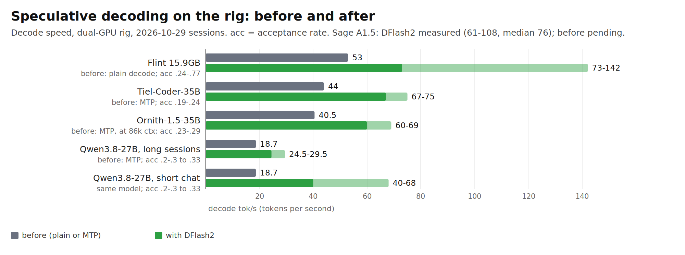

# 08: Optimisations: what actually moved the needle

Verdict up front, from about two weeks of dialing: two levers dominated everything
else.
First, speculative decoding (DFlash2, and its sibling MTP), which is the difference
between "watch it type" and "feels local-first". Second, context-memory dialing,
which is the difference between a model that boots and one that serves 262k-token
sessions. Everything else in this file is polish by comparison.

## The lever that changed everything: speculative decoding

A small drafter model proposes the next several tokens; the big model verifies the
whole proposal in one pass. Accepted tokens cost one forward pass, so throughput
scales with the acceptance rate. DFlash2 is this guide's flavour: it is the
llama.cpp implementation of [DFlash](https://arxiv.org/abs/2602.06036) (Chen,
Liang and Liu, February 2026), whose drafter is a lightweight block-diffusion
model: instead of writing one token at a time, it proposes a whole block of
tokens in a single forward pass, conditioned on features read from the big
model. The paper reports over 6x lossless speed-up (lossless: the verified
output is exactly what the big model would have produced alone) in its own
serving setup, up to 2.5x over EAGLE-3, the previous speculative-decoding
family; a single-user rig with modest acceptance gets the 2-3.5x measured
below. Two flavours:

| Mode | What it is | Cost |
|---|---|---|
| **MTP** (`--spec-type draft-mtp`) | next-token head already baked into the main GGUF | free, zero extra VRAM |
| **DFlash2** (`--spec-type draft-dflash -md draft.gguf`) | separate drafter GGUF, ~1GB F16 | ~1GB VRAM + a device pin |

Measured on the dual-GPU rig (decode tok/s, same hardware, same day):

| Model | Before (plain / MTP) | With DFlash2 | Acceptance |
|---|---|---|---|
| Flint 15.9GB | 53 (plain) | 73-142 | .24-.77 |
| Tiel-Coder-35B | 44 (MTP) | 67-75 | .19-.24 and .347 (n=28): same borrowed Ornith drafter, the spread is content |
| Ornith-1.5-35B | 40.5 (MTP, at 86k ctx) | 60-69 | .23-.29 |
| Qwen3.8-27B | 18.7 (MTP) | 24.5-29.5 (long structured), 40-68 (short chat) | .2-.3 → .33 |
| Sage A1.5 | not measured (MTP head baked) | 61-108 (short), 50-62 above 80k | .361 / 3.52 measured (n=830) |

The same table, drawn:

*Grey bars: decode speed before. Green bars: with DFlash2, the light segment is
the measured range. The acceptance rate (the share of drafted tokens the big
model keeps, which sets the speed-up) sits under each model name. Sage A1.5 is
not drawn: its before figure (plain or MTP) was never measured, so there is no
grey bar to compare against; its DFlash2 sessions measured 61-108 tok/s (median
76) on the current 229k-context boot, and acceptance came in at .361 (3.52
tokens per step) across 830 generations in the 2026-11-01 all-day session.*

That last row is the story: 18.7 tok/s is barely tolerable for interactive work;
40-68 on short turns is a daily driver. Nothing else in this guide buys a 2-3.5x
swing on existing hardware.

Field notes that took weeks to learn:

- **Acceptance is content-dependent.** Boot-test acceptance (.92-.98 on trivial
  prompts) is not real-session acceptance (.52-.72 for MTP, .2-.33 for cross-model
  drafters). Measure on your actual workload.
- **A drafter trained for a different model still works**, with degraded
  acceptance (.2-.3), which is still 50-70% faster than plain decode. A
  well-matched drafter beats a finetune-matched one; the base-model drafter
  (Qwen3.6-35B-A3B) served Sage, its finetune, fine. Tiel has no drafter of
  its own: it borrows Ornith's (a same-base sibling), and acceptance read
  .19-.24 on the first sessions and .347 across 28 later generations, a
  reminder that acceptance is content-dependent before it is drafter-dependent.
- **Draft KV is nearly free** if the drafter is a small sliding-window model
  (its attention looks only at a fixed recent window, so its cache never grows)
  (~21-25MB constant with q8 KV). Set draft KV quant separately (`-ctkd q8_0
  -ctvd q8_0`); the main `-ctk/-ctv` does not propagate.
- Pin the drafter to its own GPU (`-devd CUDA1 -ngld 999`) so it never competes
  for the main model's memory.
- **Sage's matched drafter is homemade.** The drafter GGUF behind Sage's DFlash2
  runs was produced here with llama.cpp's official
  converter: `convert_hf_to_gguf.py <drafter-HF-repo> --target-model-dir
  <target-HF-repo>` reads the drafter's config and safetensors plus only the
  target's config and tokenizer (no target weights), and writes a drafter GGUF
  that borrows the target's embeddings and output head at load time. The recipe
  works when drafter and target share one architecture shape (the same tap
  layers, block size, and selector dimensions the DFlash design expects) and
  one tokenizer; acceptance stays healthy when both were trained on similar
  data. That is why the base-model drafter served its finetune fine. Tiel skips
  the question by borrowing Ornith's drafter, which works because the two
  targets share one base family.
- Honest blank spot: Sage's before figure (plain or MTP) has never been
  measured, so its row has no grey bar. Its DFlash2 side is now well measured:
  61-108 tok/s across 216 generations (median 76), 50-62 tok/s above 80k
  context, and acceptance .361 with 3.52 tokens per step across 830 generations
  in the 2026-11-01 all-day session (zero restarts). Only the before-figure
  remains unmeasured.

## Next on the bench: DSpark (a future project)

The acceptance ceiling on this rig (.2-.36) is exactly what DSpark attacks.
[DSpark](https://arxiv.org/abs/2607.05147) (Cheng et al., July 2026, from the
DeepSeek team) keeps the parallel drafter but adds a lightweight sequential
module to it, so the drafter models dependencies inside each proposed block
instead of proposing tokens blind; verification length is then scheduled per
request from confidence estimates. Much of that scheduling half is a
serving-farm feature (it protects batch capacity under concurrent load), but
the semi-autoregressive drafter is a direct fit for a single-user rig: more
accepted tokens per verified pass is the same lever DFlash2 pulled, pulled
again. llama.cpp already reserves a DSPARK spec type beside DFlash2's; the
missing piece is a converted drafter for the fleet's targets. That is a project
for another month, and the first thing to try if the fleet ever needs another
speed tier.

## The one-time fit: dialing context per model

Context is the other great consumer of VRAM. This is not a daily activity: it is a
hardware-fit exercise you run once, when a new model lands. Once the ladder has been
walked and the context is pinned in the launch script, it never changes again; the
model runs identically in every session, which is exactly the point. The arithmetic
in [02](02-hardware-fit.md) gets you in range; the ladder gets you to the pin:

1. Pick the target context, boot, and read the log: KV buffer size, per-device
   splits, free VRAM after load.
2. If it OOMs (out of memory: the run aborts because it exceeded the memory
   budget): step the context down, or step `-ub` down. The `-ub` prefill
   buffers are the sneaky cost: doubling `-ub` from 1024 to 2048 near 196-262k
   context costs ~2.9GB (and nothing at decode time; prefill only).
3. Record the ladder in the launch script's comments. Every rig's ladder is
   different; ours lives in the `.bat` REM blocks.
4. Boot-test again after any change. Boot margins are not real-session margins:
   Windows display duty, WDDM eviction (the Windows display driver quietly
   reclaiming graphics memory for the desktop), and long sessions all eat the slack.

What the ladder produced on the 28GB rig (all measured):

| Model | Context in daily use | Notes |
|---|---|---|
| Qwen3.8-27B | 131072 | ~85k-token prefills ran clean |
| Ornith-1.5-35B | 196608 (262144 on good days) | 262144 crashed at `-ub 1024`, ran at `-ub 512` |
| Tiel-Coder-35B | 229376 | 262144 ran fine once; DWM (window manager) pressure killed it another day |
| Sage A1.5 | 229376 (262144 = native, opt-in) | the +2.7GB headroom model |
| Flint | 262144 | 153k prefills clean |
| Rig ceiling | ~300k | 524k does not fit, no configuration |

Two supporting settings matter here:

- **`-ctk q8_0 -ctv q8_0`**: halves KV memory, negligible quality cost. Always on.
- **`--ctx-checkpoints 8`**: divergence recovery (compaction, branching, edits)
  restores from a checkpoint instead of re-prefilling the whole context. The
  default of 32 costs host RAM (up to ~16GB at 262k on hybrid models); capping at
  8 keeps it around 4GB.

## Multi-GPU and placement

- **`-sm layer`** (split mode layer): only activations (the numbers flowing
  between layers during a forward pass) cross the bus between
  GPUs. `tensor`/`row` modes push weight tensors across the wire; on a USB4 dock
  that is a hard loss. Never use them.
- **`-ngl 999` with a GPU-only policy**: all layers on GPU, no CPU offload, ever.
  If it does not fit, it crashes, and the crash is the signal to shrink context or
  quant. The alternative (silent CPU offload) trades unpredictable speed cliffs for
  a boot that "works".
- One server per session on shared VRAM: two servers on one GPU degrade each other
  silently. Verify the old one is dead and VRAM is freed before relaunching.

## What did not matter

Recorded so nobody re-walks these cul-de-sacs:

- **`--cache-reuse`** is refused and inert with a vision projector loaded
  (`-mm`), and on Flint for a second reason: its sliding-window cache cannot
  shift old tokens aside. Only pure-KV text-only models benefit.
- **CPU offload** of a few layers to "fit": works, but the decode cliff makes the
  model unusable for interactive work; the GPU-only policy exists because of this.
- **Sampling flags** (`--temp`, `--top-p`): zero effect on speed. Set them once in
  the server, stop thinking about them.
- **`-ub` beyond 1024 at moderate context**: prefill-only gains, real memory cost.
  Only worth it when prefill time dominates your workload.

## The method that produced this file

One flag at a time. Boot. Read the log. Record. Copy the log file before
restarting a crashed server (it truncates on every start). A crash is a finding,
not a failure; it tells you exactly where the budget boundary is. The fleet's
launch scripts carry the full ladder history in their comments, and that history is
the most valuable documentation this project produced.

> **Takeaway:** Two levers did everything: speculative decoding (DFlash2, MTP;
> 2-3.5× measured on this rig) for speed, context-memory dialing (`-ub`, KV
> quant) for capacity. Everything else is polish.

---

*Every abbreviation and term used here is explained in one line in the [glossary](glossary.md).*
