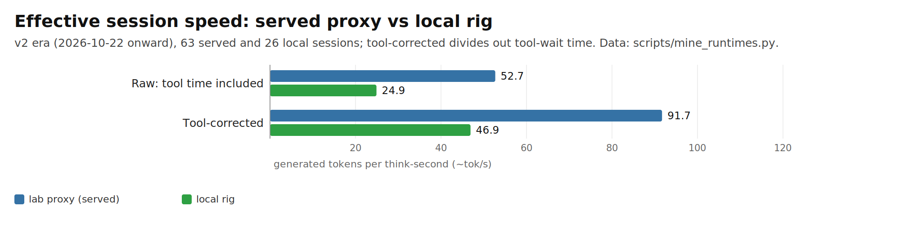

# 09: The session log: runtimes and task types

Benchmarks (05) tell you what a model can do; this chapter shows what it actually
did: 368 sessions from the lead tester's own activity between June and
November 2026, with prompts, tool calls, generation time, tool time, and effective
throughput. Not synthetic tasks, not marketing numbers: the actual tempo of five
months of research, rig maintenance, writing, and the occasional game. The sessions
ran on three access tiers: the local dual-GPU rig, the lab's served proxy, and
cloud endpoints (Ollama Cloud, used to benchmark open models too large for the rig;
see [05](05-fleet-2026-11.md)).

The tables split the log in two. The work tables carry 290 sessions: research, rig
maintenance, manuscripts, this guide. The other 78 are capability testing (games,
creative builds), personal tasks (household finance, shopping, device admin,
third-party resume reviews), or plain chats; they get their own tables in "The
fleet at home" at the end of this chapter. Same columns, same definitions, same
minimums, so work plus home reproduces the full log. The script
`scripts/mine_runtimes.py` applies the same filter. The task-type totals below
give the complete picture (every session, no work filter). The same log, mined
for failures and who fixes them, is chapter [10](10-pitfalls.md).

One timing note: the tables are a 2026-11-10 snapshot, frozen at the same
2026-11-10 20:28 UTC cutoff as the published data files in `data/deidentified/`
(the token and timing columns are the same sums those files carry). The top row
of the cloud table is the numbers-update session itself; it was still running
at the cutoff, so its row covers only what it had generated by then.

## Where the data comes from

OpenCode keeps every session in a local database. The installed `runtime-footer`
plugin renders the same numbers live in the TUI sidebar: while this section was
being written, it showed "active 18m 09s / think 15m 04s + tools 3m 04s" for an
early moment of the session that wrote it (the highlighted 11-04 row in the
cloud table). The companion script in this repo
(`scripts/mine_runtimes.py`) replicates that math across all sessions and prints the table
below:

```
python3 scripts/mine_runtimes.py
```

Definitions (identical to the plugin's, with one twist the plugin does not show):

- **think** = sum over assistant messages of (completed - created): the
  generation windows, prefill included. The twist: a message's window stays
  open until the message's last tool call finishes, so think also contains
  tool execution time (checked against the database: 100% of v2 assistant
  messages and 88% of the v1 ones, in tool-heavy sessions, complete within
  two seconds of their last tool call). Every ~tok/s in this chapter therefore
  divides tokens by a window that includes waiting on tools.
- **tools** = sum over tool calls of (completed - ran): execution time of the
  tools themselves (file edits, searches, shell commands). Exact in v2, which
  stamps the real execution start; the v1 database had no such stamp, so v1
  tool spans begin when the model finished emitting the call and include that
  emission decode.
- **active** = think + tools. Since tool time sits inside the think windows,
  active double-counts it: read it as an upper bound on work time. **wall** =
  last activity minus session creation, which is not pure work (sessions stay
  open across days).
- **Tool share** = tools as a share of the think window: how much of a
  session's model time was spent waiting on its tools rather than decoding.
- **Span med** (generation span) = median of (streamed - created) over
  assistant messages: how long the median model call took, from request to its
  last streamed token. Prefill, decode, and provider latency all sit inside.
  Note what this is not: the database stamps `streamed` when a message's
  stream ends, not when the first token arrives (checked in the data: text-only
  messages carry hundreds of tokens into a near-zero window after the stamp,
  and dividing each message's tokens by its span lands at 47 tok/s median for
  local messages and 150 for served ones, the decode speeds these engines
  actually show). Span med is a
  per-call cost figure, not a responsiveness figure. Reported wherever at least
  80% of a session's assistant messages carry the stamp: near-100% for recent
  local dualGPU sessions and the lab proxy, sparse for older sessions and the
  early Ollama Cloud runs (recorded before the stamps existed), shown as n/a
  elsewhere.
- **Gen tok, Reason tok, Out tok** = generated tokens summed over the
  assistant messages' usage records, and the provider's split of that total:
  **Reason tok** = thinking tokens, **Out tok**
  = everything else (final prose plus tool-call syntax). The served table
  carries Gen tok and then the split, each split cell with its share of the
  session's tokens in parentheses; the local table carries Gen tok only,
  because llama-server does not report a split (the thinking is in the
  total, just not separated). The split is provider-dependent: the lab proxy
  and some Ollama Cloud models report it, most Ollama Cloud models do not,
  so a zero Reason tok means the provider did not split that session, not that
  the model did no thinking.
- **~tok/s** = Gen tok divided by think seconds. A decode-only companion
  column would add nothing: the tool-corrected rate for any row is exactly
  ~tok/s divided by (1 minus its printed Tool share), and the true
  decode-only speed (prefill excluded) is what [05](05-fleet-2026-11.md)
  measures from server logs; this database has no per-message prefill
  timings to subtract.

This is deliberately *not* the server's instantaneous decode speed from
[05](05-fleet-2026-11.md) and [08](08-optimisations.md): the effective number also
swallows prefill and pauses, so it always reads lower, and it drops on
long-context sessions where prefill dominates.

Caveats, before comparing anything:

- Token counts sum the per-message usage records (the same sums the published
  data files carry). Sessions compacted mid-run lose the tokens the summary
  replaced: the session ledger, which keeps every count, reads 3.2% higher
  across the closed sessions, and a few early v1 sessions recorded usage only
  in that ledger. Forked or compacted sessions can show
  think greater than wall. Untitled sessions with under 1,000 generated tokens are
  v2 session-warming probes, not work (five such sessions from 10-22 logged 13h of
  think for a few hundred tokens); they are excluded from every table in this
  chapter.
- **Tool calls** counts every tool call recorded in a session, including calls
  that never completed (interrupted turns); the published `tool_events.csv`
  lists completed calls only, so the two differ by one or two calls on a
  handful of rows.
- **The OpenCode v1-to-v2 switch (2026-10-22) splits the log into two eras, and
  rows from the two eras are not directly comparable.** The think-window
  definition is unchanged, but streaming timestamps (the Span med column) exist
  only from v2, v1 tool spans include the call emission as described above, and
  v2 adds
  background compaction (summary tokens that carry no think time) on top of the
  warming probes already excluded. The averages section below therefore splits
  by era, and the same-task pairs are chosen within one era. (The 10-22
  migration day itself straddles the cutover: one 10-22 session is v1-style.)
- A session that switched engines midway is listed under its final model.
- Single user, single machine, no quality scoring: that is the benchmark set's job.

## The fleet at work: 290 work sessions

The table is split into two. **Local** is everything that ran on the lead tester's
hardware: the llama.cpp dual-GPU fleet and the Strata engine (which serves its
model from the local SSD). **Cloud** is everything remote: the lab's LiteLLM
proxy, Ollama Cloud, and OpenCode's free tier. Every Ollama-labelled session in
this log was in fact served by Ollama Cloud, not a local Ollama install, so all
Ollama rows sit in the cloud table regardless of how the provider recorded them.
A Span med column (the median per-message generation span; see Definitions) is
included for both tables wherever a session's streaming coverage passes the 80%
bar; the coverage reality, not a policy choice, decides where n/a appears.
Two models joined the local fleet on 11-05 and have been working since:
Groot-19B-A3B on the 4080 and the eGPU (three log rows so far, 29-91 tok/s) and
Occamy-1.0 A3B on the dual-GPU 28GB split (thirteen rows across work and home,
34-70 tok/s). The
11-08 fleet comparison ranked Occamy into Tier A as the coding/agentic pick (see
[05](05-fleet-2026-11.md)); Groot remains under evaluation.

Engine labels: **(served)** = the lab's LiteLLM proxy (medium, big, small);
**(ollama-cloud)** = Ollama's hosted cloud, including sessions whose provider
label reads "ollama"; **(local)** = the dual-GPU llama.cpp fleet from
[05](05-fleet-2026-11.md); **(strata)** = the Strata engine serving Flash-Next
IQ2_XS from local disk (Tier C); **(free tier)** = OpenCode's free cloud models.

### Local

| Date | Engine | Task | Prompts | Tool calls | Think | Tools | Tool share | Active | Span med | Gen tok | ~tok/s |
|------|---------|-----------|--------|----|----------|----------|-----|----------|------|--------|------|
| 11-10 | occamy-1.0 (local) | Heterochronous influenza tree simulations | 3 | 262 | 55m56s | 3m49s | 7% | 59m45s | 5.9s | 204,253 | 61 |
| 11-09 | occamy-1.0 (local) | Arc Pro B70 vs R9700 for llama.cpp | 3 | 11 | 4m46s | 0m12s | 4% | 4m58s | 28.2s | 9,758 | 34 |
| 11-06 | occamy-1.0 (local) | phyloplate Source tab visual bug | 4 | 64 | 11m40s | 3m46s | 32% | 15m26s | 3.6s | 27,688 | 40 |
| 11-06 | sage-a1.5 (local) | 5060 Ti vs Arc B60 for LLMs | 4 | 63 | 13m38s | 0m16s | 2% | 13m55s | 8.8s | 35,008 | 43 |
| 11-06 | occamy-1.0 (local) | PhyloMAP 2026 phylodynamics slides | 1 | 29 | 8m03s | 0m43s | 9% | 8m47s | 10.2s | 24,584 | 51 |
| 11-06 | groot-19b-a3b (local) | Build live-demo script and locate failure-mode examples | 1 | 21 | 3m40s | 0m03s | 1% | 3m43s | 10.8s | 6,440 | 29 |
| 11-06 | groot-19b-egpu (local) | Draft 15-min talk outline | 1 | 7 | 2m11s | 0m00s | 0% | 2m11s | 11.8s | 10,769 | 82 |
| 11-05 | occamy-1.0 (local) | ch09 and ch10 fleet performance | 7 | 216 | 37m49s | 1m02s | 3% | 38m52s | 4.8s | 136,299 | 60 |
| 11-05 | occamy-1.0 (local) | 16GB VRAM model for Dflash2 Dspark | 7 | 31 | 10m22s | 0m16s | 3% | 10m38s | 11.9s | 39,749 | 64 |
| 11-05 | groot-19b-a3b (local) | Ranking directory models | 5 | 26 | 5m00s | 0m01s | 0% | 5m01s | 13.7s | 27,323 | 91 |
| 11-04 | sage-a1.5 (local) | Large XML search optimization | 5 | 227 | 2h54m55s | 2h10m46s | 75% | 5h05m41s | 5.6s | 163,881 | 16 |
| 11-04 | sage-a1.5 (local) | Diagram view intelligent XML zoom | 1 | 112 | 1h03m28s | 17m54s | 28% | 1h21m22s | 8.5s | 80,490 | 21§ |
| 11-04 | sage-a1.5 (local) | Phylodynamic local LLM infrastructure | 8 | 173 | 47m17s | 5m36s | 12% | 52m54s | 7.0s | 203,831 | 72 |
| 11-03 | sage-a1.5 (local) | Beast2 taxa and sequence count bug | 3 | 317 | 5h03m02s | 3h46m12s | 75% | 8h49m14s | 6.7s | 234,300 | 13 |
| 11-02 | sage-a1.5 (local) | PhyloPlate five-feature implementation | 8 | 462 | 5h44m55s | 3h52m37s | 67% | 9h37m32s | 5.5s | 257,598 | 12‡ |
| 10-28 | qwen3.8-27b (local) | BEAST XML evaluation | 1 | 10 | 2m12s | 0m00s | 0% | 2m12s | 19.7s | 1,113 | 8 |
| 10-28 | qwen3.8-27b (local) | BEAST XML evaluation | 1 | 29 | 16m59s | 0m03s | 0% | 17m02s | 41.4s | 14,619 | 14 |
| 10-28 | ornith-1.5-35b (local) | BEAST XML evaluation | 1 | 28 | 10m19s | 0m54s | 9% | 11m13s | 11.5s | 22,581 | 36 |
| 10-28 | flint (local) | Zika BEAST2 episodic clock setup | 3 | 54 | 46m49s | 2m02s | 4% | 48m52s | 23.3s | 89,406 | 32 |
| 10-26 | qwen3.8-27b (local) | Build process improvement | 1 | 14 | 4m21s | 0m28s | 11% | 4m49s | 14.5s | 5,284 | 20 |
| 10-23 | cybertiel-coder-35b (local) | Agentic coding article venue evaluation | 4 | 10 | 5m05s | 0m26s | 9% | 5m32s | 21.8s | 14,771 | 48 |
| 10-23 | cybertiel-coder-35b (local) | swift15-qwen38-27b .bat setup | 1 | 0 | 2m14s | 0m00s | 0% | 2m14s | n/a | 0 | 0 |
| 10-23 | cybertiel-coder-35b (local) | Swift-1.5 Qwen3.8-27B .bat script | 1 | 34 | 9m37s | 2m32s | 26% | 12m09s | 7.3s | 14,827 | 26 |
| 10-23 | cybertiel-coder-35b (local) | Qwen3.8-27B GGUF bat script | 2 | 46 | 11m25s | 4m36s | 40% | 16m01s | 7.1s | 21,942 | 32 |
| 10-23 | cybertiel-coder-35b (local) | Preprint methodology and robustness | 6 | 17 | 5m09s | 1m19s | 26% | 6m29s | 4.4s | 9,733 | 31 |
| 10-22 | cybertiel-coder-35b (local) | SARS-CoV-2 NSP and ORF similarity analysis | 5 | 332 | 3h29m19s | 25m15s | 12% | 3h54m34s | 11.8s | 450,953 | 36 |
| 10-21 | ornith1.5-35b (local) | Current folder overview | 4 | 123 | 2h45m48s | 16m31s | 10% | 3h02m20s | n/a | 115,827 | 12 |
| 10-21 | strata (local) | dualGPU 27B perf: MTP, vision, 262k ctx | 1 | 16 | 8m28s | 0m14s | 3% | 8m42s | n/a | 5,327 | 10 |
| 10-21 | qwen3.8-27b (local) | 27B dualGPU perf tuning & MTP/ctx check | 1 | 5 | 8m56s | 1m13s | 14% | 10m09s | n/a | 8,637 | 16 |
| 10-21 | qwen3.8-27b (local) | 27B GSQ dual-GPU perf tuning | 2 | 5 | 8m31s | 0m07s | 1% | 8m38s | n/a | 6,910 | 14 |
| 10-21 | qwen3.8-27b (local) | Dual-GPU 27B perf: MTP, vision, 262k ctx | 1 | 5 | 4m48s | 0m04s | 2% | 4m52s | n/a | 3,105 | 11 |
| 10-21 | qwen3.8-27b (local) | qwen38-27b-gsq dualGPU perf tuning | 2 | 3 | 4m38s | 0m04s | 2% | 4m43s | n/a | 2,018 | 7 |
| 10-21 | qwen3.8-27b (local) | Dual-GPU 27B MTP/vision/ctx tuning | 1 | 4 | 2m37s | 0m05s | 3% | 2m42s | n/a | 2,885 | 18 |
| 10-21 | qwen3.8-27b (local) | Let me check the current state of that bat file. | 1 | 4 | 3m08s | 0m03s | 2% | 3m11s | n/a | 2,436 | 13 |
| 10-21 | qwen3.8-27b (local) | Qwen38-27B dualGPU perf: MTP, vision, 262k | 1 | 4 | 3m43s | 1m52s | 50% | 5m36s | n/a | 423 | 2 |
| 10-21 | qwen3.8-27b (local) | Dual-GPU 27B 262k perf tuning | 1 | 2 | 1m34s | 0m00s | 1% | 1m34s | n/a | 142 | 2 |
| 10-21 | qwen3.8-27b (local) | Workspace hardware overview | 1 | 3 | 1m02s | 0m01s | 2% | 1m03s | n/a | 748 | 12 |
| 10-18 | qwen3.8-9b (local) | Quick test message | 4 | 13 | 13m58s | 2m49s | 20% | 16m47s | n/a | 3,363 | 4 |
| 09-20 | qwen3.8-9b (local) | # HF Snapshots Not Needed | 1 | 11 | 3m38s | 2m14s | 62% | 5m52s | n/a | 804 | 4 |
| 09-18 | qwen3.8-27b (local) | Quick test | 2 | 1 | 5m12s | 0m00s | 0% | 5m13s | n/a | 273 | 1 |
| 09-11 | qwen3.8-27b (local) | Environment check | 1 | 1 | 14m50s | 0m00s | 0% | 14m51s | n/a | 361 | 0 |

Three notes on the recent sage rows, since "why is sage at 13-22 tok/s" is the
first question this table invites:

- The Tool share column answers most of it. The three rows under 20 tok/s
  (Large XML search optimization, Beast2 taxa and sequence count bug, PhyloPlate
  five-feature implementation) spent 67-75% of their think windows waiting on
  tools. Tool-corrected (tokens divided by think minus tool time), the Beast2
  taxa session decodes at roughly 52 tok/s and the XML search session at roughly
  64 tok/s: the model was not slow, the sessions were tool-bound.
- **‡** marks the row that spans the 2026-11-02 sage restart. Before it,
  deep-context decode near 150k tokens ran at 24-41 tok/s (the record in
  [05](05-fleet-2026-11.md)), the 4080 sat in its low power state throughout,
  and roughly 9 GB of context checkpoints forced burst stalls down to 2-17
  tok/s. The same-day diagnosis ([08](08-optimisations.md)) dialled the context
  back to 229376 tokens and capped checkpoints at 8 per slot; deep decode on
  the new boot reads about 68 tok/s at 150k+ depth in the server log, roughly
  double. The row still shows 13 because two thirds of its think windows were
  tool execution.
- **§** marks the one tool-light slow row (Diagram view intelligent XML zoom,
  28% tools): a 171k-token context processed once per round across 112 tool
  calls, so prefill, not decode, set the pace. The row above it (Phylodynamic
  local LLM infrastructure, 73 tok/s at 12% tools) shows the same boot at
  similar context depth running fast when the session is neither prefill- nor
  tool-bound.
### Cloud

The cloud rows are dominated by two uses: the lab proxy (`medium`/`big`/`small`)
for daily work, and Ollama Cloud for open models too large for the rig,
benchmarked for the [05](05-fleet-2026-11.md) ranking and also used for heavy
science audits (Kimi K2.6/K2.7-code and K3.1-pro, MiniMax M3/M3.1, GLM 5.2/5.3,
Mistral Large 4). On averages the lab
proxy is faster than the local fleet, not slower: see "What the averages say"
below. The Ollama Cloud benchmark rows land in the same band as the proxy, and
that is the interesting part: the cloud tier buys model size, and the tempo
holds up anyway.

| Date | Engine | Task | Prompts | Tool calls | Think | Tools | Tool share | Active | Span med | Gen tok | Reason tok | Out tok | ~tok/s |
|-----------|------------------|-----------------------|-----------------|--------|----------------------|----------------------|-----------|----------------------|------------|--------------------|------------------|------------------|-------------|
| 11-10 | medium (served) | Ch09 runtimes ch10 pitfalls numbers | 2 | 84 | 8m48s | 0m53s | 10% | 9m42s | 4.3s | 90,339 | 78,051 (86%) | 12,288 (14%) | 171 |
| 11-10 | big (served) | PLOS local LLM guidelines | 1 | 10 | 3m12s | 0m04s | 3% | 3m17s | 12.3s | 6,764 | 6,702 (99%) | 62 (1%) | 35 |
| 11-10 | big (served) | Skills audit for correctness | 2 | 111 | 3h21m16s | 0m13s | 0% | 3h21m30s | 28.5s | 74,936 | 64,160 (86%) | 10,776 (14%) | 6 |
| 11-10 | medium (served) | llama.cpp benchmark run log history | 6 | 43 | 9m03s | 0m04s | 1% | 9m07s | 5.5s | 55,621 | 51,624 (93%) | 3,997 (7%) | 102 |
| 11-10 | medium (served) | Agent work PPTX refinement | 2 | 50 | 18m18s | 1m31s | 8% | 19m49s | 6.4s | 46,932 | 36,618 (78%) | 10,314 (22%) | 43 |
| 11-10 | kimi-k3.1-pro (ollama-cloud) | BEAST X 10.5 skills audit | 1 | 48 | 7m06s | 0m34s | 8% | 7m41s | 15.4s | 14,088 | 0 (0%) | 14,088 (100%) | 33 |
| 11-10 | kimi-k3.1-pro (ollama-cloud) | Verify epoch and MMM claims | 1 | 89 | 6m07s | 0m04s | 1% | 6m12s | 20.7s | 16,276 | 0 (0%) | 16,276 (100%) | 44 |
| 11-10 | kimi-k3.1-pro (ollama-cloud) | Verify remaining audit claims | 1 | 113 | 5m26s | 0m50s | 16% | 6m17s | 19.6s | 12,131 | 0 (0%) | 12,131 (100%) | 37 |
| 11-10 | kimi-k3.1-pro (ollama-cloud) | Verify operator audit claims | 1 | 123 | 5m25s | 0m47s | 15% | 6m12s | 20.6s | 12,851 | 0 (0%) | 12,851 (100%) | 40 |
| 11-10 | kimi-k3.1-pro (ollama-cloud) | Verify priors and clock claims | 1 | 94 | 5m24s | 0m05s | 2% | 5m30s | 22.3s | 11,418 | 0 (0%) | 11,418 (100%) | 35 |
| 11-10 | medium (served) | Virus identification from Newick tree | 1 | 30 | 13m57s | 0m02s | 0% | 13m59s | 5.8s | 46,948 | 40,043 (85%) | 6,905 (15%) | 56 |
| 11-10 | medium (served) | Beast2 Remaster install verification | 2 | 42 | 3m36s | 0m34s | 16% | 4m11s | 2.9s | 8,644 | 6,986 (81%) | 1,658 (19%) | 40 |
| 11-09 | medium (served) | LLM phylogenetic dating benchmark | 2 | 13 | 3m03s | 0m00s | 0% | 3m04s | 4.8s | 25,251 | 21,826 (86%) | 3,425 (14%) | 137 |
| 11-10 | big (served) | Nature Comms Perspective desk rejection | 1 | 17 | 5m20s | 0m11s | 4% | 5m32s | 23.0s | 16,277 | 16,277 (100%) | 0 (0%) | 51 |
| 11-08 | medium (served) | Occamy prefill and decode rates | 13 | 68 | 16m04s | 0m01s | 0% | 16m05s | 3.6s | 55,488 | 49,453 (89%) | 6,035 (11%) | 58 |
| 11-08 | medium (served) | Axion Occamy Sage metrics update | 2 | 225 | 40m11s | 2m15s | 6% | 42m26s | 5.2s | 149,816 | 116,432 (78%) | 33,384 (22%) | 62 |
| 11-08 | medium (served) | Axion, Occamy, and Sage comparison | 6 | 93 | 33m59s | 0m55s | 3% | 34m55s | 32.0s | 121,885 | 104,282 (86%) | 17,603 (14%) | 60 |
| 11-06 | medium (served) | GPU0 low clock in Occamy | 31 | 184 | 2h21m28s | 1h42m06s | 72% | 4h03m35s | 5.5s | 290,757 | 274,554 (94%) | 16,203 (6%) | 34 |
| 11-08 | medium (served) | Arete-27B fleet comparison | 5 | 45 | 29m55s | 6m10s | 21% | 36m06s | 32.1s | 92,796 | 88,667 (96%) | 4,129 (4%) | 52 |
| 11-08 | medium (served) | Opencode compaction by context size | 4 | 48 | 20m58s | 3m27s | 16% | 24m25s | 5.8s | 123,757 | 120,155 (97%) | 3,602 (3%) | 98 |
| 11-06 | medium (served) | Evaluating Sage's comparison | 2 | 40 | 11m48s | 0m09s | 1% | 11m57s | 5.4s | 111,389 | 99,842 (90%) | 11,547 (10%) | 157 |
| 11-06 | medium (served) | Occamy vs Sage for science | 1 | 13 | 3m13s | 0m20s | 11% | 3m34s | 7.4s | 25,006 | 24,938 (100%) | 68 (0%) | 129 |
| 11-06 | medium (served) | PhyloMAP2026 presentation with Groot | 6 | 90 | 15m13s | 2m52s | 19% | 18m06s | 5.5s | 101,669 | 71,050 (70%) | 30,619 (30%) | 111 |
| <mark>11-05</mark> | <mark>medium (served)</mark> | <mark>09 local speed re-evaluation</mark> | <mark>18</mark> | <mark>859</mark> | <mark>2h42m31s</mark> | <mark>23m54s</mark> | <mark>15%</mark> | <mark>3h06m25s</mark> | <mark>5.0s</mark> | <mark>1,409,079</mark> | <mark>1,321,488 (94%)</mark> | <mark>87,591 (6%)</mark> | <mark>145</mark> |
| 10-26 | medium (served) | Optimised opencode server bat files | 77 | 958 | 13h47m39s | 10h20m07s | 75% | 24h07m46s | 5.9s | 1,408,899 | 1,296,124 (92%) | 112,775 (8%) | 28 |
| 11-05 | medium (served) | IsValorum fleet VRAM compatibility | 8 | 18 | 7m30s | 0m02s | 1% | 7m33s | 16.9s | 93,522 | 90,534 (97%) | 2,988 (3%) | 207 |
| 11-05 | medium (served) | OpenCode subagent with dual Groot servers | 2 | 21 | 2m19s | 0m24s | 17% | 2m43s | 9.9s | 20,210 | 20,198 (100%) | 12 (0%) | 145 |
| 11-05 | medium (served) | PLOS Comp Biol paper AI origin | 2 | 3 | 0m53s | 0m01s | 4% | 0m55s | 4.1s | 9,792 | 8,983 (92%) | 809 (8%) | 184 |
| 11-05 | big (served) | Free journal for sole author | 1 | 14 | 6m35s | 1m30s | 23% | 8m06s | 49.5s | 20,410 | 20,410 (100%) | 0 (0%) | 52 |
| <mark>11-04</mark> | <mark>medium (served)</mark> | <mark>Local LLM setup tutorial (for this very Gitlab repo :) )</mark> | <mark>72</mark> | <mark>1888</mark> | <mark>4h59m54s</mark> | <mark>2h11m38s</mark> | <mark>44%</mark> | <mark>7h11m32s</mark> | <mark>3.1s</mark> | <mark>1,665,957</mark> | <mark>1,328,847 (80%)</mark> | <mark>337,110 (20%)</mark> | <mark>93</mark> |
| 11-05 | big (served) | MiniPlus vs Qwen 3.8 9B | 1 | 23 | 1h12m10s | 0m03s | 0% | 1h12m14s | 4m26s | 77,629 | 73,696 (95%) | 3,933 (5%) | 18 |
| 11-05 | medium (served) | Repo publishability and sensitive data | 1 | 21 | 2m10s | 0m02s | 2% | 2m12s | 16.6s | 15,663 | 15,663 (100%) | 0 (0%) | 120 |
| <mark>11-05</mark> | <mark>big (served)</mark> | <mark>Writing voice and phrasing corrections</mark> | <mark>3</mark> | <mark>207</mark> | <mark>1h25m40s</mark> | <mark>0m43s</mark> | <mark>1%</mark> | <mark>1h26m24s</mark> | <mark>17.3s</mark> | <mark>165,644</mark> | <mark>152,385 (92%)</mark> | <mark>13,259 (8%)</mark> | <mark>32</mark> |
| 11-04 | medium (served) | Engram architecture for phylogenetics LLM | 3 | 12 | 2m23s | 0m17s | 12% | 2m40s | 9.4s | 17,631 | 17,354 (98%) | 277 (2%) | 123 |
| 11-04 | medium (served) | LLM agent benchmarking in science | 3 | 33 | 2m59s | 0m09s | 5% | 3m08s | 2.9s | 20,083 | 13,326 (66%) | 6,757 (34%) | 112 |
| 11-04 | medium (served) | Phylodynamic LLM infrastructure document | 8 | 78 | 17m25s | 4m00s | 23% | 21m25s | 4.4s | 91,083 | 71,502 (79%) | 19,581 (21%) | 87 |
| 11-04 | medium (served) | Evaluating veg's vibe-coded repos | 1 | 66 | 4m13s | 1m24s | 33% | 5m37s | 5.0s | 15,582 | 13,231 (85%) | 2,351 (15%) | 62 |
| 11-03 | medium (served) | phyloplate serve.sh Ctrl+C shutdown | 1 | 27 | 4m34s | 1m27s | 32% | 6m01s | 4.3s | 24,891 | 24,015 (96%) | 876 (4%) | 91 |
| 11-02 | medium (served) | Sage server performance bottleneck | 9 | 85 | 37m29s | 3m56s | 11% | 41m26s | 19.9s | 92,330 | 88,291 (96%) | 4,039 (4%) | 41 |
| 11-02 | big (served) | gpu-unlock Linux port for 4080 | 1 | 3 | 5m00s | 0m01s | 0% | 5m01s | 2m06s | 10,446 | 9,566 (92%) | 880 (8%) | 35 |
| 11-01 | medium (served) | llama.cpp vs Ollama, LM Studio, Unsloth | 6 | 74 | 10m09s | 0m36s | 6% | 10m46s | 5.3s | 116,004 | 87,380 (75%) | 28,624 (25%) | 190 |
| 11-01 | medium (served) | Local -ub vs -b values | 2 | 3 | 0m33s | 0m00s | 1% | 0m33s | 5.8s | 5,133 | 5,092 (99%) | 41 (1%) | 154 |
| 11-01 | medium (served) | Opencode and Pi CTX config update | 17 | 97 | 8m50s | 0m08s | 2% | 8m59s | 6.7s | 114,140 | 111,060 (97%) | 3,080 (3%) | 215 |
| 11-01 | minimax-m3.1-flash (ollama-cloud) | Condensing .md files | 4 | 112 | 25m11s | 0m16s | 1% | 25m27s | 9.6s | 168,176 | 0 (0%) | 168,176 (100%) | 111 |
| 10-31 | medium (served) | Compaction summary output token limit | 2 | 34 | 9m33s | 2m24s | 25% | 11m57s | 10.8s | 88,328 | 86,890 (98%) | 1,438 (2%) | 154 |
| 10-30 | medium (served) | MCP search alternatives to DuckDuckGo | 5 | 81 | 7m48s | 3m02s | 39% | 10m51s | 4.1s | 49,594 | 46,364 (93%) | 3,230 (7%) | 106 |
| 10-26 | medium (served) | openshell-cybtest disk space usage | 3 | 22 | 10m15s | 3m43s | 36% | 13m59s | 4.6s | 10,951 | 10,674 (97%) | 277 (3%) | 18 |
| 10-30 | medium (served) | MCP servers for llama.cpp | 3 | 7 | 6m59s | 0m02s | 0% | 7m01s | 29.7s | 10,718 | 10,718 (100%) | 0 (0%) | 26 |
| 10-30 | medium (served) | GPU clocking tab feasibility | 1 | 38 | 2m08s | 0m10s | 8% | 2m18s | 2.0s | 10,558 | 9,113 (86%) | 1,445 (14%) | 82 |
| 10-29 | medium (served) | Carbon-X-GGUF quantization options | 10 | 221 | 1h14m01s | 53m27s | 72% | 2h07m29s | 3.6s | 174,597 | 160,032 (92%) | 14,565 (8%) | 39 |
| 10-29 | medium (served) | CarbonX prompt for Zika XMLs | 2 | 9 | 0m40s | 0m01s | 3% | 0m41s | 4.4s | 5,406 | 5,337 (99%) | 69 (1%) | 133 |
| 10-29 | medium (served) | Identifying opencode account | 3 | 29 | 2m05s | 0m04s | 4% | 2m10s | 3.4s | 13,027 | 12,767 (98%) | 260 (2%) | 104 |
| 10-29 | medium (served) | Commit noting Pasteur GLM 5.3 Flash NVFP4 | 2 | 22 | 7m33s | 5m37s | 74% | 13m10s | 2.7s | 16,179 | 15,046 (93%) | 1,133 (7%) | 36 |
| 10-29 | medium (served) | Sage 1.5 XML visualization prompt | 1 | 29 | 6m39s | 4m17s | 64% | 10m56s | 12.0s | 19,773 | 16,872 (85%) | 2,901 (15%) | 49 |
| 10-29 | minimax-m3.1-flash (ollama-cloud) | Jinja temperature and thinking in llama.cpp .bats | 9 | 92 | 25m07s | 6m25s | 26% | 31m33s | 10.7s | 94,698 | 26,028 (27%) | 68,670 (73%) | 63 |
| 10-27 | medium (served) | LaTeX manuscript declarations | 5 | 29 | 11m02s | 0m29s | 4% | 11m31s | 11.9s | 27,813 | 1,428 (5%) | 26,385 (95%) | 42 |
| 10-26 | big (served) | APEX I MiniPlus quants vs Q4_K_M | 7 | 56 | 55m49s | 0m36s | 1% | 56m25s | 1m53s | 122,821 | 122,821 (100%) | 0 (0%) | 37 |
| 10-27 | medium (served) | gpu-unlock repos WSL2 compatibility | 3 | 14 | 1m58s | 0m03s | 3% | 2m02s | 10.5s | 20,142 | 18,817 (93%) | 1,325 (7%) | 170 |
| 10-27 | big (served) | PhyloPlate conference abstract | 3 | 16 | 3m09s | 0m00s | 0% | 3m09s | 1.5s | 22,259 | 20,044 (90%) | 2,215 (10%) | 118 |
| 10-23 | glm-5.3-flash (ollama-cloud) | Cybertiel context length mismatch | 20 | 226 | 1h34m13s | 43m15s | 46% | 2h17m29s | 7.6s | 357,554 | 336,124 (94%) | 21,430 (6%) | 63 |
| 10-26 | big (served) | Running Cyber-tiel in OpenShell | 22 | 331 | 1h01m31s | 33m50s | 55% | 1h35m22s | 2.8s | 185,774 | 164,637 (89%) | 21,137 (11%) | 50 |
| 10-26 | medium (served) | Nanbeige4.3-33B GGUF quantization | 8 | 65 | 33m27s | 7m41s | 23% | 41m09s | 9.7s | 139,976 | 136,404 (97%) | 3,572 (3%) | 70 |
| 10-23 | medium (served) | Remove Strata provider from Opencode | 5 | 24 | 7m41s | 0m05s | 1% | 7m47s | 1.8s | 18,280 | 15,506 (85%) | 2,774 (15%) | 40 |
| 10-23 | medium (served) | Flint MTP .bat setup | 2 | 41 | 15m42s | 12m06s | 77% | 27m48s | 3.7s | 39,810 | 37,107 (93%) | 2,703 (7%) | 42 |
| 10-23 | medium (served) | z_cybertiel35b dualGPU 262k cache crash | 2 | 26 | 12m41s | 9m30s | 75% | 22m11s | 2.1s | 34,084 | 31,444 (92%) | 2,640 (8%) | 45 |
| 10-23 | medium (served) | swift15-qwen38-27b dualGPU validation bat | 2 | 9 | 1m15s | 0m30s | 40% | 1m46s | 2.1s | 10,139 | 9,246 (91%) | 893 (9%) | 134 |
| 10-23 | medium (served) | swift15-qwen38-27b .bat setup | 1 | 40 | 21m36s | 15m06s | 70% | 36m42s | 6.2s | 71,442 | 68,834 (96%) | 2,608 (4%) | 55 |
| 10-23 | medium (served) | Uninstall Nemotron llama.cpp model | 6 | 60 | 12m46s | 0m17s | 2% | 13m04s | 6.8s | 109,598 | 102,693 (94%) | 6,905 (6%) | 143 |
| 10-22 | medium (served) | Greeting | 7 | 104 | 52m26s | 17m29s | 33% | 1h09m55s | 10.8s | 93,716 | 37,388 (40%) | 56,328 (60%) | 30 |
| 10-22 | medium (served) | Opencode V2 breaks Pasteur models | 3 | 87 | 27m07s | 15m20s | 57% | 42m28s | 3.8s | 54,254 | 1,241 (2%) | 53,013 (98%) | 33 |
| 10-22 | medium (served) | Opencode v2 porting plan recall | 3 | 13 | 4m17s | 3m06s | 72% | 7m23s | n/a | 10,980 | 10,037 (91%) | 943 (9%) | 43 |
| 10-21 | medium (served) | Dual-GPU 27B perf: MTP, vision, 262k ctx | 19 | 143 | 1h07m57s | 46m22s | 68% | 1h54m20s | n/a | 133,036 | 127,061 (96%) | 5,975 (4%) | 33 |
| 10-21 | medium (served) | Reducing prefill in opencode sessions | 7 | 73 | 9m54s | 1m20s | 13% | 11m14s | n/a | 68,358 | 60,464 (88%) | 7,894 (12%) | 115 |
| 10-21 | medium (served) | Your `opencode.jsonc` provider entry for the 27B sets the context limit to **32768** (output 8192... | 22 | 53 | 7m28s | 0m43s | 10% | 8m11s | n/a | 48,294 | 42,989 (89%) | 5,305 (11%) | 108 |
| 10-21 | medium (served) | Adding vision mmproj to dualGPU launchers | 15 | 157 | 1h01m51s | 45m01s | 73% | 1h46m52s | n/a | 106,997 | 82,806 (77%) | 24,191 (23%) | 29 |
| 10-21 | medium (served) | Workspace hardware overview | 3 | 22 | 2m29s | 0m50s | 34% | 3m20s | n/a | 11,644 | 11,035 (95%) | 609 (5%) | 78 |
| 10-21 | medium (served) | Strata-DualGPU single GPU load issue | 5 | 40 | 5m52s | 4m11s | 71% | 10m03s | n/a | 9,044 | 5,090 (56%) | 3,954 (44%) | 26 |
| 10-21 | medium (served) | Qwen3.8-Flash-Next model for dual-GPU | 8 | 93 | 14m43s | 2m19s | 16% | 17m02s | n/a | 58,560 | 50,930 (87%) | 7,630 (13%) | 66 |
| 10-21 | minimax-m3.1-flash (ollama-cloud) | Best LLM for 28GB dual-GPU upgrade | 1 | 84 | 27m29s | 3m46s | 14% | 31m15s | n/a | 160,806 | 0 (0%) | 160,806 (100%) | 98 |
| 10-21 | medium (served) | eGPU layer split in llama.cpp .bat launchers | 7 | 95 | 28m30s | 20m59s | 74% | 49m29s | n/a | 63,469 | 53,854 (85%) | 9,615 (15%) | 37 |
| 10-21 | medium (served) | litsearch UI overhaul and search fix | 7 | 213 | 42m17s | 24m43s | 58% | 1h07m00s | n/a | 88,164 | 17,712 (20%) | 70,452 (80%) | 35 |
| 10-21 | medium (served) | I've got the memory blocks in front of me (persona, human, project/benchmarking_agents, opencode-... | 2 | 23 | 6m12s | 5m02s | 81% | 11m15s | n/a | 6,195 | 2,036 (33%) | 4,159 (67%) | 17 |
| 10-20 | big (served) | paper-qa + SemanticScholar RAG search webapp | 5 | 257 | 2h10m49s | 57m41s | 44% | 3h08m31s | n/a | 112,719 | 39,229 (35%) | 73,490 (65%) | 14 |
| 10-20 | minimax-m3.1-flash (ollama-cloud) | PaperQA2 + S2 research plugin naming | 1 | 15 | 4m57s | 2m16s | 46% | 7m13s | n/a | 9,089 | 0 (0%) | 9,089 (100%) | 31 |
| 10-20 | medium (served) | BEAST2 hyperparameter box width fix | 2 | 411 | 3h51m41s | 3h06m19s | 80% | 6h58m01s | n/a | 300,160 | 232,111 (77%) | 68,049 (23%) | 22 |
| 10-20 | minimax-m3.1-flash (ollama-cloud) | Phyloplate Bioinformatics Application Notes article | 4 | 352 | 2h12m47s | 1h12m09s | 54% | 3h24m56s | n/a | 223,881 | 0 (0%) | 223,881 (100%) | 28 |
| 10-20 | minimax-m3.1-flash (ollama-cloud) | Opencode 1 to 2 upgrade decision | 3 | 317 | 1h18m26s | 37m22s | 48% | 1h55m48s | n/a | 151,471 | 0 (0%) | 151,471 (100%) | 32 |
| 10-20 | minimax-m3.1-flash (ollama-cloud) | Explore phyloplate codebase (@explore subagent) | 1 | 58 | 7m26s | 1m07s | 15% | 8m34s | n/a | 24,228 | 0 (0%) | 24,228 (100%) | 54 |
| 10-20 | medium (served) | MCP tools missing on first .bat boot | 3 | 325 | 1h01m50s | 39m25s | 64% | 1h41m16s | n/a | 107,812 | 55,162 (51%) | 52,650 (49%) | 29 |
| 10-20 | medium (served) | Local llama-server model locations | 4 | 11 | 0m27s | 0m05s | 19% | 0m33s | n/a | 2,527 | 1,357 (54%) | 1,170 (46%) | 90 |
| 10-19 | medium (served) | Source tab sequence compression & serve staleness | 7 | 254 | 1h19m16s | 56m46s | 72% | 2h16m02s | n/a | 77,097 | 10,687 (14%) | 66,410 (86%) | 16 |
| 10-19 | medium (served) | Multi-LLM phylogenetics benchmark design | 7 | 109 | 18m23s | 6m07s | 33% | 24m30s | n/a | 45,402 | 29,046 (64%) | 16,356 (36%) | 41 |
| 10-19 | medium (served) | Load BEAST skills and d3-diagrams | 3 | 46 | 12m30s | 7m25s | 59% | 19m55s | n/a | 30,247 | 24,700 (82%) | 5,547 (18%) | 40 |
| 10-19 | big (served) | OpenCode config customization | 12 | 16 | 2h00m36s | 2h23m41s | 119% | 4h24m18s | n/a | 10,454 | 8,168 (78%) | 2,286 (22%) | 1 |
| 10-19 | big (served) | Survey parser tables for MMM (@explore subagent) | 1 | 14 | 1h08m03s | 1h52m25s | 165% | 3h00m28s | n/a | 10,869 | 10,491 (97%) | 378 (3%) | 3 |
| 10-19 | big (served) | Survey notation MMM coverage (@explore subagent) | 1 | 17 | 16m50s | 5m11s | 31% | 22m02s | n/a | 12,928 | 12,590 (97%) | 338 (3%) | 13 |
| 10-16 | big (served) | BEASTX MMM operators and priors reference | 14 | 330 | 4h34m42s | 2h52m13s | 63% | 7h26m56s | n/a | 390,573 | 341,267 (87%) | 49,306 (13%) | 24 |
| 10-16 | big (served) | BEAST2 compat gaps and plate render bugs | 5 | 59 | 52m11s | 15m26s | 30% | 1h07m37s | n/a | 135,474 | 100,502 (74%) | 34,972 (26%) | 43 |
| 10-15 | medium (served) | BEAST2 compat batch 4-5 compute estimate | 7 | 345 | 4h10m24s | 3h08m48s | 75% | 7h19m12s | n/a | 237,880 | 182,523 (77%) | 55,357 (23%) | 16 |
| 10-15 | mistral-large-4 (ollama-cloud) | BEAST2 compat git diff review | 2 | 102 | 1h20m23s | 1h00m36s | 75% | 2h20m59s | n/a | 32,676 | 0 (0%) | 32,676 (100%) | 7 |
| 10-15 | medium (served) | Let me check the current state of Phase 3 in the phyloplate repo. | 4 | 470 | 3h58m50s | 2h45m42s | 69% | 6h44m33s | n/a | 459,590 | 361,773 (79%) | 97,817 (21%) | 32 |
| 10-15 | medium (served) | BEAST2 Phase 2: notation + dialect display | 4 | 102 | 48m23s | 15m15s | 32% | 1h03m38s | n/a | 153,183 | 140,699 (92%) | 12,484 (8%) | 53 |
| 10-14 | mistral-large-4 (ollama-cloud) | Session runtime TUI widget for reasoning vs typing | 8 | 114 | 43m17s | 13m46s | 32% | 57m04s | n/a | 56,591 | 0 (0%) | 56,591 (100%) | 22 |
| 10-14 | medium (served) | Phyloplate project status check-in | 5 | 269 | 1h34m24s | 58m10s | 62% | 2h32m34s | n/a | 203,780 | 115,446 (57%) | 88,334 (43%) | 36 |
| 10-14 | glm-5.3-flash (ollama-cloud) | Quick test message | 3 | 14 | 2m54s | 1m32s | 53% | 4m27s | n/a | 4,920 | 0 (0%) | 4,920 (100%) | 28 |
| 10-14 | medium (served) | Let me read through the launch scripts to see the current reasoning settings. | 10 | 113 | 15m48s | 5m19s | 34% | 21m07s | n/a | 50,521 | 39,520 (78%) | 11,001 (22%) | 53 |
| 10-14 | glm-5.3-flash (ollama-cloud) | Ollama TUI footer widget status | 1 | 125 | 20m46s | 9m20s | 45% | 30m07s | n/a | 46,034 | 0 (0%) | 46,034 (100%) | 37 |
| 10-13 | glm-5.3-flash (ollama-cloud) | Pre-fill token count | 10 | 182 | 5h42m22s | 4h22m17s | 77% | 10h04m40s | n/a | 59,445 | 0 (0%) | 59,445 (100%) | 3 |
| 10-13 | medium (served) | Qwen 3.8 27B quant search for 12GB VRAM | 5 | 273 | 3h39m26s | 3h12m08s | 88% | 6h51m34s | n/a | 118,732 | 63,932 (54%) | 54,800 (46%) | 9 |
| 10-13 | medium (served) | 4080 Mobile + RX 7600M XT eGPU via USB4 | 2 | 0 | 0m50s | 0m00s | 0% | 0m50s | n/a | 5,380 | 5,380 (100%) | 0 (0%) | 106 |
| 10-13 | big (served) | Asking about model identity | 4 | 19 | 21m52s | 15m08s | 69% | 37m01s | n/a | 8,560 | 7,027 (82%) | 1,533 (18%) | 7 |
| 10-10 | mistral-large-4 (ollama-cloud) | llama.cpp .bat for Qwen3.8-9B-uncensored-heretic | 3 | 9 | 4m52s | 2m19s | 48% | 7m12s | n/a | 4,146 | 0 (0%) | 4,146 (100%) | 14 |
| 10-10 | mistral-large-4 (ollama-cloud) | Qwen3.8-9B uncensored GGUF hardware comparison | 1 | 10 | 2m44s | 0m01s | 1% | 2m45s | n/a | 5,457 | 0 (0%) | 5,457 (100%) | 33 |
| 10-07 | medium (served) | Mistral Large 4 Le Chonk announcement | 2 | 4 | 1m19s | 0m01s | 2% | 1m20s | n/a | 5,275 | 5,275 (100%) | 0 (0%) | 67 |
| 10-06 | medium (served) | Is ocgc worth installing? | 3 | 49 | 54m51s | 51m58s | 95% | 1h46m49s | n/a | 15,669 | 5,039 (32%) | 10,630 (68%) | 5 |
| 10-05 | medium (served) | Honest first rung: I can't identify an LLM inference engine called "Strata" - it's not something ... | 4 | 7 | 1m17s | 0m16s | 22% | 1m34s | n/a | 4,261 | 4,189 (98%) | 72 (2%) | 55 |
| 10-02 | big (served) | PhD year 2 planning: research & skills focus | 3 | 8 | 9m34s | 0m01s | 0% | 9m36s | n/a | 9,939 | 9,519 (96%) | 420 (4%) | 17 |
| 10-02 | medium (served) | Ornith-1.5-9B Q8_0 launch scripts, MTP on | 4 | 57 | 24m50s | 21m00s | 85% | 45m50s | n/a | 16,483 | 7,095 (43%) | 9,388 (57%) | 11 |
| 10-02 | medium (served) | 5060 Ti 16GB vs 4080 Mobile 12GB for LLMs | 6 | 12 | 1m39s | 0m02s | 2% | 1m41s | n/a | 10,348 | 9,747 (94%) | 601 (6%) | 104 |
| 10-01 | big (served) | Recent HF models matching Qwen 3.8 in 12GB VRAM | 2 | 20 | 9m09s | 2m41s | 29% | 11m50s | n/a | 22,754 | 22,401 (98%) | 353 (2%) | 41 |
| 10-01 | big (served) | Scan HF trending list (@explore subagent) | 1 | 2 | 2m28s | 0m00s | 0% | 2m28s | n/a | 10,746 | 10,624 (99%) | 122 (1%) | 72 |
| 09-30 | big (served) | BEAST2 compatibility info in session notes | 3 | 26 | 7m43s | 1m13s | 16% | 8m57s | n/a | 17,219 | 15,746 (91%) | 1,473 (9%) | 37 |
| 09-29 | medium (served) | PDF summary | 4 | 8 | 1m58s | 0m02s | 2% | 2m00s | n/a | 6,240 | 4,648 (74%) | 1,592 (26%) | 53 |
| 09-25 | big (served) | Identifying 13 ARC projects axed for security | 1 | 13 | 3m36s | 2m30s | 70% | 6m06s | n/a | 2,817 | 2,632 (93%) | 185 (7%) | 13 |
| 09-22 | medium (served) | open-science 0.32.0 post-install script error | 4 | 170 | 1h53m07s | 1h35m04s | 84% | 3h28m11s | n/a | 94,152 | 77,166 (82%) | 16,986 (18%) | 14 |
| 09-22 | medium (served) | Unify SVG arrowhead sizes | 3 | 102 | 14m13s | 0m28s | 3% | 14m42s | n/a | 98,964 | 77,550 (78%) | 21,414 (22%) | 116 |
| 09-21 | medium (served) | eGPU impact on Qwen 27B CPU offload | 5 | 7 | 1m04s | 0m01s | 3% | 1m06s | n/a | 7,228 | 5,994 (83%) | 1,234 (17%) | 112 |
| 09-21 | medium (served) | Compacting governance_control_fig1.svg | 2 | 24 | 13m11s | 0m18s | 2% | 13m29s | n/a | 43,267 | 39,717 (92%) | 3,550 (8%) | 55 |
| 09-21 | medium (served) | Auto-cite links in qwen .bat responses | 5 | 232 | 42m55s | 11m25s | 27% | 54m20s | n/a | 67,381 | 26,797 (40%) | 40,584 (60%) | 26 |
| 09-19 | medium (served) | Qwen 9B server still using filesystem MCP | 1 | 140 | 7h32m44s | 7h23m53s | 98% | 14h56m38s | n/a | 32,685 | 17,332 (53%) | 15,353 (47%) | 1 |
| 09-19 | medium (served) | Qwen MCP tools: tk/s impact and vision | 4 | 6 | 5m26s | 4m35s | 84% | 10m02s | n/a | 4,072 | 3,754 (92%) | 318 (8%) | 12 |
| 09-19 | medium (served) | MCP web-search discovers 0 tools on Qwen server | 3 | 107 | 14m23s | 7m03s | 49% | 21m26s | n/a | 26,122 | 7,778 (30%) | 18,344 (70%) | 30 |
| 09-18 | medium (served) | Add Qwen models to open-science | 1 | 4 | 6m23s | 5m50s | 91% | 12m14s | n/a | 1,719 | 1,719 (100%) | 0 (0%) | 4 |
| 09-18 | medium (served) | Find open-science custom provider config (@explore subagent) | 1 | 91 | 4m53s | 0m16s | 6% | 5m09s | n/a | 11,521 | 1,922 (17%) | 9,599 (83%) | 39 |
| 09-18 | medium (served) | pi web search stuck on summary approval | 2 | 68 | 5m12s | 0m41s | 13% | 5m53s | n/a | 16,990 | 12,638 (74%) | 4,352 (26%) | 54 |
| 09-18 | medium (served) | Adding webfetch to qwen local setups | 10 | 248 | 1h03m49s | 26m44s | 42% | 1h30m33s | n/a | 61,824 | 21,748 (35%) | 40,076 (65%) | 16 |
| 09-18 | medium (served) | pi context window clearing behavior | 3 | 5 | 4m05s | 0m05s | 2% | 4m10s | n/a | 1,938 | 1,752 (90%) | 186 (10%) | 8 |
| 09-18 | medium (served) | Llama .bat launcher diagnosis | 1 | 41 | 2m11s | 0m14s | 11% | 2m25s | n/a | 9,359 | 4,160 (44%) | 5,199 (56%) | 71 |
| 09-18 | medium (served) | opencode WSL can't reach 9B server 9932 | 9 | 196 | 40m54s | 25m33s | 62% | 1h06m27s | n/a | 54,324 | 17,060 (31%) | 37,264 (69%) | 22 |
| 09-18 | medium (served) | opencode can't connect to qwen38 9B API | 3 | 25 | 2m55s | 0m12s | 7% | 3m07s | n/a | 17,560 | 10,242 (58%) | 7,318 (42%) | 100 |
| 09-18 | medium (served) | 7600M XT for Qwen + WSL2 Radeon support | 12 | 161 | 58m56s | 35m02s | 59% | 1h33m59s | n/a | 117,078 | 76,665 (65%) | 40,413 (35%) | 33 |
| 09-18 | medium (served) | Qwen offload via USB4 7600M XT | 6 | 4 | 3m46s | 0m16s | 7% | 4m02s | n/a | 23,607 | 23,355 (99%) | 252 (1%) | 104 |
| 09-17 | medium (served) | Memory saving disabled this session | 14 | 27 | 9m57s | 3m57s | 40% | 13m55s | n/a | 32,380 | 28,783 (89%) | 3,597 (11%) | 54 |
| 09-17 | medium (served) | New session - 2026-09-17T15:15:21.257Z | 5 | 35 | 5m58s | 2m14s | 37% | 8m12s | n/a | 12,668 | 9,789 (77%) | 2,879 (23%) | 35 |
| 09-17 | medium (served) | **Short answer: yes for tokens, roughly a wash for reasoning - unless you step up the quant.** | 3 | 7 | 1m05s | 0m01s | 3% | 1m07s | n/a | 3,932 | 2,949 (75%) | 983 (25%) | 60 |
| 09-16 | medium (served) | Largest firms in open-weight AI letter | 2 | 5 | 1m18s | 0m03s | 4% | 1m21s | n/a | 5,566 | 5,112 (92%) | 454 (8%) | 71 |
| 09-15 | medium (served) | Script that copies to Maestro work server | 4 | 17 | 3m50s | 2m16s | 59% | 6m06s | n/a | 4,891 | 3,269 (67%) | 1,622 (33%) | 21 |
| 09-15 | medium (served) | Qwen3.8 27B config tuning & context limits | 2 | 33 | 15m56s | 9m57s | 63% | 25m53s | n/a | 23,067 | 18,002 (78%) | 5,065 (22%) | 24 |
| 09-15 | medium (served) | Paper summary and model parameters glossary | 2 | 8 | 1m41s | 0m02s | 3% | 1m44s | n/a | 6,300 | 3,258 (52%) | 3,042 (48%) | 62 |
| 09-14 | medium (served) | Qwen 3.8 9B context length diagnosis | 7 | 57 | 23m51s | 14m35s | 61% | 38m26s | n/a | 26,554 | 22,612 (85%) | 3,942 (15%) | 19 |
| 09-14 | medium (served) | Qwen3.8-27B-NVFP4 download size | 5 | 25 | 13m41s | 11m09s | 81% | 24m51s | n/a | 7,768 | 6,096 (78%) | 1,672 (22%) | 9 |
| 09-13 | medium (served) | Previous ponytail audit lookup | 4 | 136 | 3h06m31s | 2h34m13s | 83% | 5h40m45s | n/a | 103,994 | 68,312 (66%) | 35,682 (34%) | 9 |
| 09-13 | medium (served) | Connecting pi to llama.cpp | 6 | 28 | 5m21s | 3m01s | 57% | 8m22s | n/a | 8,709 | 7,192 (83%) | 1,517 (17%) | 27 |
| 09-13 | medium (served) | Fix bwrap missing open-science/claude mount | 4 | 87 | 31m06s | 15m31s | 50% | 46m38s | n/a | 28,038 | 22,174 (79%) | 5,864 (21%) | 15 |
| 09-13 | medium (served) | Repo over-engineering audit | 3 | 44 | 22m35s | 16m46s | 74% | 39m22s | n/a | 24,464 | 18,369 (75%) | 6,095 (25%) | 18 |
| 09-11 | medium (served) | Which open-science repo is best? | 6 | 53 | 8m32s | 1m45s | 21% | 10m18s | n/a | 22,674 | 20,171 (89%) | 2,503 (11%) | 44 |
| 09-11 | medium (served) | Disable keyring password prompt in WSL | 4 | 92 | 1h48m08s | 1h30m58s | 84% | 3h19m07s | n/a | 74,804 | 67,354 (90%) | 7,450 (10%) | 12 |
| 09-11 | medium (served) | After `~/run-qwen38.sh`, llama-server is listening on **http://127.0.0.1:8080** with an OpenAI-co... | 13 | 71 | 19m19s | 5m47s | 30% | 25m06s | n/a | 42,706 | 35,978 (84%) | 6,728 (16%) | 37 |
| 09-11 | medium (served) | Qwen3.8-27B n_gpu_layers=32 memory abort | 3 | 11 | 5m36s | 4m09s | 74% | 9m46s | n/a | 5,919 | 5,760 (97%) | 159 (3%) | 18 |
| 09-11 | medium (served) | Reviewing realPrior XMLs for issues | 2 | 140 | 1h00m51s | 2m26s | 4% | 1h03m18s | n/a | 269,919 | 0 (0%) | 269,919 (100%) | 74 |
| 09-11 | medium (served) | Replace Qwen3.6-35B GGUF in HF cache | 4 | 71 | 1h46m25s | 1h28m48s | 83% | 3h15m13s | n/a | 39,901 | 31,801 (80%) | 8,100 (20%) | 6 |
| 09-11 | medium (served) | Canary presence check | 1 | 1 | 1h06m59s | 1h05m47s | 98% | 2h12m47s | n/a | 343 | 343 (100%) | 0 (0%) | 0 |
| 09-11 | medium (served) | Canary search in project | 1 | 9 | 3m28s | 0m04s | 2% | 3m33s | n/a | 2,133 | 1,799 (84%) | 334 (16%) | 10 |
| 09-10 | medium (served) | Fixing npm install failure | 16 | 484 | 3h28m04s | 2h20m21s | 67% | 5h48m26s | n/a | 228,607 | 170,952 (75%) | 57,655 (25%) | 18 |
| 09-10 | glm-5.3 (ollama-cloud) | Splitting figure 4 to rework figures 1, 2, 3, 5 | 2 | 92 | 2h15m37s | 1h44m17s | 77% | 3h59m55s | n/a | 58,429 | 0 (0%) | 58,429 (100%) | 7 |
| 09-10 | medium (served) | Checking phyloplate for embedded canaries | 4 | 51 | 1h42m59s | 1h49m17s | 106% | 3h32m16s | n/a | 63,528 | 58,917 (93%) | 4,611 (7%) | 10 |
| 09-10 | glm-5.3 (ollama-cloud) | Canary project dev continuation | 7 | 102 | 1h03m13s | 41m24s | 65% | 1h44m37s | n/a | 161,904 | 0 (0%) | 161,904 (100%) | 43 |
| 09-10 | minimax-m3 (ollama-cloud) | Evaluating recent AI developments | 6 | 11 | 2m22s | 0m03s | 3% | 2m25s | n/a | 9,734 | 0 (0%) | 9,734 (100%) | 68 |
| 09-10 | minimax-m3 (ollama-cloud) | PDF review and summarization approach | 2 | 19 | 3m01s | 1m09s | 38% | 4m11s | n/a | 6,292 | 0 (0%) | 6,292 (100%) | 35 |
| 09-10 | medium (served) | Testing canary in duplicate repo | 4 | 110 | 1h34m34s | 38m40s | 41% | 2h13m14s | n/a | 89,356 | 84,631 (95%) | 4,725 (5%) | 16 |
| 09-10 | medium (served) | Frozen session in canary_phyloplate | 2 | 30 | 2m51s | 0m59s | 35% | 3m51s | n/a | 7,468 | 7,358 (99%) | 110 (1%) | 44 |
| 09-09 | medium (served) | Catching up on repo progress | 7 | 93 | 28m18s | 10m57s | 39% | 39m15s | n/a | 74,776 | 60,618 (81%) | 14,158 (19%) | 44 |
| 09-10 | medium (served) | Noise to deter code-stealing models | 5 | 57 | 32m36s | 22m19s | 68% | 54m55s | n/a | 61,535 | 34,026 (55%) | 27,509 (45%) | 31 |
| 09-09 | medium (served) | Using opencode-phylo-canvas | 2 | 23 | 3m27s | 2m27s | 71% | 5m54s | n/a | 3,439 | 2,161 (63%) | 1,278 (37%) | 17 |
| 09-09 | medium (served) | opencode-canvas review & TUI ideas | 8 | 293 | 1h00m00s | 12m04s | 20% | 1h12m04s | n/a | 153,198 | 59,513 (39%) | 93,685 (61%) | 43 |
| 09-09 | medium (served) | Comparing opencode memory plugins | 4 | 6 | 0m43s | 0m04s | 10% | 0m48s | n/a | 2,740 | 2,588 (94%) | 152 (6%) | 62 |
| 09-08 | medium (served) | Recent readings based on Scholar profile | 6 | 71 | 11m39s | 2m09s | 19% | 13m48s | n/a | 42,294 | 29,046 (69%) | 13,248 (31%) | 61 |
| 09-08 | medium (served) | memory_set: | 1 | 68 | 19m51s | 13m52s | 70% | 33m43s | n/a | 27,247 | 20,724 (76%) | 6,523 (24%) | 23 |
| 09-08 | medium (served) | BEASTX Markov-modulated-model 2026 papers | 3 | 41 | 4m43s | 0m40s | 14% | 5m24s | n/a | 16,772 | 15,779 (94%) | 993 (6%) | 59 |
| 09-08 | medium (served) | 2026 mixed-effects molecular clock papers | 3 | 54 | 5m01s | 1m13s | 24% | 6m14s | n/a | 13,938 | 11,998 (86%) | 1,940 (14%) | 46 |
| 09-08 | glm-5.3-flash (ollama-cloud) | The user asks: "Is the plugin opencode-research-papers-plus installed properly?" | 1 | 5 | 7m09s | 7m00s | 98% | 14m09s | n/a | 697 | 0 (0%) | 697 (100%) | 2 |
| 09-08 | glm-5.3-flash (ollama-cloud) | The user is asking about whether the "opencode-research-papers-plus" plugin is correctly installe... | 2 | 16 | 1m53s | 1m02s | 55% | 2m55s | n/a | 2,296 | 0 (0%) | 2,296 (100%) | 20 |
| 09-08 | glm-5.3-flash (ollama-cloud) | bioRxiv and PubMed implementation feasibility | 6 | 118 | 20m59s | 6m29s | 31% | 27m28s | n/a | 82,455 | 0 (0%) | 82,455 (100%) | 65 |
| 09-08 | glm-5.3 (ollama-cloud) | BEASTX Markov-Modulated Model skill | 14 | 80 | 51m32s | 23m03s | 45% | 1h14m35s | n/a | 142,637 | 0 (0%) | 142,637 (100%) | 46 |
| 09-07 | medium (served) | BEAST mixed-effects clock model guide | 3 | 0 | 0m48s | 0m00s | 0% | 0m48s | n/a | 4,058 | 4,058 (100%) | 0 (0%) | 84 |
| 09-07 | medium (served) | Directory contents overview | 3 | 31 | 8m09s | 2m00s | 25% | 10m09s | n/a | 32,134 | 31,486 (98%) | 648 (2%) | 66 |
| 09-04 | glm-5.3 (ollama-cloud) | BEASTX Markov-Modulated Model (MMM) guide | 13 | 89 | 10m39s | 0m23s | 4% | 11m03s | n/a | 93,219 | 0 (0%) | 93,219 (100%) | 146 |
| 09-04 | small (served) | Session notes review | 13 | 10 | 0m49s | 0m01s | 3% | 0m51s | n/a | 4,211 | 3,936 (93%) | 275 (7%) | 85 |
| 09-04 | small (served) | Directory identification | 16 | 25 | 3m38s | 0m03s | 2% | 3m41s | n/a | 15,988 | 14,743 (92%) | 1,245 (8%) | 73 |
| 09-03 | minimax-m3 (ollama-cloud) | code configuration guide | 14 | 6 | 13m15s | 9m24s | 71% | 22m39s | n/a | 8,459 | 0 (0%) | 8,459 (100%) | 11 |
| 09-03 | minimax-m3 (ollama-cloud) | Inventory BEASTX-specific assumptions (@explore subagent) | 1 | 44 | 7m36s | 0m01s | 0% | 7m38s | n/a | 11,913 | 0 (0%) | 11,913 (100%) | 26 |
| 09-02 | glm-5.3-flash (ollama-cloud) | Resuming from previous session notes | 19 | 544 | 1h16m29s | 9m00s | 12% | 1h25m30s | n/a | 258,342 | 0 (0%) | 258,342 (100%) | 56 |
| 09-01 | glm-5.3-flash (ollama-cloud) | CMake Release build crash at 6-7% | 16 | 189 | 1h07m10s | 14m13s | 21% | 1h21m24s | n/a | 66,637 | 0 (0%) | 66,637 (100%) | 17 |
| 09-01 | glm-5.3-flash (ollama-cloud) | nvtop can't detect GPU | 1 | 9 | 2m22s | 0m01s | 1% | 2m23s | n/a | 8,153 | 0 (0%) | 8,153 (100%) | 57 |
| 08-31 | minimax-m3 (ollama-cloud) | opencode config customization guide | 16 | 31 | 4m52s | 0m00s | 0% | 4m53s | n/a | 11,022 | 0 (0%) | 11,022 (100%) | 38 |
| 08-31 | minimax-m3 (ollama-cloud) | opencode customization reference | 12 | 127 | 29m04s | 2m06s | 7% | 31m11s | n/a | 41,742 | 0 (0%) | 41,742 (100%) | 24 |
| 08-31 | minimax-m3 (ollama-cloud) | izing opencode configuration | 12 | 54 | 22m14s | 14m43s | 66% | 36m58s | n/a | 18,844 | 0 (0%) | 18,844 (100%) | 14 |
| 08-28 | minimax-m3 (ollama-cloud) | opencode customization reference | 13 | 54 | 47m36s | 5m20s | 11% | 52m56s | n/a | 6,268 | 0 (0%) | 6,268 (100%) | 2 |
| 08-28 | minimax-m3 (ollama-cloud) | Opencode config file used | 2 | 8 | 2m56s | 1m23s | 48% | 4m20s | n/a | 2,329 | 0 (0%) | 2,329 (100%) | 13 |
| 08-28 | minimax-m3 (ollama-cloud) | Pushing to test branch | 3 | 17 | 4m31s | 0m15s | 6% | 4m47s | n/a | 5,254 | 0 (0%) | 5,254 (100%) | 19 |
| 08-28 | minimax-m3 (ollama-cloud) | Customizing opencode config | 12 | 15 | 1m53s | 0m25s | 22% | 2m18s | n/a | 2,716 | 0 (0%) | 2,716 (100%) | 24 |
| 08-27 | minimax-m3 (ollama-cloud) | Customizing opencode configuration | 15 | 27 | 6m24s | 0m01s | 0% | 6m25s | n/a | 5,375 | 0 (0%) | 5,375 (100%) | 14 |
| 08-27 | big (served) | Customizing opencode | 12 | 24 | 8m46s | 0m01s | 0% | 8m48s | n/a | 8,006 | 7,211 (90%) | 795 (10%) | 15 |
| 08-27 | minimax-m3 (ollama-cloud) | Customizing opencode config | 13 | 235 | 1h04m11s | 4m39s | 7% | 1h08m51s | n/a | 49,668 | 0 (0%) | 49,668 (100%) | 13 |
| 08-27 | big (served) | Customizing opencode configuration reference | 12 | 36 | 18m06s | 0m02s | 0% | 18m08s | n/a | 18,520 | 13,317 (72%) | 5,203 (28%) | 17 |
| 08-27 | big (served) | Customizing opencode configuration guide | 12 | 15 | 14m51s | 0m08s | 1% | 14m59s | n/a | 4,086 | 3,545 (87%) | 541 (13%) | 5 |
| 08-27 | minimax-m3 (ollama-cloud) | Opencode startup issue with LiteLLM Pasteur | 4 | 29 | 15m39s | 5m34s | 36% | 21m13s | n/a | 5,281 | 0 (0%) | 5,281 (100%) | 6 |
| 08-26 | minimax-m3 (ollama-cloud) | LiteLLM setup for OpenCode | 3 | 25 | 4m13s | 1m37s | 38% | 5m50s | n/a | 6,185 | 0 (0%) | 6,185 (100%) | 24 |
| 08-26 | minimax-m3 (ollama-cloud) | Fixing diagram, notation, and source tab issues | 3 | 349 | 1h04m36s | 11m40s | 18% | 1h16m17s | n/a | 101,010 | 0 (0%) | 101,010 (100%) | 26 |
| 08-26 | minimax-m3 (ollama-cloud) | Resuming crashed session | 6 | 14 | 0m47s | 0m00s | 0% | 0m47s | n/a | 2,517 | 0 (0%) | 2,517 (100%) | 53 |
| 08-26 | minimax-m3 (ollama-cloud) | Legend and layout fixes | 7 | 289 | 1h24m01s | 19m16s | 23% | 1h43m17s | n/a | 54,183 | 0 (0%) | 54,183 (100%) | 11 |
| 08-26 | minimax-m3 (ollama-cloud) | screen after bun install | 4 | 29 | 3m21s | 1m53s | 56% | 5m14s | n/a | 3,012 | 0 (0%) | 3,012 (100%) | 15 |
| 08-26 | minimax-m3 (ollama-cloud) | Providers key error in Chipotlai | 3 | 15 | 0m44s | 0m03s | 7% | 0m47s | n/a | 1,308 | 0 (0%) | 1,308 (100%) | 29 |
| 08-25 | minimax-m3 (ollama-cloud) | Phyloplate test branch GitHub Pages setup | 7 | 121 | 1h12m42s | 46m06s | 63% | 1h58m48s | n/a | 23,408 | 0 (0%) | 23,408 (100%) | 5 |
| 08-24 | minimax-m3 (ollama-cloud) | Customizing opencode config | 24 | 537 | 2h08m47s | 11m39s | 9% | 2h20m27s | n/a | 214,580 | 0 (0%) | 214,580 (100%) | 28 |
| 08-24 | minimax-m3 (ollama-cloud) | Customizing opencode configuration | 13 | 12 | 2m38s | 0m04s | 3% | 2m43s | n/a | 1,338 | 0 (0%) | 1,338 (100%) | 8 |
| 08-23 | minimax-m3 (ollama-cloud) | opencode customization reference | 14 | 379 | 4h19m55s | 3h01m49s | 70% | 7h21m45s | n/a | 210,590 | 0 (0%) | 210,590 (100%) | 14 |
| 08-21 | minimax-m3 (ollama-cloud) | Customizing opencode config | 15 | 310 | 1h00m57s | 9m45s | 16% | 1h10m43s | n/a | 156,557 | 0 (0%) | 156,557 (100%) | 43 |
| 08-20 | qwen2.5-coder (ollama-cloud) | Context length clarification | 5 | 0 | 11m50s | 0m00s | 0% | 11m50s | n/a | 775 | 0 (0%) | 775 (100%) | 1 |
| 08-20 | qwen2.5-coder (ollama-cloud) | Current environment inquiry | 1 | 0 | 2m21s | 0m00s | 0% | 2m21s | n/a | 54 | 0 (0%) | 54 (100%) | 0 |
| 08-20 | minimax-m3 (ollama-cloud) | Manuscript project session notes review | 4 | 303 | 1h26m29s | 13m46s | 16% | 1h40m15s | n/a | 87,062 | 0 (0%) | 87,062 (100%) | 17 |
| 08-20 | llama3.1 (ollama-cloud) | Environment query | 6 | 5 | 1m25s | 0m00s | 0% | 1m25s | n/a | 366 | 0 (0%) | 366 (100%) | 4 |
| 08-20 | kimi-k2.7-code (ollama-cloud) | Add kimi-k2.7-code:cloud to Ollama opencode list | 2 | 40 | 2m06s | 0m40s | 32% | 2m46s | n/a | 4,797 | 0 (0%) | 4,797 (100%) | 38 |
| 08-19 | minimax-m3 (ollama-cloud) | Summarizing bioinformatics research articles | 3 | 62 | 7m16s | 2m34s | 35% | 9m51s | n/a | 16,286 | 0 (0%) | 16,286 (100%) | 37 |
| 08-19 | minimax-m3 (ollama-cloud) | Resume manuscript work from saved notes | 5 | 151 | 53m42s | 35m22s | 66% | 1h29m04s | n/a | 48,287 | 0 (0%) | 48,287 (100%) | 15 |
| 08-13 | kimi-k2.7-code (ollama-cloud) | Git push rejected: non-fast-forward | 2 | 62 | 6m05s | 0m02s | 1% | 6m07s | n/a | 22,758 | 0 (0%) | 22,758 (100%) | 62 |
| 08-06 | kimi-k2.7-code (ollama-cloud) | Update skills using beast XML templates and examples | 1 | 225 | 22m15s | 14m58s | 67% | 37m13s | n/a | 45,551 | 0 (0%) | 45,551 (100%) | 34 |
| 08-06 | minimax-m3 (ollama-cloud) | opencode config customization | 11 | 106 | 12m59s | 2m43s | 21% | 15m42s | n/a | 32,060 | 0 (0%) | 32,060 (100%) | 41 |
| 08-06 | kimi-k2.7-code (ollama-cloud) | Find MMM XML examples in mmm_beastx (@explore subagent) | 1 | 163 | 7m06s | -1m59s | -0% | 7m05s | n/a | 19,849 | 0 (0%) | 19,849 (100%) | 47 |
| 08-06 | kimi-k2.7-code (ollama-cloud) | Find MMM XML examples in beastX (@explore subagent) | 1 | 75 | 6m54s | 0m40s | 10% | 7m34s | n/a | 7,498 | 0 (0%) | 7,498 (100%) | 18 |
| 07-31 | kimi-k2.7-code (ollama-cloud) | Continue from previous session with figures backup | 6 | 127 | 25m57s | 0m02s | 0% | 26m00s | n/a | 138,394 | 0 (0%) | 138,394 (100%) | 89 |
| 07-27 | glm-5.2 (ollama-cloud) | Academic writing style skill | 16 | 172 | 48m33s | 5m02s | 10% | 53m36s | n/a | 140,013 | 0 (0%) | 140,013 (100%) | 48 |
| 07-23 | glm-5.2 (ollama-cloud) | D3.js skills update for manuscript restart | 8 | 81 | 17m06s | 3m28s | 20% | 20m34s | n/a | 61,294 | 0 (0%) | 61,294 (100%) | 60 |
| 07-23 | glm-5.2 (ollama-cloud) | GitLab manuscript continuation with D3.js diagrams | 3 | 33 | 6m59s | 2m01s | 29% | 9m00s | n/a | 11,512 | 0 (0%) | 11,512 (100%) | 27 |
| 07-22 | glm-5.2 (ollama-cloud) | GitLab session continuation | 4 | 24 | 4m54s | 0m24s | 8% | 5m18s | n/a | 3,599 | 0 (0%) | 3,599 (100%) | 12 |
| 07-22 | glm-5.2 (ollama-cloud) | Technical review manuscript from outline.md | 6 | 106 | 1h27m06s | 1h14m00s | 85% | 2h41m07s | n/a | 39,422 | 0 (0%) | 39,422 (100%) | 8 |
| 07-22 | glm-5.2 (ollama-cloud) | GitLab git commit troubleshooting | 2 | 14 | 1m43s | 0m09s | 10% | 1m53s | n/a | 3,425 | 0 (0%) | 3,425 (100%) | 33 |
| 07-20 | glm-5.2 (ollama-cloud) | Rewriting main.tex and references.bib from PDFs | 3 | 32 | 7m29s | 1m47s | 24% | 9m17s | n/a | 19,668 | 0 (0%) | 19,668 (100%) | 44 |
| 07-17 | glm-5.2 (ollama-cloud) | Mixed-effects & TDR molecular clocks summary | 3 | 41 | 5m28s | 0m00s | 0% | 5m28s | n/a | 25,833 | 0 (0%) | 25,833 (100%) | 79 |
| 07-17 | glm-5.2 (ollama-cloud) | Writing-style skills file | 2 | 38 | 21m20s | 6m32s | 31% | 27m52s | n/a | 17,272 | 0 (0%) | 17,272 (100%) | 13 |
| 07-17 | glm-5.2 (ollama-cloud) | Find Trends journals author guidelines (@general subagent) | 1 | 23 | 2m13s | 1m19s | 60% | 3m33s | n/a | 6,874 | 0 (0%) | 6,874 (100%) | 51 |
| 06-18 | kimi-k2.7-code (ollama-cloud) | BEASTX directory activity summary to PDF | 4 | 111 | 10m30s | 0m03s | 1% | 10m34s | n/a | 28,397 | 0 (0%) | 28,397 (100%) | 45 |
| 06-04 | kimi-k2.6 (ollama-cloud) | relaxed_clock.png title and X-label update | 4 | 13 | 3m12s | 0m00s | 0% | 3m12s | n/a | 9,366 | 0 (0%) | 9,366 (100%) | 49 |
| 06-04 | kimi-k2.6 (ollama-cloud) | Multiple gamma distributions in single plot | 6 | 23 | 10m11s | 0m28s | 5% | 10m40s | n/a | 32,409 | 0 (0%) | 32,409 (100%) | 53 |
| 06-03 | minimax-m3 (ollama-cloud) | Ebola Nord Kivu tree sequences access | 3 | 17 | 1m48s | 0m03s | 3% | 1m52s | n/a | 1,810 | 0 (0%) | 1,810 (100%) | 17 |
| 06-02 | minimax-m3 (ollama-cloud) | Refining MMM covarion review outline | 1 | 28 | 27m03s | 20m09s | 75% | 47m12s | n/a | 12,485 | 0 (0%) | 12,485 (100%) | 8 |
| 06-02 | minimax-m3 (ollama-cloud) | Fact-checking and improving .tex file with beast skills | 1 | 85 | 23m47s | 8m34s | 36% | 32m22s | n/a | 20,946 | 0 (0%) | 20,946 (100%) | 15 |
| 06-02 | minimax-m3 (ollama-cloud) | ASM 2026 conference poster creation | 3 | 106 | 39m30s | 3m07s | 8% | 42m38s | n/a | 75,533 | 0 (0%) | 75,533 (100%) | 32 |
| 06-02 | minimax-m3 (ollama-cloud) | Porting from Claude Code to Opencode | 1 | 41 | 10m26s | 1m49s | 18% | 12m16s | n/a | 8,601 | 0 (0%) | 8,601 (100%) | 14 |

The highlighted rows are this guide's own sessions; the 11-04 build
session's story closes [06](06-use-cases.md).

## Same task, different engines (time to completion + decode speed)

All three pairs are era-consistent by construction (A and B ran after the
OpenCode v2 switch, C before it), so they compare like with like.

**Pair A: one research-document task, local vs served, same day (11-04).**
"Phylodynamic LLM infrastructure", 8 prompts each:

| Engine | Think | Tools | Active | Wall | Gen tok | ~tok/s |
|---|---|---|---|---|---|---|
| medium (served) | 17m25s | 4m00s | 21m25s | 2h01m07s | 91k | 87 |
| sage-a1.5 (local) | 47m17s | 5m36s | 52m54s | 1h06m47s | 207k | 73 |

The local model generated 2.3x the tokens and finished the same-day wall-clock
sooner (1h07m vs 2h01m); the served model was faster per token but produced less.
Same brief, different appetite.

**Pair B: identical one-prompt evaluation, three runs (10-28).** "BEAST XML
evaluation", one prompt each:

| Engine | Active | Gen tok | ~tok/s |
|---|---|---|---|
| qwen3.8-27b (local, MTP) | 2m12s | 1.2k | 9 |
| qwen3.8-27b (local, MTP, longer run) | 17m02s | 15k | 14 |
| ornith-1.5-35b (local, DFlash2) | 11m13s | 23k | 37 |

The 35B class with DFlash2 evaluated more XML in comparable active time at roughly
2.6x the effective throughput: exactly the model-choice effect predicted by
[08](08-optimisations.md), now visible in real sessions.

**Pair C: same rig-tuning brief, three engines (10-21).** "Dual-GPU 27B perf:
MTP, vision, 262k ctx", run on the served tier and on two local engines:

| Engine | Prompts | Tool calls | Think | Tools | Active | Gen tok | ~tok/s |
|---|---|---|---|---|---|---|---|
| medium (served) | 19 | 143 | 1h07m57s | 46m22s | 1h54m20s | 135k | 33 |
| strata (local) | 1 | 16 | 8m28s | 0m14s | 8m42s | 5.3k | 10 |
| qwen3.8-27b (local) | 1 | 5 | 4m48s | 0m04s | 4m52s | 3.1k | 11 |

Same brief, very different depths: the served session iterated (19 prompts,
143 tool calls) while the local ones were one-shot passes. Tempo differs with
working style, not only with hardware.

## What the averages say

Single rows invite cherry-picking, and the tool share column shows why the
~tok/s column must be read with care. The table below (fifth output block of
`scripts/mine_runtimes.py`) aggregates the same 290 sessions by era and tier:
median ~tok/s, token-weighted mean (total tokens divided by total think
seconds), and a tool-corrected mean that divides tokens by the generation-only
part of the think window (think minus tools; an upper bound on decode speed,
since prefill remains inside). Sessions where parallel tool overlap pushes
tools above think are excluded from the corrected column.

| Era | Tier | Sessions | Median ~tok/s | Token-weighted | Tool-corrected |
|---|---|---|---|---|---|
| v1 (pre 10-22) | Local rig | 15 | 10.5 | 10.2 | 11.3 |
| v1 (pre 10-22) | Lab proxy (served) | 100 | 32.3 | 20.3 | 64.6 |
| v1 (pre 10-22) | Ollama Cloud | 78 | 26.8 | 22.2 | 40.4 |
| v2 (10-22 and later) | Local rig | 26 | 33.0 | 24.9 | 46.9 |
| v2 (10-22 and later) | Lab proxy (served) | 63 | 61.6 | 52.7 | 91.7 |
| v2 (10-22 and later) | Ollama Cloud | 8 | 41.9 | 65.8 | 94.1 |
| pre 10-29 medium swap | Lab proxy (served) | 117 | 36.0 | 23.2 | 71.5 |
| 10-29 and later | Lab proxy (served) | 46 | 88.9 | 67.8 | 90.7 |

The headline pair, drawn:



*Generated tokens per think-second, v2 era (63 served, 26 local sessions):
raw, with tool time inside the denominator, and tool-corrected. The correction
more than doubles both tiers and the served lead survives it. The medians, the
v1 era, and Ollama Cloud's rows are in the table above.*

Reading:

- **On averages, the lab proxy is faster than the local fleet in both eras,
  with or without the tool correction.** In the v2 era the proxy's
  token-weighted rate is 52.7 against the local rig's 24.9; tool-corrected,
  91.7 against 46.9. The folklore that "local models are faster" holds for
  instantaneous decode speed on the benchmark table ([05](05-fleet-2026-11.md)),
  not for the average runtime of agentic sessions.
- **The served tier carries the same tool-time distortion, and the correction
  is cross-checkable there.** Tool waiting is 43% of the v2 served think
  windows (the local rig: 47%) and roughly two-thirds in v1, so the raw column
  understates served decode by about the same factor as the local one. A
  second, independent check: the database stamps the end of each message's
  generation (the Span med stamp), and dividing tokens by the summed
  generation spans reproduces the corrected column for the v2 local rig
  within a percent (47.2 tok/s against the tabulated 46.9). The served tier
  reads 101.9 against 91.7, an 11% gap that traces to interrupted
  generations: a message cut off before its stream ends keeps its full think
  window but carries no stream stamp, so the corrected rate charges that dead
  time to decode while the span rate skips it (one 2.4-hour interrupted
  window, a stalled generation that produced no tokens, is nearly the whole
  gap; where streams did
  end, span sums match think minus tools to within seconds). The correction
  is not an artifact of one tier's accounting.
- **The local rig's low averages are mostly tool time, not slow decode.**
  Tool-corrected, the v2 local rig reaches 46.9 tok/s, close to what its
  decode-plus-prefill windows allow at 150k-230k context depths. The v1 local
  fleet shows the same pattern at the bottom of the table (10.2 raw, 11.3
  corrected): those were shallow chat-era sessions where tools were rare, so
  the correction barely moves.
- **The served tier's v2 jump is mostly the model, not the switch.** The lab
  proxy's default medium model changed to GLM 5.3 Flash NVFP4 on 10-29;
  splitting the served tier at that date gives 36.0 median before (v1 plus the
  first v2 week pooled) and 88.9 after. The v2 cutover itself contributes
  little to throughput.
- **The v1 Tool-corrected column reads high.** v1 tool spans begin when the
  model finishes emitting the call, so the subtraction removes call-emission
  decode from the corrected window; treat the v1 corrections as upper bounds
  with a wider margin than the v2 ones.
- **Ollama Cloud sits in the same band as the proxy.** Token-weighted 22.2 in
  v1 (n=78) and 65.8 in v2 (n=8), against the proxy's 20.3 and 52.7. The
  per-row spread is the widest of any tier (0.4 to 146), which is the real
  price of model size: the big open models reason slowly token by token on
  some tasks and pour tokens on others.
- **Most of the served tier's tokens are thinking, not prose.** The usage
  records split reasoning from output for the served models: 79% of
  litellm/medium's 12.2M generated tokens are reasoning, 85% for big. The
  same records cannot split the local fleet's tokens: llama-server counts
  thinking as ordinary completion, so the local table shows only the Gen
  tok total even when the transcripts are full of it.

## Observations

- **The lab proxy wins on tempo, era for era.** The averages above: 52.7 vs
  24.9 token-weighted in the v2 era (91.7 vs 46.9 tool-corrected), 20.3 vs
  10.2 in v1. Per row, litellm/medium reached up to 215 effective tok/s across
  the work tables where the local fleet landed 0-91; after the
  10-29 model swap the proxy's fastest rows run 100-215.
- **Cloud buys model size, and the tempo holds.** The Ollama Cloud rows are how
  the ranking in [05](05-fleet-2026-11.md) covers open models the rig cannot
  hold (Kimi K2.6/K2.7-code and K3.1-pro, MiniMax M3/M3.1, GLM 5.2/5.3, Mistral Large 4).
  Their averages match or beat the lab proxy's (22.2 vs 20.3 token-weighted in
  v1, 65.8 vs 52.7 in v2 on eight sessions); their reach, not their speed, is
  the reason they are on this tier.
- **Marathons happen on both sides.** The single biggest work session (24h08m
  active, 958 tool calls, 1.4M generated tokens) ran served; the local fleet
  carried multi-hour work sessions with 300-462 tool calls on sage-a1.5 (BEAST2
  taxa bug: 8h49m, 317 calls; PhyloPlate five-feature: 9h37m, 462 calls), at
  zero marginal cost and full privacy.
- **Effective tok/s tracks model choice.** The identical-task pairs above
  reproduce the DFlash2 effect from [08](08-optimisations.md) in production use,
  not only in benchmarks.
- **Scientific sessions split by weight.** Quick audits and reviews ran on the
  served tier (5-6 min active); the heavy implementation (PhyloPlate
  five-feature, 9h37m active) ran local.

## What this section does not claim

It does not score output quality, count cost or quota, or normalize task
difficulty. Use [05](05-fleet-2026-11.md) for capability, this section for tempo:
bench for whether a model can do the job, runtimes for what the job feels like.
The cost side of these volumes, priced against APIs and subscriptions, is
[12](12-hardware-and-costs.md).

## Where the time actually went

The sessions I reach for when someone asks what this rig can do are games and
small app builds: short, frequent, and fun to demo (my long-suffering
colleagues can confirm). Over the full five months, the log tells a different
story. Classifying every session in the log by task type (rule-based on session
titles, with the first user message as fallback when a title is generic; the
script is `scripts/agg_task_types.py` in this repo):

| Task type | Sessions | Active total | Share | Avg per session |
|---|---|---|---|---|
| Fleet, tooling & config | 147 | 145h02m | 39.98% | 0h59m |
| Science & manuscripts | 110 | 127h36m | 35.17% | 1h09m |
| Games & creative | 47 | 46h03m | 12.70% | 0h58m |
| Other (chats, Q&A, news) | 36 | 20h27m | 5.64% | 0h34m |
| This Tutorial & documentation | 5 | 12h29m | 3.44% | 2h29m |
| Personal & admin | 23 | 11h09m | 3.07% | 0h29m |
| **All sessions** | **368** | **362h48m** | 100.00% | 0h59m |

Three readings:

- Games and creative builds are 13% of active compute. They are what I
  demonstrate to others, because a playable build is a better demo than a quant
  hunt. That is still real capability testing, and it is how the fleet got fast
  and reliable, but it is a minority of the compute. (The share shifted slightly
  as the fleet's tooling sessions grew.)
- The largest line is still rig upkeep: two fifths of all active time went to
  launchers, quant hunts, serving bugs, and the OpenCode v2 migration. The two
  biggest single sessions are both fleet marathons (24h08m launcher tuning, then
  14h56m MCP diagnosis). This is the maintenance tax of running your own
  infrastructure: every capability gain in this guide was paid for in tooling
  hours.
- Science and manuscripts take 35%, concentrated in PhyloPlate and the preprint
  audit; the remainder is chats, admin, and this guide. The work-filtered
  session log above shows the same period day by day for the
  290 work sessions only; "The fleet at home" below shows the other 78.

(First session June 2026. Active = generation plus tool time, the same definition
as the tables above, and the same double-count: tool time also sits inside the
think windows, so every active figure here is an upper bound on work time.
Wall-clock idle excluded. The
classification is rule-based on titles, so category boundaries are approximate.)

## The fleet at home: 78 non-work sessions

The work tables above exclude 78 sessions: capability testing (games, 3D scenes,
creative builds), personal tasks (household finance, shopping, device admin,
resume checks), and plain chats. They are not noise: this is where the fleet
gets exercised for fun, where the same question goes to several models in a row,
and where two retired models logged their farewell sessions. Same columns, same
definitions, same wall and activity minimums as the work tables, so work plus
home reproduces the full 368-session log. Engine labels are the ones defined
above.

### Local

| Date | Engine | Task | Prompts | Tool calls | Think | Tools | Tool share | Active | Span med | Gen tok | ~tok/s |
|------|---------|-----------|--------|----|----------|----------|-----|----------|------|--------|------|
| 11-08 | occamy-1.0 (local) | Revolver secondary projectile bug | 17 | 626 | 3h32m40s | 35m41s | 17% | 4h08m21s | 5.6s | 679,854 | 53 |
| 11-03 | occamy-1.0 (local) | Projectile impact and explosion radius | 14 | 261 | 1h23m58s | 5m05s | 6% | 1h29m03s | 10.0s | 193,548 | 38 |
| 11-08 | sage-a1.5 (local) | Sniper weapon zoom and damage tuning | 3 | 358 | 1h15m00s | 0m30s | 1% | 1h15m31s | 6.1s | 260,893 | 58 |
| 11-08 | occamy-1.0 (local) | Enemy behavior variety | 11 | 228 | 57m31s | 2m07s | 4% | 59m39s | 7.4s | 149,972 | 43 |
| 11-08 | occamy-1.0 (local) | Rocket direction reversal | 5 | 198 | 1h00m31s | 3m07s | 5% | 1h03m38s | 6.5s | 180,536 | 50 |
| 11-08 | occamy-1.0 (local) | Revolver secondary projectile bug | 4 | 80 | 56m05s | 2m33s | 5% | 58m38s | 5.9s | 170,596 | 51 |
| 11-08 | occamy-1.0 (local) | Enemy spawn rate initialization | 3 | 12 | 4m14s | 0m00s | 0% | 4m14s | 6.4s | 17,791 | 70 |
| 11-06 | occamy-1.0 (local) | Teleport bug and weapon sounds | 31 | 715 | 2h08m46s | 8m02s | 6% | 2h16m48s | 4.3s | 379,843 | 49 |
| 11-03 | sage-a1.5 (local) | Three.js procedural horse animation | 6 | 331 | 2h13m34s | 25m18s | 19% | 2h38m53s | 5.8s | 487,983 | 61 |
| 11-02 | sage-a1.5 (local) | Multi-weapon bug fixes | 6 | 572 | 3h52m26s | 26m38s | 11% | 4h19m04s | 6.5s | 648,766 | 47 |
| 11-01 | sage-a1.5 (local) | Pre-feature bug and flag check | 16 | 590 | 3h13m12s | 21m11s | 11% | 3h34m23s | 6.3s | 555,717 | 48 |
| 11-01 | flint (local) | Enemy projectile behavior design | 15 | 502 | 3h11m00s | 8m06s | 4% | 3h19m07s | 4.9s | 706,839 | 62 |
| 11-01 | flint (local) | HEIC to JPG converter webapp | 1 | 18 | 5m28s | 0m26s | 8% | 5m55s | 8.5s | 19,595 | 60 |
| 10-31 | flint (local) | Refine modelgen.mjs and shotgun damage | 6 | 432 | 2h49m54s | 0m18s | 0% | 2h50m12s | 9.2s | 632,184 | 62 |
| 10-31 | sage-a1.5 (local) | modelgen.mjs and shotgun rebalance | 4 | 134 | 1h53m28s | 1m37s | 1% | 1h55m05s | 16.7s | 361,485 | 53 |
| 10-30 | sage-a1.5 (local) | Mobile bugs and 5060 Ti rendering | 5 | 446 | 2h20m52s | 6m12s | 4% | 2h27m05s | 7.4s | 383,171 | 45 |
| 10-29 | sage-a1.5 (local) | Enemy obstacle pathing and peeking | 14 | 851 | 5h57m30s | 13m14s | 4% | 6h10m44s | 5.9s | 943,938 | 44 |
| 10-29 | sage-a1.5 (local) | Sage 1.5 3D horse prompt | 6 | 202 | 41m35s | 0m24s | 1% | 42m00s | 4.9s | 196,450 | 79 |
| 10-29 | ornith-1.5-35b (local) | Ornith 1.5 3D horse prompt | 4 | 13 | 3m50s | 0m01s | 1% | 3m52s | 16.8s | 14,749 | 64 |
| 10-28 | qwen3.8-27b (local) | Weapon TTK and health bars | 1 | 32 | 27m16s | 0m36s | 2% | 27m53s | 8.5s | 49,836 | 30 |
| 10-28 | flint (local) | Shooter dash key mapping | 3 | 50 | 21m02s | 6m43s | 32% | 27m45s | 5.7s | 42,095 | 33 |
| 10-28 | ornith-1.5-35b (local) | Weapon and enemy animations | 4 | 109 | 33m14s | 0m03s | 0% | 33m17s | 7.9s | 88,142 | 44 |
| 10-28 | tiel-coder-35b (local) | Three.js FPS game improvements | 4 | 102 | 23m45s | 0m02s | 0% | 23m48s | 6.1s | 60,513 | 42 |
| 10-28 | qwen3.8-27b (local) | Single-file Three.js FPS | 1 | 3 | 11m56s | 0m00s | 0% | 11m57s | 1m05s | 27,513 | 38 |
| 10-27 | nanbeige4.3-33b (local) | HTML implementation issues | 1 | 3 | 3m23s | 0m00s | 0% | 3m23s | 46.1s | 368 | 2 |
| 10-26 | nanbeige4.3-33b (local) | Open-ended creative project | 6 | 208 | 1h29m00s | 2m24s | 3% | 1h31m25s | 9.8s | 140,060 | 26 |
| 10-26 | flint (local) | Single-file Snake game | 1 | 2 | 6m38s | 0m00s | 0% | 6m38s | 1m29s | 25,400 | 64 |
| 10-26 | flint (local) | 3D animated horse | 3 | 18 | 12m51s | 0m01s | 0% | 12m52s | 10.1s | 40,132 | 52 |
| 10-26 | flint (local) | Milankovitch cycle simulator | 2 | 28 | 13m20s | 0m01s | 0% | 13m22s | 8.9s | 40,769 | 51 |
| 10-26 | flint (local) | Single-file Snake game | 1 | 1 | 6m32s | 0m00s | 0% | 6m32s | 3m15s | 23,071 | 59 |
| 10-26 | cybertiel-coder-35b (local) | Single-file Snake game | 2 | 17 | 6m13s | 0m02s | 1% | 6m15s | 17.5s | 23,692 | 64 |
| 10-26 | cybertiel-coder-35b (local) | Milankovitch cycles visualizer | 1 | 2 | 3m50s | 0m00s | 0% | 3m50s | 10.4s | 14,038 | 61 |
| 10-23 | cybertiel-coder-35b (local) | Open-ended creative project | 9 | 309 | 1h41m19s | 13m57s | 14% | 1h55m17s | 7.7s | 235,667 | 39 |
| 10-23 | cybertiel-coder-35b (local) | Hypothetical free will | 2 | 8 | 3m02s | 0m00s | 0% | 3m02s | 9.2s | 14,100 | 77 |
| 10-23 | strata (local) | CV authenticity check | 1 | 21 | 6m40s | 0m21s | 5% | 7m01s | 18.0s | 9,838 | 25 |
| 10-23 | flint (local) | CV authenticity check | 1 | 14 | 6m12s | 0m05s | 1% | 6m18s | 17.7s | 12,490 | 33 |
| 10-23 | swift1.5-qwen3.8-27b (local) | CV authenticity and GitHub repos check | 1 | 14 | 8m27s | 0m04s | 1% | 8m32s | 49.3s | 7,159 | 14 |
| 10-23 | swift1.5-qwen3.8-27b-val (local) | CV and GitHub evaluation | 1 | 20 | 8m57s | 0m06s | 1% | 9m03s | 19.4s | 9,011 | 17 |
| 10-23 | qwen3.8-27b (local) | Milankovitch cycles visualization app | 2 | 12 | 9m56s | 0m01s | 0% | 9m57s | 9.7s | 20,779 | 35 |
| 10-23 | nemotron-3.5-bolt-74b (local) | Milankovitch cycles visualization | 1 | 1 | 11m38s | 0m00s | 0% | 11m38s | 5m49s | 17,470 | 25 |
| 10-23 | ornith1.5-35b (local) | Milankovitch cycles visualization | 1 | 8 | 6m55s | 0m01s | 0% | 6m56s | 11.0s | 15,740 | 38 |
| 10-22 | ornith1.5-35b (local) | 3D galloping horse animation | 3 | 63 | 25m08s | 2m43s | 11% | 27m52s | 12.7s | 51,487 | 34 |
| 10-22 | nemotron-3.5-bolt-74b (local) | 3D galloping horse animation | 2 | 23 | 23m11s | 0m01s | 0% | 23m12s | 27.4s | 51,218 | 37 |
| 09-17 | qwen3.8-9b (local) | **Asus TUF A15 (FA507FA-FU439) - 90Y0654Z01 - QWERTY, in stock at LDLC** | 1 | 17 | 2m44s | 0m14s | 9% | 2m59s | n/a | 1,937 | 12 |

Games dominate the local home log, and most of the 10-28 to 11-08 rows on
sage-a1.5, flint, tiel-coder-35b, occamy-1.0 and ornith-1.5-35b are one project: a browser shooter
in Three.js, iterated session after session (pathing, weapons, rendering, bug
fixes) the way the science sessions iterate on a manuscript; the 10-29 pathing
session alone spent 6h10m active and 1.04M generated tokens. Occamy-1.0 picked
the project up on 11-06 and ran six more fix sessions through 11-09 (the
teleport-and-audio session alone: 31 prompts, 715 tool calls, 2h17m active; its
two revolver-bug sessions together: 21 prompts, 706 tool calls, 5h07m active),
taking over the 11-03 projectile session Ornith-1.5 had started along the way,
with sage-a1.5 taking one on 11-08 and Axion-1.0-35B its single appearance: the
revolver-secondary-projectile task it left unfinished, which Occamy-1.0 redid
the same day. The home log is
also where model bake-offs happen: the 10-23 CV check ran the same resume past
four engines in a morning, the Milankovitch cycles visualizer was rebuilt on
seven engines between 09-23 and 10-26 (two of them cloud, see below), and the
horse-animation prompt went to six engines across two weeks. Two retired models
make farewell appearances: nemotron-3.5-bolt-74b (removed from the fleet 10-23)
and nanbeige4.3-33b (shuttered 10-29) logged their last sessions here between
10-22 and 10-27, on horse animation, the Milankovitch visualizer, an HTML fix,
and an open-ended creative build, before the fleet dropped them.

### Cloud

| Date | Engine | Task | Prompts | Tool calls | Think | Tools | Tool share | Active | Span med | Gen tok | Reason tok | Out tok | ~tok/s |
|-----------|------------------|--------------------------|-----------------|--------|----------------------|----------------------|-----------|----------------------|------------|--------------------|------------------|------------------|-------------|
| 11-03 | mistral-large-4 (ollama-cloud) | Sage A1.5 horse prompt | 4 | 20 | 9m56s | 0m01s | 0% | 9m57s | 8.4s | 35,340 | 0 (0%) | 35,340 (100%) | 59 |
| 10-29 | minimax-m3.1-flash (ollama-cloud) | Sage 1.5 3D weapon models | 5 | 229 | 1h16m00s | 7m56s | 10% | 1h23m57s | 3.9s | 380,965 | 0 (0%) | 380,965 (100%) | 84 |
| 10-29 | minimax-m3.1-flash (ollama-cloud) | Vulcan Energy quarterly and Ludwig valuation | 2 | 57 | 12m48s | 2m33s | 20% | 15m22s | 6.8s | 86,911 | 0 (0%) | 86,911 (100%) | 113 |
| 10-29 | glm-5.3 (ollama-cloud) | Vulcan Energy share analysis | 2 | 31 | 9m53s | 0m36s | 6% | 10m30s | 4.4s | 49,302 | 0 (0%) | 49,302 (100%) | 83 |
| 10-29 | deepseek-v4.1-flash-free (free tier) | Vulcan Energy quarterly share outlook | 2 | 21 | 6m39s | 0m16s | 4% | 6m55s | 3.6s | 34,006 | 27,316 (80%) | 6,690 (20%) | 85 |
| 10-29 | kimi-k3 (ollama-cloud) | Vulcan Energy share price analysis | 2 | 13 | 2m26s | 0m03s | 2% | 2m29s | 3.1s | 13,007 | 0 (0%) | 13,007 (100%) | 89 |
| 10-29 | muse-spark-open (ollama-cloud) | Vulcan Energy share analysis | 2 | 12 | 2m33s | 0m13s | 9% | 2m47s | 3.9s | 9,053 | 0 (0%) | 9,053 (100%) | 59 |
| 10-29 | mistral-large-4 (ollama-cloud) | Vulcan Energy quarterly share outlook | 2 | 20 | 2m04s | 0m15s | 13% | 2m20s | 3.9s | 7,579 | 0 (0%) | 7,579 (100%) | 61 |
| 10-29 | minimax-m3.1-flash (ollama-cloud) | Research VUL valuation Ludwig inclusion | 1 | 85 | 7m29s | 2m17s | 30% | 9m47s | 4.5s | 37,071 | 0 (0%) | 37,071 (100%) | 82 |
| 10-29 | minimax-m3.1-flash (ollama-cloud) | Sage A1.5 rendering and performance bugs | 1 | 13 | 3m52s | 1m55s | 50% | 5m47s | 3.1s | 25,175 | 0 (0%) | 25,175 (100%) | 108 |
| 10-29 | deepseek-v4.1-flash-free (free tier) | Sage 1.5 horse animation prompt | 5 | 20 | 4m57s | 0m13s | 4% | 5m11s | 4.9s | 36,519 | 21,648 (59%) | 14,871 (41%) | 123 |
| 10-25 | mistral-large-4 (ollama-cloud) | FPS game LLM prompt | 2 | 0 | 1m47s | 0m00s | 0% | 1m47s | 53.9s | 8,968 | 0 (0%) | 8,968 (100%) | 83 |
| 10-25 | mistral-large-4 (ollama-cloud) | Build an FPS game | 3 | 44 | 8m58s | 0m02s | 1% | 9m01s | 4.7s | 44,665 | 0 (0%) | 44,665 (100%) | 83 |
| 10-21 | minimax-m3.1-flash (ollama-cloud) | Investment growth comparison webpage | 2 | 227 | 1h10m39s | 36m32s | 52% | 1h47m12s | n/a | 178,137 | 0 (0%) | 178,137 (100%) | 42 |
| 10-20 | minimax-m3.1-flash (ollama-cloud) | EU econ-finance crash course (AU→EU) | 3 | 159 | 3h15m35s | 2h35m00s | 79% | 5h50m36s | n/a | 225,106 | 0 (0%) | 225,106 (100%) | 19 |
| 10-20 | minimax-m3.1-flash (ollama-cloud) | Reconcile BdF household asset data (@general subagent) | 1 | 36 | 5m35s | 0m20s | 6% | 5m55s | n/a | 32,295 | 0 (0%) | 32,295 (100%) | 96 |
| 10-20 | minimax-m3.1-flash (ollama-cloud) | Australian household asset allocation (@general subagent) | 1 | 130 | 15m54s | 1m45s | 11% | 17m40s | n/a | 66,818 | 0 (0%) | 66,818 (100%) | 70 |
| 10-20 | minimax-m3.1-flash (ollama-cloud) | Final data batch for vignette (@general subagent) | 1 | 373 | 55m13s | 5m29s | 10% | 1h00m43s | n/a | 137,317 | 0 (0%) | 137,317 (100%) | 41 |
| 10-20 | minimax-m3.1-flash (ollama-cloud) | Research EU/FR investment law (@general subagent) | 1 | 171 | 25m24s | 1m51s | 7% | 27m16s | n/a | 79,664 | 0 (0%) | 79,664 (100%) | 52 |
| 10-20 | minimax-m3.1-flash (ollama-cloud) | Research French fiscal institutions (@general subagent) | 1 | 309 | 45m50s | 3m53s | 8% | 49m43s | n/a | 84,585 | 0 (0%) | 84,585 (100%) | 31 |
| 10-20 | minimax-m3.1-flash (ollama-cloud) | Extract market data from saved output (@explore subagent) | 1 | 41 | 3m13s | 0m01s | 1% | 3m15s | n/a | 16,664 | 0 (0%) | 16,664 (100%) | 86 |
| 10-08 | mistral-large-4 (ollama-cloud) | New Constructs Anthropic IPO report evaluation | 2 | 1 | 4m52s | 0m00s | 0% | 4m52s | n/a | 5,233 | 0 (0%) | 5,233 (100%) | 18 |
| 10-01 | medium (served) | Roll back Windows 11 26H2 update | 2 | 19 | 3m06s | 0m36s | 20% | 3m43s | n/a | 23,070 | 22,741 (99%) | 329 (1%) | 123 |
| 10-01 | medium (served) | Windows 11 26H2 rollback option missing | 1 | 22 | 2m20s | 0m20s | 15% | 2m41s | n/a | 17,659 | 16,870 (96%) | 789 (4%) | 126 |
| 09-23 | big (served) | Milankovitch cycles interactive visualization | 1 | 3 | 11m07s | 0m00s | 0% | 11m08s | n/a | 16,546 | 16,218 (98%) | 328 (2%) | 25 |
| 09-23 | medium (served) | Milankovitch cycles visualization app | 2 | 6 | 5m02s | 0m00s | 0% | 5m02s | n/a | 49,924 | 49,474 (99%) | 450 (1%) | 165 |
| 09-15 | medium (served) | ALDImobile SIM not working in Poco F9 Ultra | 29 | 14 | 11m00s | 0m10s | 2% | 11m10s | n/a | 55,011 | 51,587 (94%) | 3,424 (6%) | 83 |
| 09-10 | medium (served) | Map settings + menu patterns (@explore subagent) | 1 | 120 | 7m41s | 0m02s | 0% | 7m43s | n/a | 14,373 | 8,608 (60%) | 5,765 (40%) | 31 |
| 09-10 | medium (served) | Resume review (third-party CV) | 3 | 32 | 6m48s | 0m46s | 11% | 7m35s | n/a | 32,038 | 28,261 (88%) | 3,777 (12%) | 78 |
| 09-03 | kimi-k3 (ollama-cloud) | Dog and cat breeds website planning | 1 | 26 | 6m29s | 0m56s | 15% | 7m26s | n/a | 27,135 | 0 (0%) | 27,135 (100%) | 70 |
| 09-03 | glm-5.3-flash (ollama-cloud) | Dog and cat breeds website planning | 2 | 22 | 5m07s | 0m43s | 14% | 5m50s | n/a | 33,234 | 0 (0%) | 33,234 (100%) | 108 |
| 08-31 | glm-5.3-flash (ollama-cloud) | HTML game with procedural 2D sprite art | 6 | 139 | 1h02m22s | 10m31s | 17% | 1h12m53s | n/a | 158,061 | 0 (0%) | 158,061 (100%) | 42 |
| 08-31 | glm-5.3-flash (ollama-cloud) | Fix broken level-up upgrades, session notes | 34 | 746 | 1h19m34s | 1m55s | 2% | 1h21m29s | n/a | 308,584 | 0 (0%) | 308,584 (100%) | 65 |
| 08-20 | qwen3 (ollama-cloud) | CSV ROI calculation with salary groups | 2 | 0 | 6m19s | 0m00s | 0% | 6m19s | n/a | 1,195 | 0 (0%) | 1,195 (100%) | 3 |

The home cloud log splits three ways. Ollama Cloud carries the big builds, and
the 10-29 evening is a bake-off in miniature:
one stock-research question (Vulcan Energy's quarterly numbers and the Ludwig
stake) put to six engines in seven sessions inside two hours. The minimax-m3.1
block on 10-20 is personal finance coursework: a seven-session crash course on
EU fiscal institutions and household asset allocation, much of it run through
subagents. The lab proxy handles the everyday asks (a SIM that will not connect,
a Windows rollback), and two free-tier sessions close the set. The Reason tok
column separates by host: the lab proxy rows and the two free-tier rows report
60 to 99% of their generated tokens as reasoning, while the Ollama Cloud rows
sit at 0 to 2%. The ledger cannot say how much of that gap is the models and
how much is the host's accounting.

> **Takeaway:** The five-month log: two fifths of active time is rig upkeep,
> over a third is science, games are 13%. The work tables (290 sessions) and
> the home tables (78) cover the same period with the same columns. On tempo
> the served tier wins on averages in both eras; the local rig's low session
> numbers are tool time, not slow decode.

---

*Every abbreviation and term used here is explained in one line in the
[glossary](glossary.md).*
