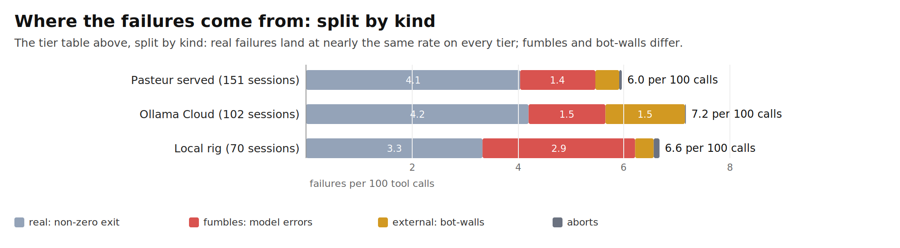

# 10: Pitfalls and debugging: who fixes what

Benchmarks rank capability and the session log ranks tempo; neither says what
happens the moment a model stumbles. This chapter asks that question with the
same five-month log: how often the models' own errors arise, whether they fix
them alone, and where the human has to step in.

The session database records every tool failure: a command that exits non-zero,
a tool call that misses its target, a fetch that gets blocked, a run that gets
interrupted. Mining the same sessions with the same task-type rules as the
task-type table in [09](09-runtimes.md) (the script is `scripts/mine_errors.py`
in this repo; the fleet, personal and chat categories are omitted here, they are
tooling and admin by nature):

| Metric | Science & manuscripts | Games & creative |
|---|---|---|
| Sessions in the log | 94 | 41 |
| Sessions with at least one failure | 82 (87%) | 27 (66%) |
| Failure events | 700 | 401 |
| - command failed (non-zero exit) | 454 | 191 |
| - agent fumble (mis-called tool) | 175 | 189 |
| - external (fetch blocked, 404, timeout) | 65 | 18 |
| - interrupted (escape) | 6 | 3 |
| Same operation retried before yielding | 91% | 94% |
| Handed back without a retry | 9% | 6% |
| Sessions needing a correction from me | 18 (19% of all) | 14 (34% of all) |

### The science half

Command failures dominate (454 of 700, retried 99.6% of the time): a one-off
analysis script crashes, the model reads the traceback, fixes the line, reruns.
None of that reached me as a decision. Agent fumbles (a stale edit target, an
out-of-range file read, a malformed command line) retried in-turn 73% of the
time; the rest ended with the model reporting what it could not do, which is the
correct behavior. External failures are mostly publisher sites bot-blocking
scripted fetches (403s). What actually reached me was rarely the crash and
almost always the quality layer: "the subscripts did not render properly and are
still full of underscores", "Figure A needs a rescaled X-axis", "there is still
overlapping text". The model cannot see the rendered PDF; verifying the output
is the human's job, and that is where 19% of science sessions needed me.

### The games half

Fewer sessions, similar failure volume, a different mix: agent fumbles dominate
(401 of 633, mostly stale edit targets in fast-changing game code) and retry
in-turn 94% of the time; command failures (191) retry 99%. But the correction
rate is nearly double (34% vs 19%), and the corrections are of a different kind:
"the camera is not centered on the player", "the menu is still broken, there are
no animations", "Sentinel is absolutely broken, no character should have an AOE
(area of effect) as their base attack". A model cannot play its own game. It
writes the code, the code runs, syntax errors are caught and fixed in-turn, and
the experience bugs surface only when a human plays. That is the games loop:
the model's ceiling is not writing code, it is verifying experience.

### By tier and by model

The same failure taxonomy, regrouped by where the model ran: every session with
at least one tool call (318 of the 324, not just the two halves above; the
script is `scripts/mine_failures_by_model.py` in this repo). Failures per 100
tool calls; "fumbles" are the model-attributable kind (mis-called tools).

| Access tier | Sessions | Tool calls | Fails /100 calls | real | fumble | external | abort | Sessions w/ failure |
|---|---|---|---|---|---|---|---|---|
| Pasteur served | 151 | 14,706 | 6.0 | 606 | 210 | 66 | 7 | 76% |
| Ollama Cloud | 102 | 11,024 | 7.2 | 463 | 160 | 165 | 1 | 83% |
| Local rig | 70 | 7,580 | 6.6 | 252 | 218 | 26 | 8 | 69% |
| Free tier | 2 | 41 | 0.0 | 0 | 0 | 0 | 0 | 0% |

The same table, drawn:

*The three main tiers as stacked bars: grey = real failures (non-zero exits,
task or environment), red = fumbles (model-attributable mis-calls), amber =
external blocks (bot-walls), dark grey = aborts. The real-failure segment is
nearly the same height on every tier; the differences live in the fumble and
external segments. Segment labels are rounded to one decimal; the free tier
(2 sessions, 41 calls, 0 failures) is in the table only.*

The headline rates separate the tiers less than expected (6.1 to 7.2 per 100).
Split by kind, the real fact appears: command failures land at nearly the same
rate everywhere (3.3 to 4.2 per 100), because a non-zero exit is driven by the
task and the environment, not by which model typed the command. What separates
the tiers is the fumble rate: the served proxy mis-calls tools least (1.4 per
100), Ollama Cloud is just behind (1.5), and the local fleet sits at 2.9. And Ollama Cloud's higher
headline is partly not the model's fault: 165 of its failures are external
fetch blocks, the bot-walls of benchmark-season web research.

| Model | Tier | Sessions | Tool calls | Fails /100 calls | Fumbles /100 calls | Sessions w/ failure |
|---|---|---|---|---|---|---|
| medium (served) | Pasteur served | 126 | 13,162 | 6.0 | 1.3 | 78% |
| sage-a1.5 | Local rig | 12 | 4,417 | 5.5 | 2.6 | 100% |
| minimax-m3 (ollama-cloud) | Ollama Cloud | 34 | 3,656 | 5.7 | 1.2 | 82% |
| minimax-m3.1-flash (ollama-cloud) | Ollama Cloud | 19 | 2,860 | 6.8 | 0.6 | 79% |
| glm-5.3-flash (ollama-cloud) | Ollama Cloud | 13 | 2,335 | 8.0 | 2.0 | 100% |
| big (served) | Pasteur served | 23 | 1,509 | 6.9 | 2.4 | 70% |
| flint | Local rig | 10 | 1,119 | 6.2 | 2.4 | 60% |
| kimi-k2.7-code (ollama-cloud) | Ollama Cloud | 7 | 803 | 7.2 | 3.4 | 100% |
| cybertiel-coder-35b | Local rig | 9 | 775 | 9.5 | 2.3 | 78% |
| glm-5.2 (ollama-cloud) | Ollama Cloud | 10 | 564 | 13.7 | 2.7 | 90% |
| glm-5.3 (ollama-cloud) | Ollama Cloud | 5 | 394 | 8.4 | 0.8 | 80% |
| ornith-1.5-35b | Local rig | 4 | 359 | 12.3 | 8.1 | 100% |
| mistral-large-4 (ollama-cloud) | Ollama Cloud | 8 | 320 | 7.8 | 1.6 | 62% |
| qwen3.8-27b | Local rig | 17 | 137 | 7.3 | 2.9 | 35% |
| Other models (under 4 sessions each) | mixed | 28 | 941 | 7.5 | 2.9 | 64% |

The per-model rates need two honesty flags before any ranking. Denominators
first: qwen3.8-27b's low session-failure share (35%) reflects its chat-era
sessions (137 tool calls across 17 sessions), not excellence, and sage-a1.5 is
the only model with a genuinely stable agentic rate (4,417 calls over 12
sessions: 5.5 per 100, the cleanest in the table). Single-session dominance
second: ornith-1.5-35b's fumbles are 21-of-29 from one projectile-radius
session. Per-model failure rates on this fleet are indicative, not ranked
measurements: one pathological session can dominate a small sample.

### What this teaches

- Mechanical errors are the models' problem, and they mostly solve them alone:
  91-95% of failures are retried in the same turn, and the ones that are not
  usually end with an honest report rather than a hallucinated success.
- Experiential errors are the human's problem, by construction: quality bugs in
  rendered output (papers, figures) and playability bugs in games surface only
  through the person looking at the result.
- The intervention gap between the halves (19% vs 34% of sessions) is the price
  of output you can only judge by experiencing it. A paper's numbers can be
  checked by a script; a game's fun cannot.

(Method: every tool failure recorded in the session database, classified with
the same task-type rules as chapter 09's task-type table; "retried" = the same
operation attempted again before the model handed back; corrections = my next
message matching failure-report wording ("still", "broken", "didn't", and
similar); the tier and model tables rate every session with at least one tool
call, attributed to the session's final model. Rule-based and approximate.)

> **Takeaway:** The models retry 9 in 10 of their own failures, and command
> failures land at nearly the same rate on every tier: what separates tiers is
> the fumble rate. The bugs that reach a human are the ones no machine can see:
> rendered figures on the science half, playability on the games half, and the
> games need nearly twice the interventions (34% vs 19% of sessions).

---

*Every abbreviation and term used here is explained in one line in the
[glossary](glossary.md).*
