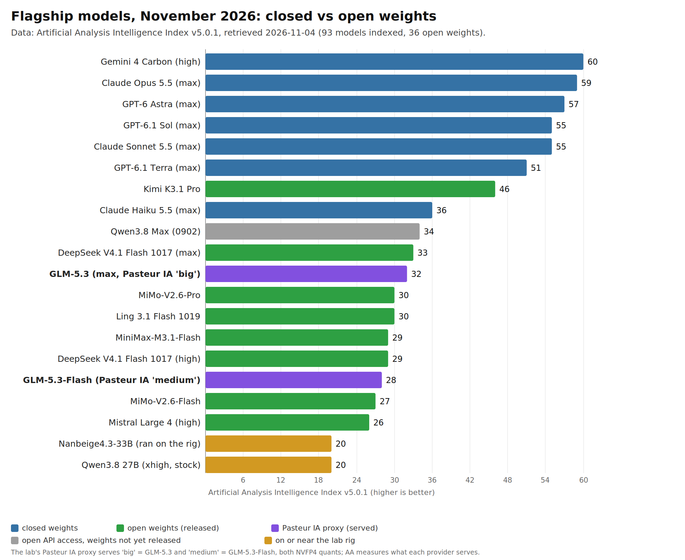
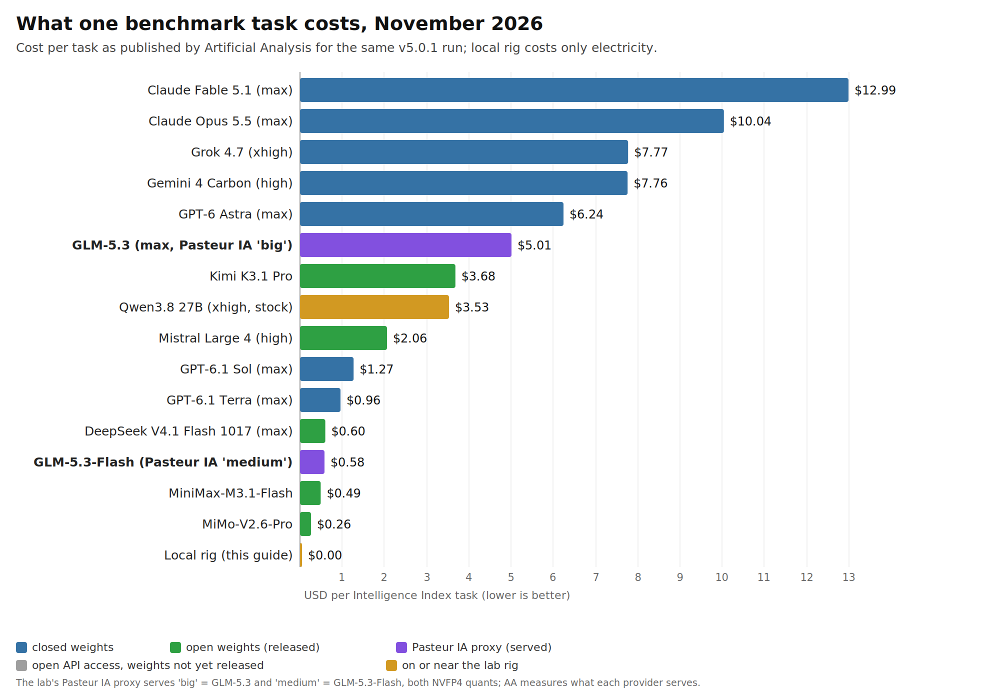

# 11: Flagship models: open versus closed (snapshot 2026-11-04)

[05](05-fleet-2026-11.md) ranks the fleet the rig can actually run. This chapter
steps outside the rig and asks the bigger question: how far is the open-weights
frontier from the closed one, and how do the flagship models compare on a
measurement that is not ours? The honest answer has two halves: the capability
gap is real (roughly 27 index points between the best closed model and the best
open-badged model on the Artificial Analysis Intelligence Index; an amendment
below, dated 2026-11-04, moves Kimi K3.1 Pro into the open column), and the
price gap is also real (the best cheap open model costs about 10 to 16 times
less per benchmark task). Whether that trade matters for your work is the
decision this chapter tries to inform, and it moves every few months, so treat
every number here as a dated snapshot.

## What the Artificial Analysis Intelligence Index is

[Artificial Analysis](https://artificialanalysis.ai) ("AA") is an independent
benchmarking shop that runs frontier and open models through a fixed battery of
evaluations and publishes a composite Intelligence Index (0-100) plus cost and
speed per task. The current index version is
[**v5.0.1**](https://artificialanalysis.ai/articles/artificial-analysis-intelligence-index-v5),
announced 2026-10-27.
It aggregates nine evaluations, most of them agentic (the model drives a
terminal or tool loop, not a single prompt):

| Evaluation | What it probes |
|---|---|
| AA-Briefcase v1.1 | professional business analysis tasks |
| AutomationBench-AA | agentic workflow automation |
| [Terminal-Bench 4.0](https://github.com/laude-institute/terminal-bench) | real terminal tasks (upgraded to 4.0 in v4.3) |
| FrontierCode 2.0 | private coding benchmark by [Cognition](https://cognition.ai), graded on whether a repository maintainer would merge the agent's change |
| AA-Omniscience v1.1 | breadth of knowledge |
| GDP.pdf | questions grounded in a long economic report |
| [HLE-Diamond](https://github.com/centerforaisafety/hle) | hard expert questions (the Diamond subset replaced plain HLE in v5) |
| CritPt v2 Hard Subset | research-level physics |
| Terminal-Bench-Science 0.1 | 70 agentic scientific research tasks run in a terminal |

The defining change in v5: about 60% of the index is now scored against
**private test sets** (questions withheld from public release, so they cannot
appear in a model's training data) or held-out answers. That is a direct
response to **contamination**: the tendency of a benchmark that is public long
enough to end up in training corpora, at which point scores measure memorized
answers rather than ability. For a lab that reads benchmark tables to pick a
model, private-heavy indices are the more trustworthy ones.

Scores are reported per **reasoning-effort tier** (models with a thinking
budget are run at their (low)/(medium)/(high)/(max) settings; higher effort
buys more thinking time and more tokens, so it costs more). AA also launched a
**Progress Index v1** alongside v5, one continuous scale meant to track
capability across model generations without the version jumps described below.

## The snapshot: closed versus open, November 2026

The chart below is generated by `scripts/make_charts.py` in this repository from the
[AA leaderboard](https://artificialanalysis.ai/leaderboards/models), retrieved
2026-11-04 (93 models indexed, 36 open weights).
`charts/aa-intelligence-index.png` shows capability;
`charts/cost-per-task.png` shows what one benchmark task cost at the same
settings.





*Both charts: AA Intelligence Index v5.0.1
([leaderboard](https://artificialanalysis.ai/leaderboards/models),
[v5 announcement](https://artificialanalysis.ai/articles/artificial-analysis-intelligence-index-v5)),
retrieved 2026-11-04. The lab's Pasteur IA proxy serves "big" = GLM-5.3 and
"medium" = GLM-5.3-Flash, both NVFP4-quantized (NVIDIA's 4-bit floating-point
format, see the glossary): AA measures what each provider serves, so the
published rows and the lab's proxy are two servings of the same models, not
identical ones.*

The same data as a table (rows the lab has direct experience with in bold):

| Model | Index | Cost per task | Weights |
|---|---|---|---|
| [Gemini 4 Carbon (high)](https://artificialanalysis.ai/leaderboards/models) | 60 | $7.76 | closed |
| [Claude Opus 5.5 (max)](https://openrouter.ai/anthropic/claude-opus-5.5) | 59 | $10.04 | closed |
| [GPT-6 Astra (max)](https://openrouter.ai/openai/gpt-6-astra) | 57 | $6.24 | closed |
| [GPT-6.1 Sol (max)](https://openrouter.ai/openai/gpt-6.1-sol) | 55 | $1.27 | closed |
| [Claude Sonnet 5.5 (max)](https://openrouter.ai/anthropic/claude-sonnet-5.5) | 55 | $10.02 | closed |
| [GPT-6.1 Terra (max)](https://openrouter.ai/openai/gpt-6.1-terra) | 51 | $0.96 | closed |
| [Kimi K3.1 Pro](https://huggingface.co/moonshotai/Kimi-K3.1-Pro) | 46 | $3.68 | **open** (weights released 2026-11-02, after the snapshot; AA still badged it API-only) |
| [Claude Haiku 5.5 (max)](https://openrouter.ai/anthropic/claude-haiku-5.5) | 36 | $0.41 | closed |
| [Qwen3.8 Max (0902)](https://openrouter.ai/qwen/qwen3.8-max-0902) | 34 | $10.02 | API only, weights not released |
| **[DeepSeek V4.1 Flash 1017 (max)](https://huggingface.co/deepseek-ai/DeepSeek-V4.1-Flash-1017)** | 33 | $0.60 | **open** |
| **[GLM-5.3 (max)](https://huggingface.co/zai-org/GLM-5.3)** (served by Pasteur IA as "big") | 32 | $5.01 | **open** |
| [MiMo-V2.6-Pro](https://huggingface.co/XiaomiMiMo/MiMo-V2.6-Pro-RL) | 30 | $0.26 | open |
| [MiniMax-M3.1-Flash](https://huggingface.co/MiniMaxAI/MiniMax-M3.1-Flash) | 29 | $0.49 | open |
| [DeepSeek V4.1 Flash 1017 (high)](https://huggingface.co/deepseek-ai/DeepSeek-V4.1-Flash-1017) | 29 | $0.46 | open |
| **[GLM-5.3-Flash](https://huggingface.co/zai-org/GLM-5.3-Flash)** (served by Pasteur IA as "medium") | 28 | $0.58 | **open** |
| [MiMo-V2.6-Flash](https://huggingface.co/XiaomiMiMo/MiMo-V2.6-Flash-RL) | 27 | $0.13 | open |
| [Mistral Large 4 (high)](https://huggingface.co/mistralai/Mistral-Large-4-1T-A52B) | 26 | $2.06 | open |
| [Nanbeige4.3-33B](https://huggingface.co/Nanbeige/Nanbeige4.3-33B) (ran on the rig until 10-29) | 20 | n/a | open |
| [Qwen3.8 27B](https://huggingface.co/Qwen/Qwen3.8-27B) (xhigh, stock) | 20 | $3.53 | open |

Readings that matter for the lab:

- **The frontier is closed, and it is 25+ points ahead.** The best open-badged
  model on the snapshot (DeepSeek V4.1 Flash 1017 at 33) scores about half of
  the top closed model (60); no open-badged model touched 40 in the snapshot. Dated
  amendment: Kimi K3.1 Pro's weights landed on
  [HuggingFace](https://huggingface.co/moonshotai/Kimi-K3.1-Pro) on 2026-11-02,
  two days before this data was pulled, while AA's FAQ still badged it
  API-only; counting it, the open frontier is 46 and the gap narrows to 14
  points. Those weights ship as 96 safetensors shards, far beyond anything in
  [12](12-hardware-and-costs.md) ([01](01-huggingface.md) draws the scale), so
  for this lab the practical frontier remains the mid-30s models.
- **But the price asymmetry dwarfs the score asymmetry.** DeepSeek's 33 comes
  at $0.60 per task; Claude Opus 5.5's 59 at $10.04; Gemini 4 Carbon high, $7.76.
  The 27-point capability gap costs roughly 10 to 16 times the price, and for
  many lab tasks (rewriting, summarizing, code translation, first-pass
  analysis) the last 20 points are worth nothing anyway.
- **The models the rig actually runs are not on the index.** The lab's Tier A
  fleet are community finetunes and mixed requants (Sage A1.5, Ornith-1.5-35B,
  Tiel-Coder-35B, Flint: see [05](05-fleet-2026-11.md)); AA does not evaluate
  those. Of models the lab has run, only the stock bases are indexed:
  Qwen3.8 27B (20), Nanbeige4.3-33B (20, since shuttered), and the two models
  the Pasteur IA proxy serves: "big" = GLM-5.3 (32) and "medium" =
  GLM-5.3-Flash (28), both NVFP4-quantized (see the glossary). So the honest
  statement is: the local fleet sits in the mid-20s on AA's axis at near-zero
  marginal cost, the served proxy buys a slice of the low-30s tier at lab
  scale, and the cloud tier (Ollama Cloud, see [05](05-fleet-2026-11.md)) buys
  the frontier when a task needs it.
- **Cost per task is a benchmark metric, not a bill.** It reflects the tokens
  AA spent running the task battery, which is not your workload. For real
  volume math, see [12](12-hardware-and-costs.md), which prices the lab's own
  session logs against these API rates.

## The index keeps changing underneath you

This is the section to read before quoting any AA number twice. The index has
been revised repeatedly, and each revision breaks comparability with earlier
ones:

| Version | When | What changed |
|---|---|---|
| v4 | Jan 2026 | the last full rebuild before v5 |
| v4.2 | Sept 2026 | GPQA Diamond dropped from the index; private-test weighting raised to about 40% |
| v4.3 | Sept/Oct 2026 | Terminal-Bench upgraded to 4.0; AutomationBench-AA added |
| v5 | 2026-10-27 | FrontierCode 2.0 and Terminal-Bench-Science added; HLE replaced by HLE-Diamond; AA-Briefcase and AA-Omniscience bumped to v1.1; private share raised to about 60% |

Two consequences for lab practice:

1. **Do not compare scores across index versions.** A "34" from a v4-era page
   and a "33" from v5 are not the same unit. When this guide's benchmark tables
   (05) were assembled, GPQA-D numbers came from v4-era AA pages; GPQA-D has
   since left the index (it remains a fine standalone benchmark, which is why
   the lab still runs it internally, but it no longer feeds AA's composite).
2. **Anchor on the version when you cite.** Write "Intelligence Index v5.0.1,
   retrieved 2026-11-04", not just "AA says 33". The version is the only thing
   that makes the number reproducible a month later.

The replacement of public benchmarks with private ones will continue, because
contamination gets worse as benchmarks age. Expect the composition table above
to be out of date before the fleet table in 05 is.

## Caveats, in order of how often they bite

- **Provider-run scores.** AA runs models through each provider's API, which
  means the numbers measure the served product (quantization, sampler settings,
  server config included), not the weights. This is the same honesty rule as in
  05. The lab has measured served-model numbers (09) that differ from
  published ones by more than the gap between model generations.
- **Reasoning-effort tiers.** "(max)" rows are the most expensive and score
  highest; the same model's low tier can trail its max tier by a couple of
  points or by nearly 30 (Claude Sonnet 5.5: 55 at max, 26 at low) at a
  fraction of the cost. When a vendor advertises a score, ask which tier it is.
- **Agentic benchmarks reward agent scaffolding**, not just the model. Scores
  embed the harness AA uses (terminal, tool loop, retry policy). Two models can
  swap ranks in a different harness.
- **Contamination.** Public benchmarks decay in informativeness as they age.
  The index's move to 60% private content is the fix AA chose; older
  public-only numbers are the least trustworthy.
- **Open-weight badges only go so far.** AA's own
  [v5 statement](https://artificialanalysis.ai/articles/artificial-analysis-intelligence-index-v5)
  names the top three open models (DeepSeek, GLM-5.3, MiMo-V2.6-Pro); for rows
  further down,
  the "open" label reflects each lab's release practice at snapshot time.
  Check the live page's badge before citing any specific row.
- **The gap is measured, the usefulness is not.** A 27-point index gap says
  nothing about whether your specific task (a BEAST XML, a methods paragraph, a
  plotting script) needs the closed tier. The lab's own runs (06, 09) are the
  evidence that mid-20s local models carry most day-to-day research work.

## Keeping this chapter current

The snapshot is regenerated from one script and one fetch:

```
python3 scripts/make_charts.py  # rewrites charts/*.svg + *.png from the tables in the script
```

The AA leaderboard itself is fetched live from
[artificialanalysis.ai/leaderboards/models](https://artificialanalysis.ai/leaderboards/models)
(no API key needed for the public page). Update the two data lists at the top of `scripts/make_charts.py` from the
current page, rerun, and commit the script plus both chart formats (the SVGs
are the crisp originals; the PNGs exist because pandoc embeds PNG but silently
drops SVG when `rsvg-convert` is not installed). This keeps the
chart reproducible like `scripts/mine_runtimes.py` in 09.

> **Takeaway:** Both gaps are real: about 27 index points of capability and
> 10-16× in task-level price. The gap is closing (Kimi K3.1 Pro's weights are
> public); buy the frontier only when the task needs it.

---

*Every abbreviation and term used here is explained in one line in the
[glossary](glossary.md).*
