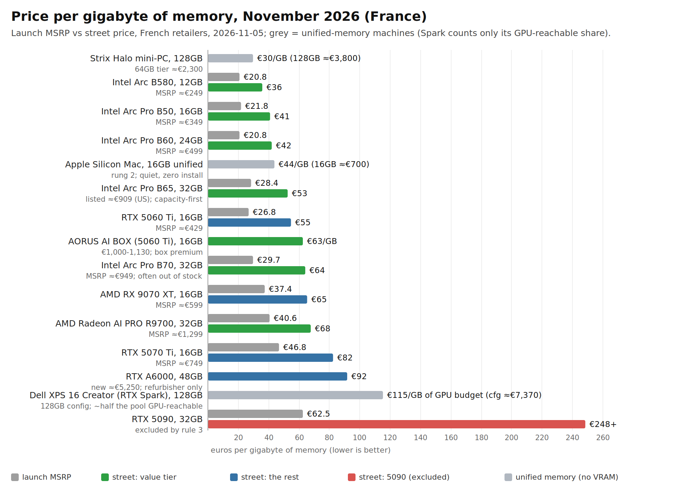
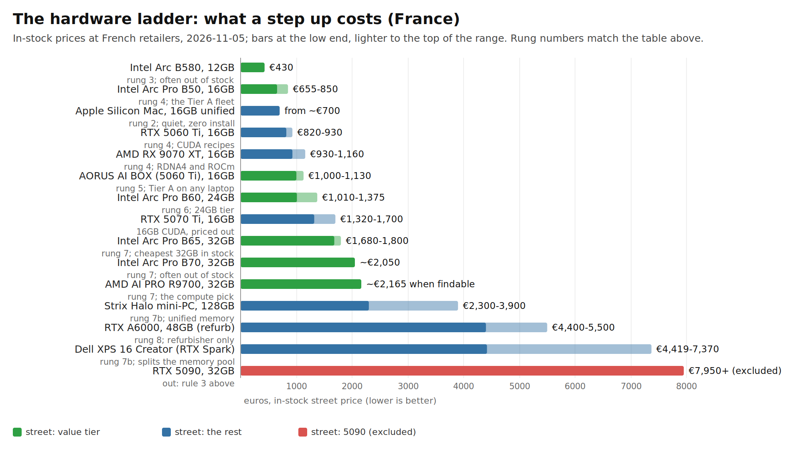

# 12: Hardware and costs: what to buy, what to hand over, what it saves

[02](02-hardware-fit.md) teaches the fit arithmetic; this chapter covers the
money and the logistics. Three questions come up whenever someone joins the lab
or someone leaves it: what should I buy, what do I do with the machine my
predecessor left behind, and does any of this actually save money against a
subscription? All hardware prices below are euro street prices checked at
French retailers (the lab sits in Paris; LDLC, Materiel.net, TopAchat, Rue du
Commerce and Amazon.fr are the reference shops) and on the
[idealo.fr](https://www.idealo.fr/cat/16073/cartes-graphiques.html) price
comparison, checked 2026-11-05. Launch prices (the manufacturer's suggested
retail price, MSRP) are carried over from the dollar launch figures at roughly
1:1, because EU list prices typically land within about 10% of the dollar
number. Cloud
pricing keeps its dollar quotes (per-token APIs and subscriptions are
dollar-set; see the tables further down). Three market rules shape every
recommendation in this chapter:

1. **In-stock prices from official retailers only** (in practice: LDLC,
   Materiel.net, TopAchat, Rue du Commerce, Amazon.fr, or the brand's own
   store). Marketplace listings and scalper re-pricing are not prices; they are
   noise.
2. **Used cards only from large-scale datacentre decommissioning and
   refurbishment businesses** that sell tested, warrantied stock. Private and
   marketplace second-hand listings are out, no matter how good the price.
3. **The NVIDIA xx90 gaming cards (RTX 4090, RTX 5090) are excluded.** Both
   sell for several times their launch MSRPs ($1,599 and $1,999 at launch);
   French in-stock listings run from about €6,760 (RTX 4090) and €7,950 (RTX
   5090) upward on idealo.fr, and the memory shortage repriced them out of any
   sane lab budget.

The whole market is inflated: the [RTX 5060 Ti 16GB](https://www.nvidia.com/en-us/geforce/graphics-cards/50-series/rtx-5060-family/) launched at $429 in 2025 and
sells at €820-930 on [idealo.fr](https://www.idealo.fr/cat/16073F106698661/cartes-graphiques.html) as of this writing; the [RTX 5070 Ti](https://www.nvidia.com/en-us/geforce/graphics-cards/50-series/rtx-5070-family/) ($749 launch)
sells at €1,320-1,700 on [idealo.fr](https://www.idealo.fr/cat/16073F106580114/cartes-graphiques.html). The cards that kept anything close to sane pricing are Intel's
[Battlemage workstation line](https://www.intel.com/content/www/us/en/products/details/discrete-gpus/arc/workstations/b-series.html) and AMD's [RDNA4 workstation card](https://www.amd.com/en/products/graphics/workstations/radeon-ai-pro/ai-9000-series/amd-radeon-ai-pro-r9700.html), which is why they
lead every rung below.

The inflation, drawn as price per gigabyte:

*Launch MSRP against in-stock street price per gigabyte of memory at French
retailers (2026-11-05). Green: the value tier this chapter recommends (the
Battlemage Pro cards and the R9700). Red: the excluded xx90 tier. Grey: the
unified-memory machines, which have no VRAM at all; their bars divide the
whole memory pool (the Mac, Strix Halo) or only the GPU-reachable share (the
RTX Spark, whose Windows driver reserves about half of it). Grey rows carry
no MSRP bar: each machine sells at one list price. MSRPs are the dollar
launch figures carried over 1:1 as euro approximations. Range bars are drawn
at their low end (the euro ranges are in the ladder chart below); the
5060 Ti and 9070 XT bars sit at the middle of theirs, and the unified-memory
bars use the 128GB configuration.*

## The hardware ladder, in detail

In-stock prices at French retailers, checked 2026-11-05 (verify the day you
buy; the market has moved every month since mid-2025):

| Rung | Hardware (new, in stock) | In-stock price | What it runs |
|---|---|---|---|
| 0 | Any CPU laptop, 16GB RAM | already owned | 9B-class Q4/Q5 (~6.5GB), ~5-12 tok/s (est.) |
| 1 | Any CPU laptop, 32GB RAM | already owned | 35B-A3B MoE MiniPlus (~15GB) at CPU speed, ~15-25 tok/s (est.) |
| 2 | [Apple Silicon Mac](https://www.apple.com/mac/), 16-48GB unified memory | 16GB configs from ~€700, 32GB from ~€1,100 (verify) | same, all layers on GPU (llama.cpp's [Metal](https://developer.apple.com/metal/) backend); quiet, zero install |
| 3 | [Intel Arc B580](https://www.intel.com/content/www/us/en/products/sku/241598/intel-arc-b580-graphics/specifications.html), 12GB | ~€430 (idealo; often out of stock; MSRP ≈€249) | 9B-class fast; 190W |
| 4 | 16GB: [Intel Arc Pro B50](https://www.intel.com/content/www/us/en/products/sku/242615/intel-arc-pro-b50-graphics/specifications.html) (70W SFF), [RTX 5060 Ti 16GB](https://www.nvidia.com/en-us/geforce/graphics-cards/50-series/rtx-5060-family/), [AMD RX 9070 XT](https://www.amd.com/en/products/graphics/desktops/radeon/9000-series/amd-radeon-rx-9070xt.html) | B50 €655-850; 5060 Ti €820-930; 9070 XT €930-1,160 | the whole Tier A fleet, full offload + MTP |
| 5 | eGPU box: [AORUS RTX 5060 Ti AI BOX](https://www.gigabyte.com/us/Graphics-Card/GV-N506TIXEB-16GD) (Thunderbolt 5 / USB4) | €1,000-1,130 ([Darty/Fnac from €1,000](https://ledenicheur.fr/product.php?p=16030087), [LDLC €1,129.95](https://www.ldlc.com/fiche/PB00723305.html)) | Tier A on any TB5/USB4 laptop, moves between hosts |
| 6 | 24GB: [Intel Arc Pro B60](https://www.intel.com/content/www/us/en/products/details/discrete-gpus/arc/workstations/b-series.html) | €829-1,046 (idealo.de lists German offers from ~€680, checked 2026-11-06; MSRP ≈€499) | 24GB-class models, longer context; four cards = 96GB |
| 7 | 32GB: [Intel Arc Pro B65](https://www.asrock.com/Graphics-Card/Intel/Intel%20Arc%20Pro%20B65%20Creator%2032GB/index.asp) (capacity-first), [Intel Arc Pro B70](https://www.intel.com/content/www/us/en/products/details/discrete-gpus/arc/workstations/b-series.html), [AMD Radeon AI PRO R9700](https://www.amd.com/en/products/graphics/workstations/radeon-ai-pro/ai-9000-series/amd-radeon-ai-pro-r9700.html) | B65 €1,680-1,800; B70 ~€2,050 (frequently out of stock); R9700 ~€2,165 when findable | 70B-class single-card tier; the B65 is the cheapest 32GB in stock, the B70/R9700 the compute picks |
| 7b | Unified memory, no VRAM: [Ryzen AI Max "Strix Halo" mini-PC](https://www.amd.com/en/products/processors/desktops/ryzen/ryzen-ai-halo.html) 128GB, or [RTX Spark (N1X) laptop/mini-PC](https://www.dell.com/en-us/blog/dell-xps-16-creator-edition-where-nvidia-rtx-spark-meets-premium-design) | Strix Halo 128GB ≈€2,300-3,900; [XPS 16 Creator €4,419-7,370](https://www.notebookcheck.com/Neues-Dell-XPS-16-mit-128GB-RAM-und-hellem-OLED-Display-startet-in-Deutschland.1431600.0.html) | Tier A at large context on one memory pool; trade-offs in the unified-memory section below |
| 8 | 48GB: [RTX A6000](https://www.nvidia.com/en-us/design-visualization/rtx-a6000/) from a datacentre refurbisher | €4,400-5,500 refurbished (new ≈€5,250) | 70B at high quant, 40-series A3B with big context; the only sane path to 48GB |
| 9 | The lab rig: 12GB internal laptop GPU + 16GB USB4 eGPU = 28GB | built from rung 5 plus the laptop's own GPU | everything in this guide, 229-262k context, DFlash2, 60-140 tok/s measured (see 08) |
| out | NVIDIA xx90 (RTX 4090 / [RTX 5090](https://www.nvidia.com/en-us/geforce/graphics-cards/50-series/rtx-5090/)) | 4090 ≈€6,760+, 5090 ≈€7,950+ in stock | excluded by rule 3, above |
| out | marketplace used anything | varies | excluded by rule 2, above |

The same ladder, drawn:

*In-stock street prices at French retailers, 2026-11-05, sorted by price:
bars at the low end, the lighter segment runs to the top of the range. Green
is the value tier this chapter recommends (the Battlemage cards, the R9700,
and the AI BOX); blue is everything else; red is the excluded xx90 tier. Rung
numbers match the table above. Rungs 0-1 (CPU laptops you already own) have no
purchase price, and marketplace used hardware (rule 2) has no fixed one
either.*

Details that matter when choosing between rungs:

- **The Battlemage Pro cards are the value tier, with a software footnote.**
  Intel's Arc Pro B50 (16GB, 70W, fits a small chassis), B60 (24GB), B65 and
  B70 (32GB) undercut every NVIDIA card at the same VRAM by 2-3x. llama.cpp runs
  them through its [Vulkan](https://github.com/ggml-org/llama.cpp/blob/master/docs/build.md) and SYCL backends; use Vulkan as the default (the
  SYCL backend has had a hard-abort bug on Battlemage and slower decode in
  places), and expect prefill-heavy workloads to run the recipes from
  [03](03-llamacpp-server.md) with the CUDA-specific flags dropped. Four B60s
  (96GB) is a measured, working serving config.
- **The B65 is the capacity pick at 32GB.** It carries the same 32GB as the B70
  on a 256-bit bus (~608GB/s) with roughly 20
  of the B70's 32 Xe2 cores ([ASRock specs](https://www.asrock.com/Graphics-Card/Intel/Intel%20Arc%20Pro%20B65%20Creator%2032GB/index.asp), [Igor's Lab on the positioning](https://www.igorslab.de/en/intel-arc-pro-b65-is-launching-on-the-market-and-intel-is-deliberately-positioning-the-workstation-graphics-card-closer-to-the-gaming-segment/)).
  That is a capacity rung, not a speed rung: decode stays fine for the A3B MoE
  fleet (only ~3B parameters are active per token, so decode is
  bandwidth-light), while prefill and compute-heavy work lean on the missing
  cores. In France it is €1,680-1,800 (LDLC €1,799.95, idealo from €1,680).
  If prefill speed matters more than capacity, stay on the B70 or R9700.
- **The R9700 is the other value pick, when you can find it.** AMD's 32GB
  RDNA4 workstation card launched at MSRP ≈€1,299; French in-stock listings
  have ranged €1,900-5,800 since, with [LDLC](https://www.ldlc.com) carrying the
  ASRock Creator at €2,199.95 and idealo listing from €2,165 on 2026-11-05. At
  the low end it is competitive on price-per-GB (the B65 is cheaper per GB; the
  R9700 buys the 900GB/s bandwidth); at the high end it is
  scalping. llama.cpp runs
  RDNA4 through Vulkan, and [ROCm 7.2](https://github.com/ROCm/ROCm/releases) (AMD's compute stack, the AMD equivalent of CUDA) added official
  RDNA4 support for the heavier paths.
- **The 16GB rung is a three-way choice now.** The Arc Pro B50 (€655-850) is
  the cheapest 16GB card in stock and sips power; the RTX 5060 Ti 16GB
  (€820-930) buys the CUDA ecosystem this guide's recipes assume; the RX
  9070 XT (€930-1,160) buys RDNA4 with official ROCm. All three run the Tier A
  fleet.
- **eGPU boxes (rung 5) are the laptop-friendly path.** The AORUS RTX 5060 Ti
  AI BOX is the reference unit: Thunderbolt 5 and USB4, €1,000-1,130 in France
  (Darty and Fnac from €1,000, LDLC €1,129.95). Two caveats from the rig's own
  history: bandwidth is real but manageable (with `-sm layer`, only activations
  cross the cable: see [08](08-optimisations.md)), and if the eGPU also drives a
  display, decode slows measurably; keep the display on the internal GPU.
- **24GB changed hands.** The Arc Pro B60 at €829-1,046 new (idealo.de lists
  German offers from ~€680, checked 2026-11-06) is now
  the sane entry
  at this tier: the used-3090 alternative (~€1,100 equivalent on marketplaces)
  violates the sourcing rule and only wins on memory bandwidth (~2x), which
  matters mostly for dense 24GB models. For the lab's A3B MoE fleet, either
  fits; the B60 also does SR-IOV (one card partitioned across containers) if
  that ever matters.
- **The 48GB rung is refurb-only, and its price is climbing.** New RTX
  A6000-class cards run ≈€5,250 in France (idealo lists the PNY from €5,243,
  [SMicro](https://smicro.eu/pny-rtx-a6000-ampere-pcie-4-0-x16-48-gb-vcnrtxa6000-pb-1) at
  €5,554); datacentre refurbishers sell the same 48GB card at €4,400-5,500
  tested and warrantied (the [GPUDojo refurb price tracker](https://gpudojo.com/de/a6000) watched eBay refurb listings
  climb from ~€3,900 in July to ~€5,500 in October 2026). That is the tier
  where the sourcing rule earns its keep.
- **Do not buy a GPU below 12GB new, and expect the B580 to stay scarce.**
  Intel is reported to be considering discontinuing the consumer B-series in
  favour of the higher-margin Pro cards; treat B580 stock as opportunistic.
  The reference-card Limited Edition currently lists at €1,259 on idealo (one
  scalper offer); the ASRock cards sit at ~€430 when stock appears.
- **Apple Silicon is the honest rung 2.** Unified memory (one pool shared by
  CPU and GPU) means a 32GB Mac can hold a full Tier A model with no split
  math at all. It will not match CUDA tooling for exotic flags, but for
  serving and agents it needs nothing from this guide except the model file.

## The unified-memory option: Strix Halo and RTX Spark

Two hardware classes change the "how many GB do I have" arithmetic because
they have no VRAM at all: the CPU and GPU share one pool of soldered RAM
(unified memory, the same trick as the Apple Silicon rung above). The trade is
capacity for bandwidth, and both fit this lab's fleet better than their prices
suggest:

- **AMD Ryzen AI Max, codename Strix Halo** (mini-PCs and laptops): one APU
  (CPU and GPU on one chip) with 32-128GB of LPDDR5X. The line grew at CES
  2026: beyond the 395 flagship there are now 388 and 392 SKUs with fewer CPU
  cores ([ServeTheHome's CES roundup](https://www.servethehome.com/amd-reveals-new-ryzen-ai-400-series-ryzen-ai-max-and-ryzen-7-9850x3d-chips-at-ces-2026/)); for LLM duty the 395 remains the pick (40 GPU
  compute units), and [AMD's own 128GB Halo Box](https://www.amd.com/en/products/processors/desktops/ryzen/ryzen-ai-halo.html) anchors the desktop tier. French
  street prices: the 128GB [GMKtec EVO-X2](https://www.amazon.fr/dp/B0F6X332N6) runs €3,799.96 on Amazon.fr (LDLC
  carried it at €5,559.95, currently sold out), the 64GB tier from ~€2,300, and
  Minisforum's [MS-S1 Max 128GB](https://minisforumpc.eu/products/minisforum-ms-s1-max-mini-pc) lists at €5,399 in the EU store. Memory bandwidth is ~256GB/s (LPDDR5X-8000),
about half the RTX 5060 Ti's ~448GB/s and far below the 900GB/s-class
workstation cards, so decode on the Tier A fleet is slower than on the cards
above; budget this as a capacity tier, not a speed tier. What it buys: 128GB fits models no single card in
this chapter can hold, with CUDA-free llama.cpp (Vulkan/ROCm) recipes.
- **NVIDIA RTX Spark machines (the N1X chip)**, in laptops and mini PCs: Dell's
  XPS 16 Creator Edition is the first, a 16-inch laptop with up to 128GB of
  unified LPDDR5X, a
  Blackwell RTX GPU (up to 6,144 cores) and the full CUDA stack in a 2kg body
  ([Dell's own announcement](https://www.dell.com/en-us/blog/dell-xps-16-creator-edition-where-nvidia-rtx-spark-meets-premium-design)). European pricing started in October 2026: €4,419 for the
  base (18-core, 32GB), €5,228 for the 20-core tier, €7,370 for the 128GB
  configuration ([Notebookcheck's launch report](https://www.notebookcheck.com/Neues-Dell-XPS-16-mit-128GB-RAM-und-hellem-OLED-Display-startet-in-Deutschland.1431600.0.html), confirmed on Dell's EU stores). Two
  caveats that matter before buying: Windows splits the unified pool, and
  StorageReview measured only 30.5GB of the 64GB unit actually reachable by
  the GPU ([their review](https://www.storagereview.com/review/dell-xps-16-creator-edition-review-rtx-spark-n1x)),
  so treat a "128GB" Spark system as ~64GB of GPU budget; and the N1X has the
  same memory-wall class as Strix Halo (~300GB/s at LPDDR5X-9400, versus
  448-900GB/s on the discrete cards above). The upside over Strix Halo is
  native CUDA: the recipes in this guide run unmodified.

As a value line: €3,800 for a 128GB Strix Halo box is ~€30/GB of model-fit
memory, versus ~€68/GB (R9700) and ~€92/GB (refurb A6000) of VRAM above. You
pay for that with bandwidth (slower decode) and soldered, non-upgradeable RAM.
For a lab that mostly serves Tier A models and wants one box per office, it is
a genuine new rung; for prefill-heavy benchmarking, the discrete cards win.

## The plug-and-play single-GPU-per-host pass-down

The recurring lab situation: a PhD student or postdoc leaves, their (often
good) machine passes to the next person, and for months nobody serves anything
on it because "setting it up" is a project. The fix is to
make the serving setup boring and identical on every host: **one GPU, one
recipe per tier, one port**.

The standard:

1. **One llama.cpp build** (`llama-server.exe`) in `C:\Users\<user>\Llama\`,
   replaced wholesale when the lab pins a new build. No per-host forks.
2. **One launcher per tier**, a `.bat` copied from the fleet folder
   (`qwen38-9b.bat` for Tier B, `sage-a15_dualGPU.bat`-style for Tier A), with
   only env parameters differing (`PORT`, `CTX`, `NP`): see the recipes in
   [03](03-llamacpp-server.md).
3. **One model store**: a single directory tree, one subdirectory per model,
   holding the GGUF files (and the mmproj file if the model has vision); each
   launcher points at it in one place.
4. **One OpenCode provider entry** pointing at `http://127.0.0.1:<port>/v1`,
   named after the tier, not the person.
5. **One port per tier** across the lab (e.g. 9932 for the 9B tier, 9941-9946
   for the Tier A models): anyone's notes apply to anyone's host.

The handover checklist, which is the entire cost of adopting a passed-down
machine:

- [ ] copy `llama-server.exe` + the tier launcher + the model directory
- [ ] set `PORT` in the launcher to the lab-standard port for that tier
- [ ] boot test: run the launcher, confirm the log line for model load and MCP
      warmup, send one prompt
- [ ] add the provider entry in `opencode.jsonc` and confirm in
      `opencode models`
- [ ] append one line to the fleet doc (05): host, tier, date

That is under an hour, it needs no new knowledge, and it converts an idle
left-behind machine into Tier B or Tier A capacity. It also means upgrades
propagate by editing one launcher file, not by re-teaching everyone.

Why **single GPU per host** rather than everyone building a dual-GPU rig: the
dual rig earns its keep only for long-context sessions and the biggest local
models; a single 16GB card (or a 24GB B60, or a 32GB B70/R9700) covers the
daily work of one researcher. Heterogeneity is fine: Tier B on a CPU laptop,
Tier A on a 16GB card, and the served proxy for everyone else. The dual rig is
the lead tester's bench for finding the recipes, not the lab standard. The same
standard extends to non-NVIDIA hosts: a Battlemage or RDNA4 host runs the
Vulkan build of llama-server with the same model files, the launcher set gains
one CUDA-free variant per tier, and the OpenCode provider entry does not change
at all (llama-server speaks the same HTTP API whatever the GPU).

## What local actually costs

The rig's running cost is electricity. Under full load the dual-GPU rig draws
roughly 450-550W; at the French domestic tariff (~0.20-0.25 €/kWh, kWh =
kilowatt-hour, the unit on your electricity bill) a heavy
day of sessions is well under a euro, and a typical month of research use is a
few euros (est.). The hardware cost is sunk (the laptop exists, the eGPU box
would otherwise be sold) and amortizes to zero per token.

The honest comparison is therefore not "local vs free" but "the marginal cost
of the next million tokens":

| Channel | Marginal cost per Mtok (million tokens, the pricing unit) | Rate limits | Data leaves the machine? |
|---|---|---|---|
| Local rig | electricity only (est. < €0.01) | none | no |
| Pasteur IA proxy (served GLM 5.3 Flash) | prepaid by the institution | fair-use | to the institute's endpoint only |
| [OpenRouter](https://openrouter.ai) (any model, metered) | vendor price, see table | provider quotas | to the vendor |
| [Ollama Cloud](https://ollama.com/pricing) pay-as-you-go | per token, model-dependent | 3 concurrent | to Ollama |
| Chat subscription ([ChatGPT Plus](https://openai.com/chatgpt/pricing), [Claude Pro](https://www.anthropic.com/pricing), [Gemini Pro](https://one.google.com/about/google-ai-plans/)) | flat ~$20/mo, chat quotas | yes, tight | to the vendor |
| [Mistral Le Chat (Vibe) Pro](https://mistral.ai/pricing) | flat $14.99/mo | yes | to Mistral |

### Per-token API prices, November 2026 (OpenRouter, USD per million tokens)

| Model | Input | Output | Weights |
|---|---|---|---|
| [GPT-6 Astra (max)](https://openrouter.ai/openai/gpt-6-astra) | $10.00 | $50.00 | closed |
| [Claude Fable 5.1](https://openrouter.ai/anthropic/claude-fable-5.1) | $10.00 | $50.00 | closed |
| [Claude Opus 5.5](https://openrouter.ai/anthropic/claude-opus-5.5) | $4.00 | $20.00 | closed |
| [Claude Sonnet 5.5](https://openrouter.ai/anthropic/claude-sonnet-5.5) | $2.00 | $10.00 | closed |
| [Gemini 4 Argon](https://openrouter.ai/google/gemini-4-argon) | $2.00 | $10.00 | closed |
| [Gemini 3.8 Flash](https://openrouter.ai/google/gemini-3.8-flash) | $0.83 | $4.12 | closed |
| [Kimi K3.1 Pro](https://openrouter.ai/moonshotai/kimi-k3.1-pro) | $2.00 | $10.00 | open (weights 2026-11-02) |
| [Qwen3.8 Max (0902)](https://openrouter.ai/qwen/qwen3.8-max-0902) | $2.00 | $6.00 | API only |
| [Mistral Large 4](https://openrouter.ai/mistralai/mistral-large-4-0) | $0.70 | $2.10 | [open](https://huggingface.co/mistralai/Mistral-Large-4-1T-A52B) |
| [MiMo-V2.6-Pro](https://openrouter.ai/xiaomi/mimo-v2.6-pro) | $0.43 | $0.87 | [open](https://huggingface.co/XiaomiMiMo/MiMo-V2.6-Pro-RL) |
| [DeepSeek V4.1 Flash 1017](https://openrouter.ai/deepseek/deepseek-v4.1-flash-1017) | $0.15 | $0.60 | [open](https://huggingface.co/deepseek-ai/DeepSeek-V4.1-Flash-1017) |
| [GLM-5.3](https://openrouter.ai/z-ai/glm-5.3) | $0.07 | $1.40 | [open](https://huggingface.co/zai-org/GLM-5.3) |
| [GLM-5.3-Flash](https://openrouter.ai/z-ai/glm-5.3-flash) | $0.15 | $0.50 | [open](https://huggingface.co/zai-org/GLM-5.3-Flash) |
| [MiniMax-M3.1-Flash](https://openrouter.ai/minimax/minimax-m3.1-flash) | $0.07 | $0.30 | [open](https://huggingface.co/MiniMaxAI/MiniMax-M3.1-Flash) |

(OpenRouter also resells the open models' official endpoints at the same
rates; it adds a payment-processing fee on credit purchases rather than a
subscription, and is the simplest way to run one-off benchmarks of models the
rig cannot fit. Prices drift; verify before budgeting.)

### What the lab's own volume would have cost

Five months of the lead tester's logged work sessions (June to November 2026,
the same corpus as [09](09-runtimes.md) as of 2026-11-08; tokens as recorded,
including the huge repeated-input share an agentic session generates, agentic =
the model driving tools itself):

| Volume | Input | Output |
|---|---|---|
| Served proxy ("medium" = GLM 5.3 Flash) | 1,388M | 13.7M |
| Ollama Cloud (big open models) | 947M | 4.2M |
| Local rig | 17M | 2.1M |

Priced at the per-token table above, what that usage would have cost on other
channels:

| Reroute the same usage through | Volume basis | Approx. cost |
|---|---|---|
| GPT-6 Astra | proxy | ~$14,564 |
| Claude Fable 5.1 | proxy | ~$14,564 |
| Claude Opus 5.5 | proxy | ~$5,825 |
| Claude Sonnet 5.5 | proxy | ~$2,913 |
| Gemini 3.8 Flash | proxy | ~$1,208 |
| GLM-5.3 Flash (OpenRouter) | proxy | ~$215 |
| Ollama Cloud at Mistral Large 4 rates | cloud | ~$671 |

Caveats that keep this honest:

- **Prompt caching would cut the input side** by a large factor on vendors
  that discount repeated context (Anthropic, OpenAI and Google all do, at
  50-90% off cached input). The sticker numbers above assume no caching;
  think of them as ceilings.
- **Subscriptions do not meter this way.** A $20 chat subscription buys
  interactive quotas, not agent-scale volumes; running the table above through
  a chat plan would exhaust any fair-use tier in days. Subscriptions and
  metered APIs are different products (see below).
- **The served proxy and Ollama Cloud costs are prepaid or institution-level**
  and not visible to the lead tester; the reroute rows are the only apples-to-
  apples comparison available.
- **The local share is small by volume, and that is the point**: the rig's 17M
  input tokens are a rounding error next to the proxy's 1,388M, but they were
  free and private, and the local sessions were the longest and most agentic
  (marathons like the 8h49m BEAST2 debugging run in 09).

### Subscriptions: what $20 actually buys

- **[ChatGPT Plus](https://openai.com/chatgpt/pricing) ($20/mo), [Claude Pro](https://www.anthropic.com/pricing) ($20/mo), [Gemini AI Pro](https://one.google.com/about/google-ai-plans/) (~$20/mo)**:
  interactive chat with frontier models, daily/weekly quotas, generous
  reasoning tiers. Excellent for thinking and drafting; not designed for
  agent-scale metered workloads, and your data goes to the vendor.
- **[Mistral Le Chat (Vibe) Pro](https://mistral.ai/pricing) ($14.99/mo; Team $24.99/user/mo)**: the cheapest
  major chat subscription, plus European data-residency framing that matters
  for institutional compliance. Same chat-quota caveat.
- **[Ollama Cloud Pro ($20/mo with $60 of usage credits) / Max ($100/mo with
  $300 credits)](https://ollama.com/blog/transparent-pricing)**: hosted versions of open models, no subscription-locked
  hardware. This is what the lab used to benchmark Kimi K2.6/K2.7, MiniMax
  M3/M3.1, GLM 5.2/5.3 and Mistral Large 4 without buying hardware (see 05).
  Credits roughly match the metered prices above; pay-as-you-go has no
  subscription at all.
- **[OpenRouter](https://openrouter.ai)**: no subscription; prepaid credits, any of ~450 models through
  one OpenAI-compatible key. The natural complement to a local rig: access to
  whatever is new this week with no capex (capital expenditure: hardware you
  buy up front).

## The decision, compressed

| Situation | Do this |
|---|---|
| Individual researcher, daily coding + writing on private data | local single GPU (rung 4/5) or CPU Tier B; served proxy as backup |
| Lab with several members, heterogeneous laptops | the pass-down recipe of this chapter: one standard per tier |
| Benchmarking a model too big for any lab hardware | Ollama Cloud pay-as-you-go or OpenRouter, a few euros per eval |
| A task genuinely needing frontier capability (the gap in [11](11-flagship-models.md)) | chat subscription for the human, or metered API for the agent |
| Hardware purchase decision | 16GB: Arc Pro B50 or RTX 5060 Ti 16GB; 24GB: Arc Pro B60; 32GB: Arc Pro B65 (capacity-first) or B70/R9700 (compute-first); one-box capacity: 128GB Strix Halo mini-PC; 48GB: refurb A6000 from a refurbisher; never the xx90 tier, never marketplace used |

The frontier comparison of chapter 11 supplies the final twist: because the
capability gap is 25+ points but the *marginal* cost gap is one to three orders
of magnitude, the local rig is not a worse version of the frontier, it is a
different product. Use the frontier when the task needs it and budget for it
as the exception; run everything else where the marginal token costs
electricity.

> **Takeaway:** A pass-down lab needs one llama.cpp build and one launcher per
> tier, from about €400 per tier at 2026 French street prices. The closing
> thought of this guide: the local rig is not a worse frontier, it is a
> different product.

---

*Every abbreviation and term used here is explained in one line in the
[glossary](glossary.md).*
