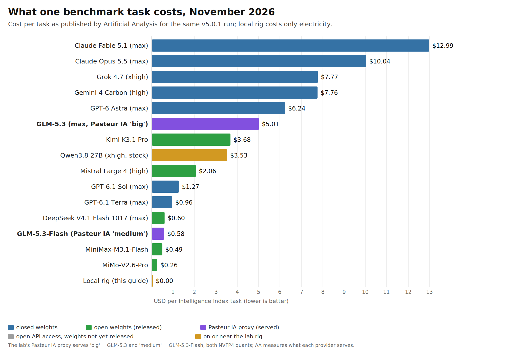
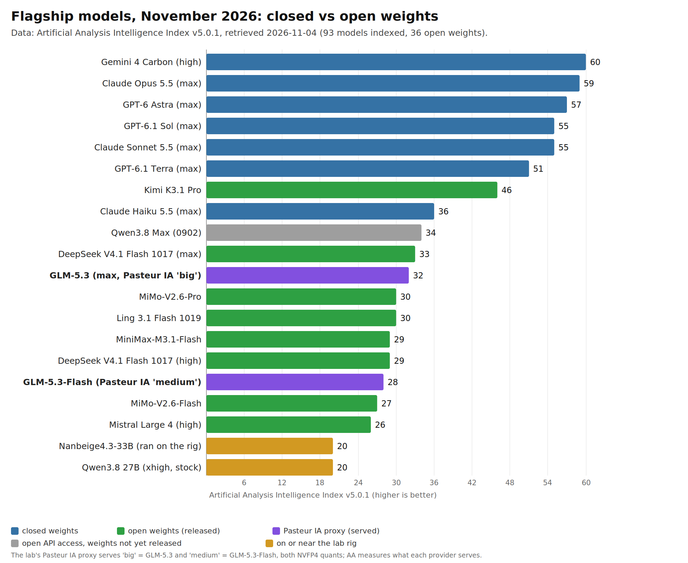

# Running Open-Weights LLMs Locally: A Practical Guide

## This is why we need open models



*What one run through Artificial Analysis' Intelligence Index task battery
costs, November 2026: the top closed models bill $10-13 per task, the best
open model $0.60, the lab's everyday model (GLM-5.3-Flash through the Pasteur
proxy) $0.58, the rig on your desk electricity only. Data: AA index v5.0.1,
retrieved 2026-11-04; full table and sources in
[11](11-flagship-models.md).*

## However, this is the limitation



*Capability on the same index: the closed frontier sits at 57-60, the best open
weights on the index at 33, and what this guide's rig runs near 20 (closest
indexed stock models; the guide's own finetunes are not on the index). That gap
is real, and so is the other half: a model is a tool, not a race. We do not need
the answer in ten seconds; we just need a correct answer, on our own data, at
any hour, for as many questions as we care to ask. You do not need a supercar to
go to the grocery store. The full comparison is [11](11-flagship-models.md);
what the hardware costs is [12](12-hardware-and-costs.md).*

For lab colleagues who want a fully local assistant (coding agent + models) with no
cloud dependency. Everything here is verified on the lead tester's rig as of
**2026-11-04**: RTX 4080 Laptop 12GB + RTX 5060 Ti 16GB eGPU (28GB total), plus
plain-CPU checks. What runs on that rig runs on anything in the same memory class,
and the same thinking covers other hardware.

> Absolute beginner (a little Linux, a little R/Python, no AI background)?
> Start with [beginner/README.md](beginner/README.md) instead: same topics, zero jargon.

## The files, in reading order

Nobody will read all of this in one sitting. The middle column is the whole
guide in eleven lines: read it top to bottom as a skim, and open a chapter
only when a line is not enough. Each chapter also closes with a fuller
**Takeaway** box covering its claims.

| File | In one line | Time |
|---|---|---|
| [01-huggingface.md](01-huggingface.md) | Find, judge, download; the frontier weighs 200GB-1.5TB, which is why tiers exist. | 8 min |
| [02-hardware-fit.md](02-hardware-fit.md) | Four budgets (weights, KV cache, context, speed); arithmetic gets you in range, the boot log decides. | 6 min |
| [03-llamacpp-server.md](03-llamacpp-server.md) | One `llama-server` command per tier; five operating habits prevent most of the pain. | 5 min |
| [04-opencode.md](04-opencode.md) | OpenCode is the workhorse: one config, local and served side by side; tools make the assistant. | 7 min |
| [05-fleet-2026-11.md](05-fleet-2026-11.md) | Sage A1.5 for science, Occamy-1.0 for coding; 9B chats to 262k marathons; every setup is a copy-paste launcher, and the table is dated. | 8 min |
| [06-use-cases.md](06-use-cases.md) | Real scientific output exists; published agentic-science evidence is thin (114 of 135 failed integrity checks); verification is yours. | 8 min |
| [07-ecosystem.md](07-ecosystem.md) | MCP servers, skills, plugins are the wheels: PubMed, web search, BEASTX skills. | 7 min |
| [08-optimisations.md](08-optimisations.md) | Two levers: speculative decoding for speed, context-memory dialing for capacity. | 8 min |
| [09-runtimes.md](09-runtimes.md) | Two fifths maintenance, over a third science, games 12 percent: the five-month tempo, at work and at home. | 16 min |
| [10-pitfalls.md](10-pitfalls.md) | Models retry 9 in 10 of their own failures; the rest are bugs only a human can see, and the games half needs twice the human fixes. | 4 min |
| [11-flagship-models.md](11-flagship-models.md) | About 27 points of capability gap, 10-16× in price; the gap is closing. | 12 min |
| [12-hardware-and-costs.md](12-hardware-and-costs.md) | One build and one launcher per tier, from about €400; the rig is a different product, not a worse frontier. | 19 min |
| [glossary.md](glossary.md) | Every abbreviation and term, one line each | reference |

Times are reading time only: prose at a normal reading pace, tables and charts
skimmed, with nothing installed or run while reading. The hands-on chapters
(03, 04) cost whatever setup time you choose to spend when you actually do them.

## The one-page decision table

| Your hardware | Free memory | Run (fleet picks in 05) | Output speed |
|---|---|---|---|
| CPU-only laptop, 16GB RAM | ~10GB | 9B-class Q4/Q5 (e.g. Qwen3.8-9B Q5_K_M, ~6.5GB) | ~5–12 tok/s (est.) |
| CPU-only laptop, 32GB RAM | ~26GB | 35B-A3B MoE MiniPlus (~15GB) | ~15–25 tok/s (est.) |
| MacBook, M-series Pro/Max, 32GB | unified | 35B-A3B MoE MiniPlus, all layers on GPU | ~40–80 tok/s (est.) |
| MacBook, M-series, 48GB | unified | same + much longer context | ~40–80 tok/s (est.) |
| Strix Halo mini-PC/laptop, 64–128GB | unified | 35B-A3B MoE MiniPlus, all layers on GPU; whole Tier A at large context | ~40–80 tok/s (est.) |
| RTX Spark (N1X) laptop/mini-PC, 128GB | unified, ~half GPU-reachable on Windows | same MiniPlus (a "128GB" box is ~64GB of GPU budget) | ~40–80 tok/s (est.) |
| eGPU dock / GPU, 16GB VRAM | 16GB | 35B-A3B MiniPlus, full offload + MTP | ~40–70 tok/s (est.) |
| Dual GPU (12+16GB) or 32GB VRAM | 28GB | whole Tier-A fleet, 229–262k context, DFlash2 | 60–140 tok/s (measured) |

Speeds depend on model (MoE *active* parameters matter: see 02) and context length.

## Notation and honesty rules

- **tok/s** = generated tokens per second during output (decode speed).
- **bpw** = bits per weight (quantization density; more = better quality, bigger file).
- **(measured)** numbers come from the lead tester's dual-GPU rig on llama.cpp b11803,
  Nov 2026. **(est.)** numbers are bandwidth-based estimates: verify on your machine.
- Benchmark scores in 05 are provider-published, not independently replicated.

## Printing

```sh
pandoc README.md 01-huggingface.md 02-hardware-fit.md 03-llamacpp-server.md \
  04-opencode.md 05-fleet-2026-11.md 06-use-cases.md 07-ecosystem.md \
  08-optimisations.md 09-runtimes.md 10-pitfalls.md \
  11-flagship-models.md 12-hardware-and-costs.md glossary.md \
  -o local-llm-guide.pdf --pdf-engine=xelatex -V mainfont="DejaVu Serif" \
  -V geometry:margin=2cm \
  -V header-includes="\usepackage{etoolbox}\AtBeginEnvironment{longtable}\
{\scriptsize\setlength{\tabcolsep}{2.5pt}}"
```

## What this guide cost to build

This guide was written the way it describes: inside the same session log that
[09](09-runtimes.md) tabulates. The sessions run inside this repository's
directory (seven by 2026-11-08: the build session itself, a speed re-evaluation
of ch 09's tables, an Occamy-1.0 performance pass on ch 09 and ch 10, a wording
pass, a sensitive-data check before publication, a free-journal inquiry, and
the metrics update that fed this chapter's numbers) add up to 104 prompts,
about 3,400 tool calls, and about 10.5 hours of active assistant time, for
about 330 million input tokens and 3.7 million generated tokens, reasoning
included. Priced at the lab proxy's own rates for the models that actually ran
them (GLM-5.3-Flash at $0.15 per million input and $0.50 per million output, and
GLM-5.3 at $0.07 and $1.40 for the two sessions that used it), the bill is
<mark>**about $51**</mark>, a ceiling that assumes no prompt-cache discounts.
Almost all of it is
input: agentic sessions re-read their context on every turn, and the build
session alone, at more than 200 million input tokens, is about two thirds of
the total. Pricing everything at Flash rates would change little
(<mark>**about $52**</mark>); at big rates throughout, <mark>**about
$28**</mark>. The whole five-month log behind ch 09 and
ch 10 prices the same way at <mark>**about $440**</mark> medium and
<mark>**about $240**</mark> big;
[12](12-hardware-and-costs.md) carries that table and the channel-by-channel
reroute.
