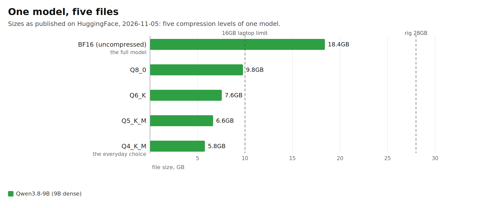
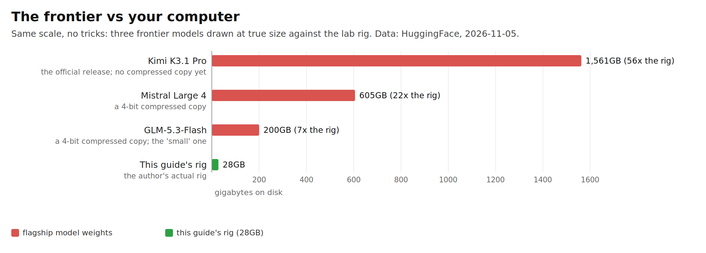

# 01: Where to get a model (HuggingFace)

[HuggingFace](https://huggingface.co) is GitHub for AI models. Labs upload their
models; anyone can download. You need exactly one skill here: picking the right file.

## What you download

One file whose name ends in `.gguf`. That is a "compressed" copy of the model:
smaller file, slightly less sharp, much easier to run. Think MP3 instead of WAV.

The file name tells you the compression level. The everyday choice is
`Q4_K_M`; a bit smaller is `IQ4_XS`; anything below `Q3` starts to lose noticeably.
(More detail than you need right now is in the advanced guide, file 01.)

One thing worth knowing: the compression level tells you roughly how many bits
each number in the model gets, but **the final file size depends on the model
itself**, not just the compression label. Bigger models, models with more
"experts", or models with bigger vocabularies produce bigger files at the same
label. So `Q4_K_M` of one model might be 5 GB while `Q4_K_M` of another is 8 GB.
The file size on HuggingFace is always the truth; don't estimate from the label
alone.

*One model (the 9B example used throughout this guide), five files, sizes
straight from its HuggingFace repo. Smaller file, slightly less sharp, same
model. The dashed lines: the largest file a 16GB RAM laptop should take (next
chapter's rule), and the lab rig's 28GB. The advanced guide's version of this
chart adds the fleet's 35B model to the same picture: nearly 4x bigger at the
same compression label. Data: HuggingFace, 2026-11-05.*

## How to actually get it

1. Pick your model from [05-models.md](05-models.md).
2. On huggingface.co, search that model name.
3. Open the **Files and versions** tab.
4. Download the `.gguf` file whose size fits your RAM (next chapter).
5. A plain browser download is fine. Put it in a folder like `~/models/`.

**License check** (on the model's front page): Apache-2.0 or MIT means free to use,
including for research. Anything else, read the terms.

## Ignore, for now

- `.safetensors` files: the original uncompressed weights. Not what llama.cpp runs.
- Files with `-draft` in the name: speed-up helpers, not standalone models.
- Files with `mmproj` in the name: for image input (grab it later if you want images).

## How big is too big

One last picture, because everyone underestimates this at first: the
models in the news are not a little bigger than the 9B above, they are another
universe:

*Real sizes, drawn to scale: three of today's frontier models against the rig
this guide is built around. Even the "small" GLM-5.3-Flash needs seven rigs'
worth of memory; Kimi needs fifty-six. Nobody runs these at home; when a task
needs one, that is what cloud services are for (the advanced guide covers them).
Data: HuggingFace, 2026-11-05.*

---

*Unfamiliar words? One-line explanations in the [glossary](glossary.md).*
