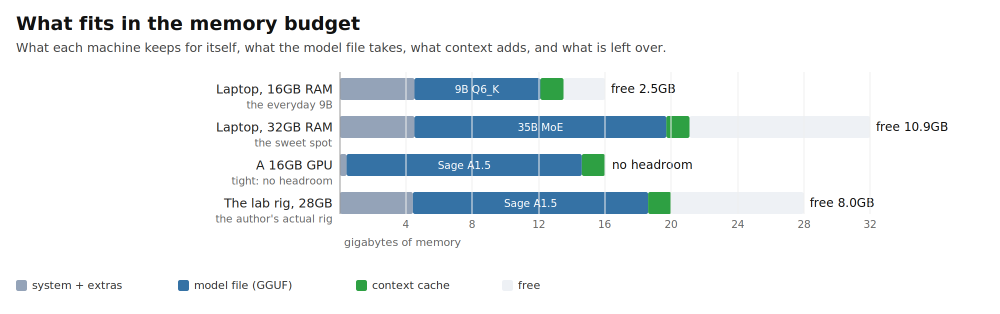

# 02: Will it run on my computer?

One rule:

> **Model file size + about 2GB must be less than your free RAM.**

RAM is memory, not disk space. Check yours:

- Linux: run `free -h` in a terminal, look at the "available" column
- macOS: Apple menu > About This Mac > Memory
- Windows: Task Manager > Performance > Memory

## What fits

| Free RAM | Biggest model file you should pick |
|---|---|
| 8GB | ~4GB file (very small models; this guide assumes 16GB+) |
| 16GB | ~10GB file (that means the 9B models) |
| 32GB | ~25GB file (that means the 27B-35B models) |
| 64GB+ | almost anything |

*The table above, drawn: what the system keeps for itself (grey), what the
model file takes, what context adds, and what is left over. The last row is the
author's actual rig, two GPUs working together. Treat every number as a round
figure; the boot test is what really decides. The advanced guide's version of
this chart has more machine rows and a finer breakdown.*

Disk space matters too: the file sits on disk (need its size plus a bit of slack),
but it must *fit in RAM* while running.

## About speed, honestly

- A 9B model on a laptop CPU types a few words per second. Usable, not fast.
- The 35B "MoE" models are special: although the file is 15GB, each word only uses
  about 3 billion of the 35 billion numbers. On a plain 32GB laptop they are
  *faster* than the 9B dense ones, typically a good paragraph per second.
- Macs and GPUs are much faster because memory in them is quicker. Rules of thumb:
  Mac 35B-class: fast reading speed. GPU: very fast.

## One more knob: "context"

Context is how much text the model can keep in mind at once (your files, the whole
conversation). More context needs more RAM. The defaults are fine to start; if you
ever hit "out of memory", lowering context is the first fix.

Keep the model file on your main disk, not on a USB stick: the program reads from it
constantly.

---

*Unfamiliar words? One-line explanations in the [glossary](glossary.md).*
